## 1. 이 과정은 무엇인가

### 한 줄 소개

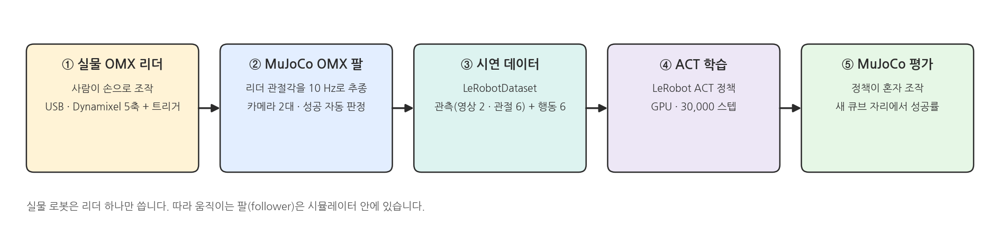{width=1000}

- 실물 OMX 리더 팔로 시뮬레이터(MuJoCo) 안의 OMX 팔을 조작해 시연을 모으고, 그 시연으로 모방학습 정책(ACT)을 학습해 다시 MuJoCo에서 평가합니다.
- 실물 로봇은 리더 한 대만 있으면 됩니다.

### 모방학습 (Imitation Learning)

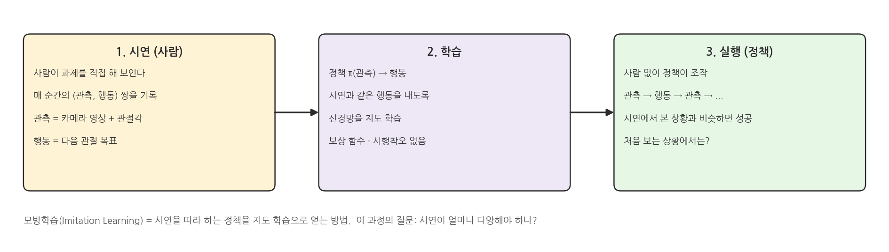{width=1000}

### 왜 MuJoCo 팔로워인가

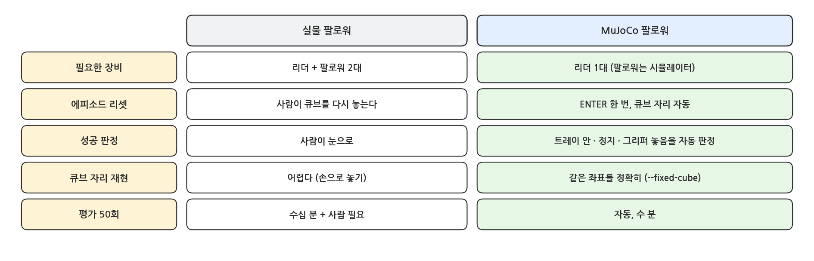{width=1000}

### 과제: 큐브를 트레이에

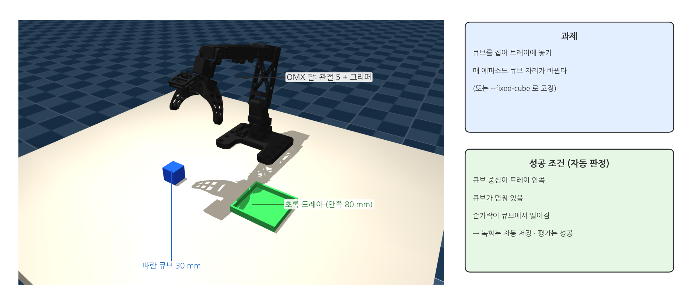{width=1000}

### 정책이 보는 것과 내는 것

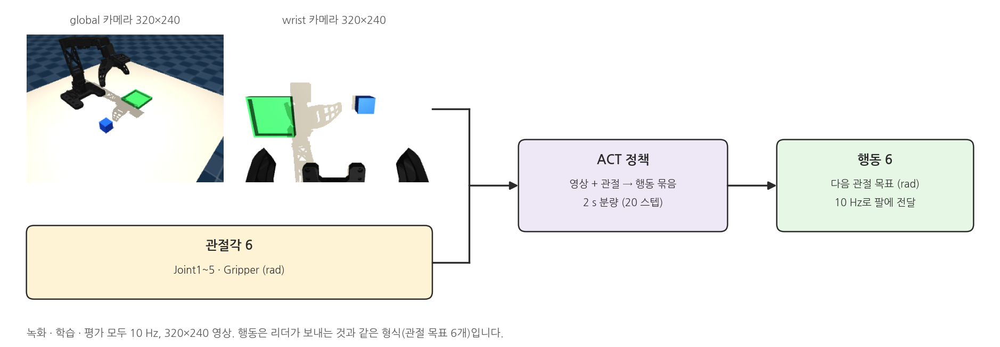{width=1000}

## 2. 핵심 실습: 시연은 얼마나 다양해야 하나

### 실습 흐름

{width=1000}

- 실습 1: 큐브를 한 자리에 고정하고 시연 5회 → 학습 → 같은 자리에서 추론, 자리와 각도를 바꿔서 추론
- 실습 2: 큐브 자리를 매번 바꾸며 시연 50회 → 학습 → 같은 두 조건에서 추론
- 두 실습의 추론 조건이 같으므로 결과를 나란히 비교할 수 있습니다.

### 큐브 고정과 무작위

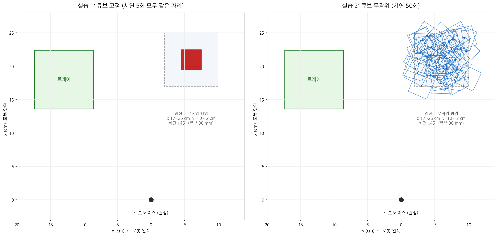{width=1000}

### 미리 보는 결과

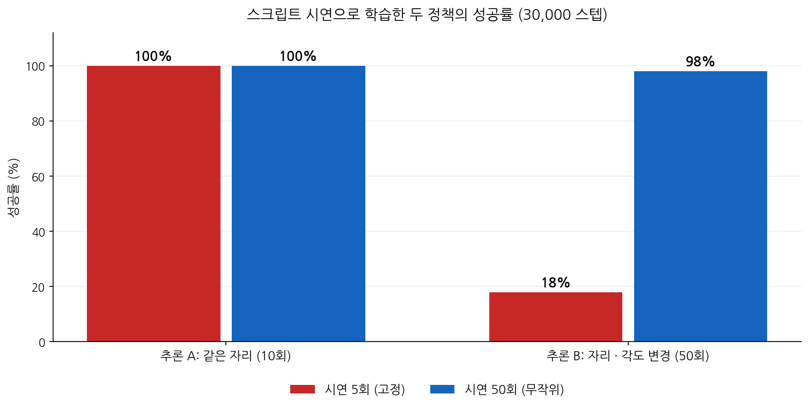{width=1000}

- 사람 대신 IK 스크립트가 만든 시연으로 학습한 결과입니다 (⑩ 부록). 수강생이 직접 녹화한 시연에서는 수치가 달라집니다.
- 시연 5회(고정) 정책은 학습한 자리에서는 잘 되지만, 큐브가 몇 cm만 옮겨져도 학습한 동작을 그대로 반복합니다.

## 3. 커리큘럼

### 페이지 구성

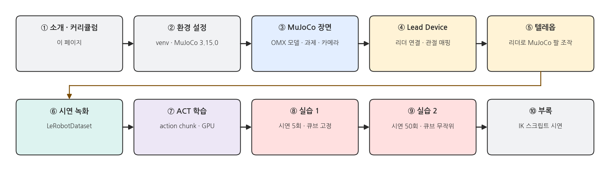{width=1000}

- ②~⑦: 실습에 필요한 도구를 하나씩 익힙니다 (환경 → 장면 → 리더 → 텔레옵 → 녹화 → 학습).
- ⑧ · ⑨: 핵심 실습. 앞의 도구를 그대로 써서 시연 수와 다양성에 따른 차이를 체험합니다.

### 페이지 진행 방식

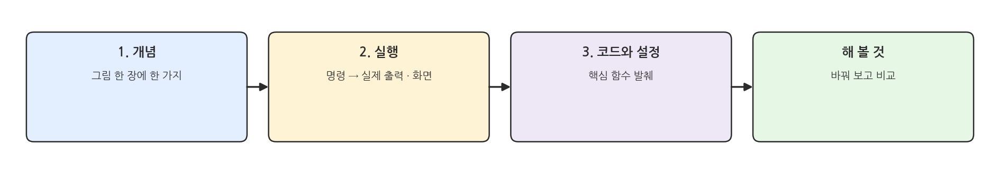{width=1000}

## 4. 사용하는 도구

### 기술 스택

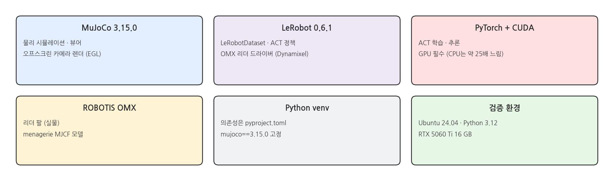{width=1000}

## 5. 코드 저장소

### 저장소 구성

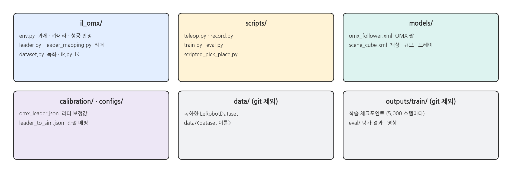{width=1000}

- GitHub 공개 저장소: **https://github.com/PinkWink/il_omx_mujoco**
- 설치와 실행 준비는 ② 환경 설정 페이지에서 다룹니다.
- 이 강의 원고와 그림을 만드는 스크립트: 저장소의 `docs/lecture/`
