## 0. 시작 전에

### 필요한 것

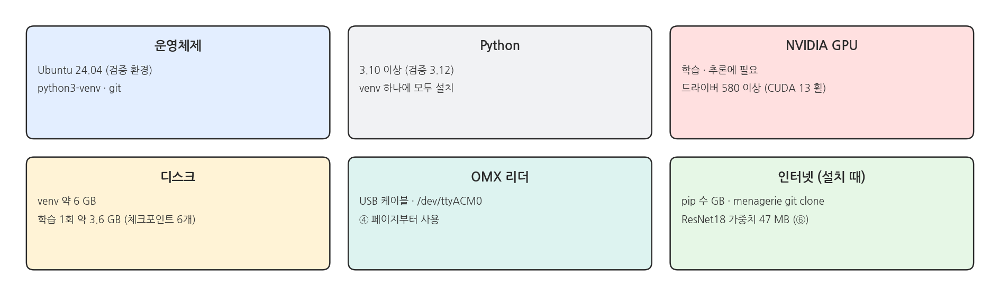{width=1000}

## 1. 설치

### 설치 흐름

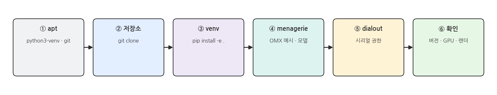{width=1000}

### ① apt 패키지

```bash
sudo apt update
sudo apt install -y python3-venv git tree
```

### ② 저장소 받기

```bash
cd ~
git clone https://github.com/PinkWink/il_omx_mujoco.git
cd il_omx_mujoco
```

### 실행 결과: 저장소 받기

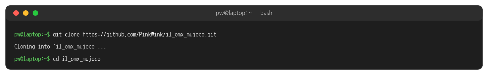{width=1000}

### ③ venv와 패키지 설치

```bash
python3 -m venv .venv
.venv/bin/pip install -e .
```

### 실행 결과: pip install

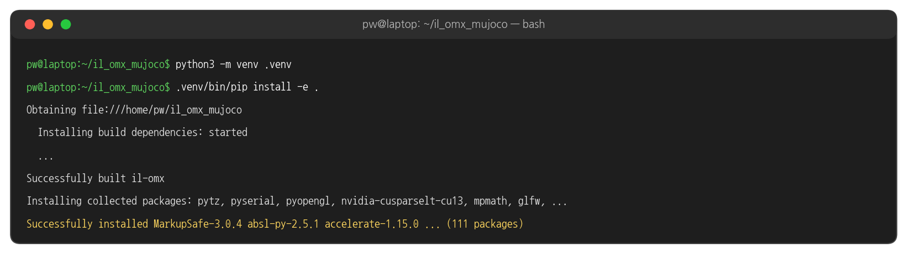{width=1000}

- 처음 설치할 때는 PyTorch · CUDA 라이브러리를 포함해 수 GB를 내려받습니다. 네트워크에 따라 수 분에서 수십 분 걸립니다.
- 같은 PC에서 pip 캐시가 있을 때 다시 설치하면 약 40초 걸렸습니다.
- `-e` (editable): 저장소의 `il_omx/` 코드를 고치면 다시 설치하지 않아도 바로 반영됩니다.

### pip install 이 설치하는 것

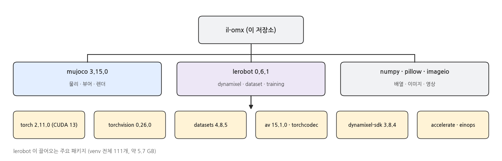{width=1000}

### ④ OMX 모델 받기 (menagerie)

```bash
git clone --depth 1 https://github.com/ROBOTIS-GIT/robotis_mujoco_menagerie.git third_party/robotis_mujoco_menagerie
du -sh .venv third_party
```

### 실행 결과: menagerie

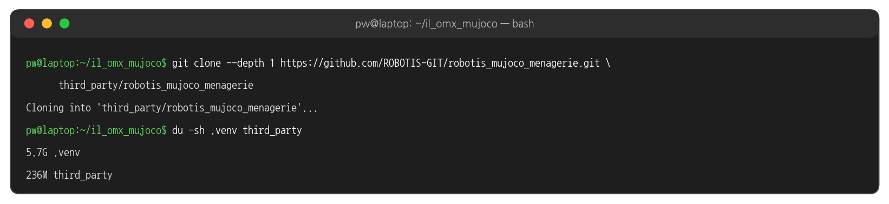{width=1000}

- `models/omx_follower.xml` 이 `third_party/robotis_mujoco_menagerie/robotis_omx/assets/` 의 메시(STL)를 읽습니다. 받지 않으면 장면을 열 수 없습니다 (5절).

### ⑤ 시리얼 포트 권한

```bash
sudo usermod -aG dialout $USER
# 로그아웃 후 다시 로그인
groups
ls -l /dev/ttyACM0       # 리더를 USB로 연결한 상태에서
```

### 실행 결과: dialout 그룹

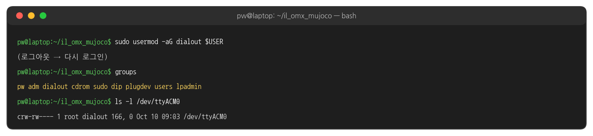{width=1000}

- `/dev/ttyACM0` 는 root 와 dialout 그룹만 읽고 쓸 수 있습니다. `groups` 에 dialout 이 보이면 됩니다.
- 리더는 ④ 페이지부터 씁니다. 지금 연결되어 있지 않아도 설치는 계속할 수 있습니다.

### ⑥ 설치 확인: 버전과 GPU

```bash
.venv/bin/python -c "import mujoco, lerobot, torch; print('mujoco', mujoco.__version__); print('lerobot', lerobot.__version__); print('torch', torch.__version__, 'cuda', torch.cuda.is_available(), torch.cuda.get_device_name(0))"
nvidia-smi --query-gpu=name,driver_version,memory.total --format=csv
```

### 실행 결과: 버전과 GPU

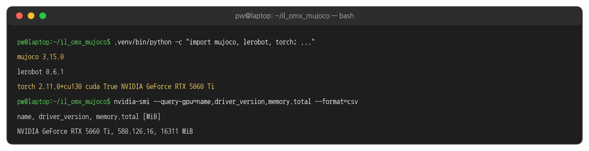{width=1000}

- `cuda True` 가 나와야 GPU로 학습할 수 있습니다. `False` 이거나 오류가 나면 NVIDIA 드라이버부터 확인합니다.

### ⑥ 학습용 가중치 미리 받기

```bash
.venv/bin/python -c "import torchvision; torchvision.models.resnet18(weights='IMAGENET1K_V1')"
```

- ACT 의 영상 백본(ResNet18) ImageNet 가중치 47 MB 를 `~/.cache/torch/hub` 에 받아 둡니다. 받지 않으면 첫 학습(⑦) 때 받으므로, 그때 인터넷이 없으면 학습이 시작되지 않습니다.

### ⑥ 설치 확인: 폴더 구조

```bash
cd ~/il_omx_mujoco
ls -a
tree -L 2 -d
```

### 실행 결과: 폴더 구조

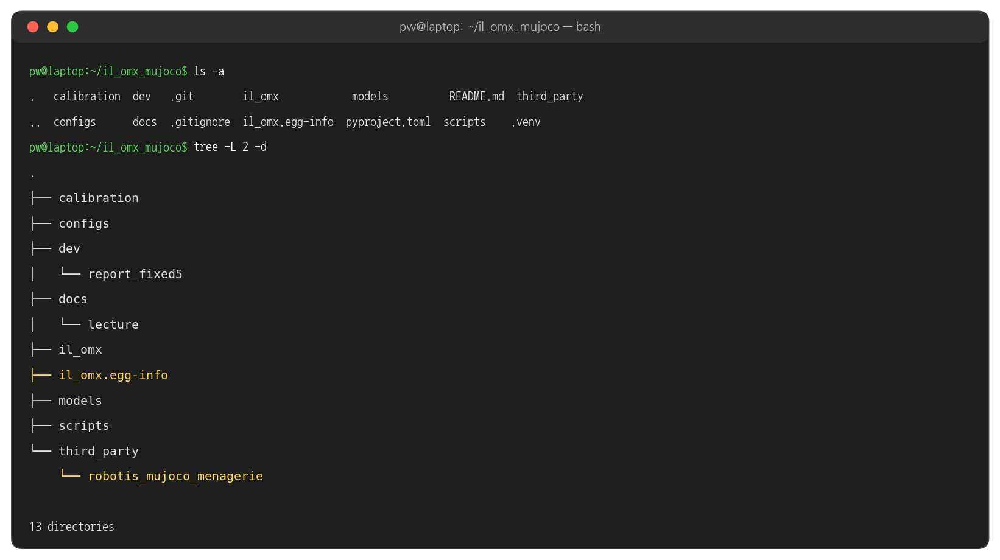{width=1000}

- `.venv/` (③), `il_omx.egg-info/` (③), `third_party/robotis_mujoco_menagerie/` (④) 가 보이면 됩니다.
- `data/`, `outputs/` 는 아직 없습니다. 렌더 · 녹화 · 학습을 하면 생깁니다.

### ⑥ 설치 확인: 카메라 렌더

```bash
MUJOCO_GL=egl .venv/bin/python scripts/render_cameras.py
ls outputs
```

### 실행 결과: 카메라 렌더

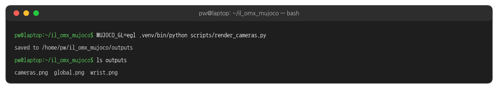{width=1000}

### 실행 결과: outputs/cameras.png

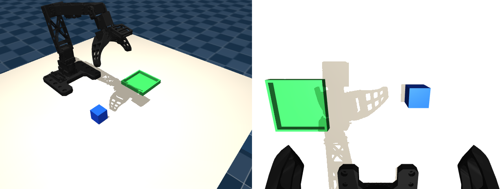{width=1000}

- 창 없이(오프스크린) 렌더한 두 카메라 이미지입니다. 녹화 · 학습에서는 같은 카메라를 320x240 으로 씁니다.

### ⑥ 설치 확인: 뷰어

```bash
.venv/bin/python scripts/view_scene.py
```

### 실행 결과: 뷰어 첫 화면

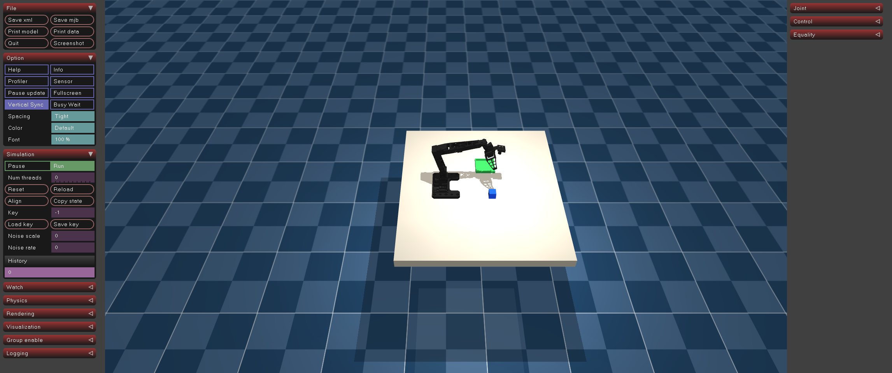{width=1000}

- 마우스: 왼쪽 드래그 = 회전, 오른쪽 드래그 = 이동, 휠 = 확대 · 축소
- 오른쪽 Control 패널의 슬라이더로 관절을 움직여 볼 수 있습니다. 창을 닫으면 끝납니다.

## 2. 실행 구조

### venv 파이썬으로 실행

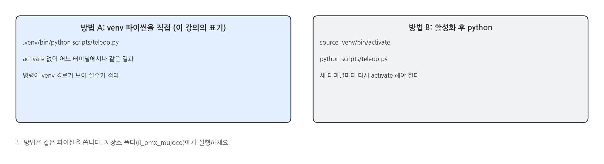{width=1000}

### 스크립트와 페이지

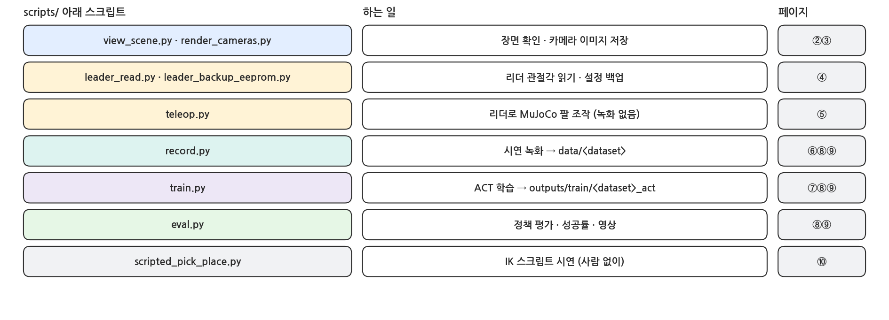{width=1000}

### 데이터와 결과 폴더

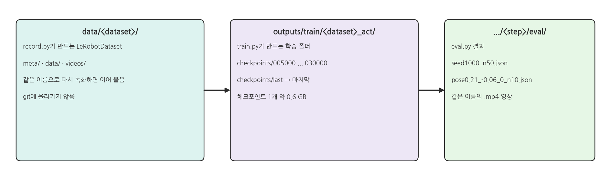{width=1000}

## 3. MuJoCo 버전 고정

### venv마다 다른 버전

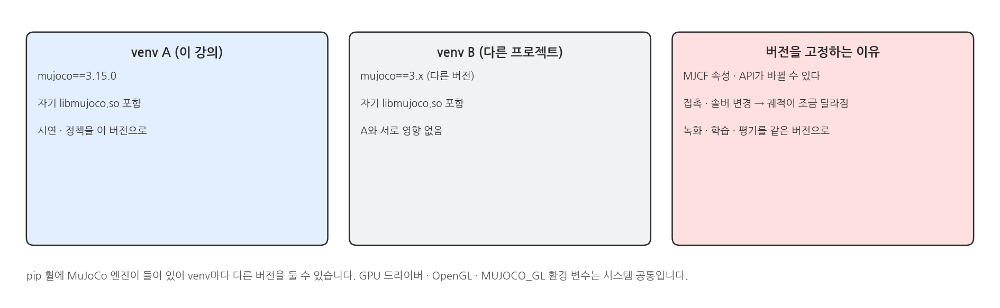{width=1000}

- 이 강의는 `mujoco==3.15.0` 으로 고정합니다. 녹화한 시연, 학습한 정책, 평가를 모두 같은 버전에서 해야 결과가 재현됩니다.
- 다른 프로젝트에서 다른 MuJoCo 버전이 필요하면 그 프로젝트용 venv를 따로 만들면 됩니다.

## 4. 코드와 설정

### pyproject.toml - 의존성

```text
# pyproject.toml (발췌)
[project]
name = "il-omx"
requires-python = ">=3.10"
dependencies = [
    "mujoco==3.15.0",                                # 버전 고정 (3절)
    "numpy",
    "pillow",
    "imageio[ffmpeg]",                               # 평가 영상 저장
    "lerobot[dynamixel,dataset,training]==0.6.1",    # 리더 드라이버 · LeRobotDataset · ACT 학습
]
```

### pyproject.toml - 패키지

```text
# pyproject.toml (발췌)
[project]
version = "0.1.0"

[tool.setuptools]
packages = ["il_omx"]                                # pip install -e . 로 import il_omx 가능
```

### .gitignore

```bash
# .gitignore (발췌) - 큰 파일과 내려받는 것은 저장소에 넣지 않는다
.venv/
outputs/          # 학습 체크포인트 · 평가 결과
third_party/      # menagerie (④ 에서 git clone)
data/             # 녹화한 시연
```

## 5. 문제 해결

### 자주 나는 오류

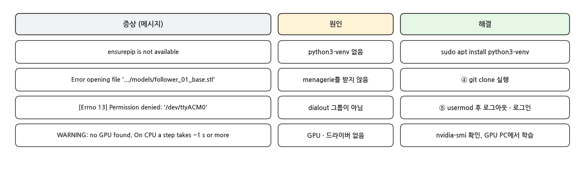{width=1000}

### 실행 결과: menagerie 가 없을 때

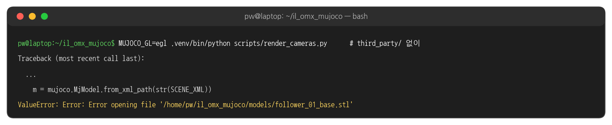{width=1000}

- 오류 경로가 `models/` 아래로 나오지만, 실제로 없는 것은 `third_party/` 의 메시입니다. ④를 실행하면 해결됩니다.

### 해 볼 것

- `.venv/bin/pip show mujoco` 로 설치 위치(Location) 확인 → venv 안의 site-packages
- 다른 폴더에 venv를 하나 더 만들어 다른 버전의 mujoco를 설치하고, 두 venv에서 `mujoco.__version__` 비교
- `scripts/render_cameras.py --out /tmp/cams` 로 저장 위치를 바꿔 실행
