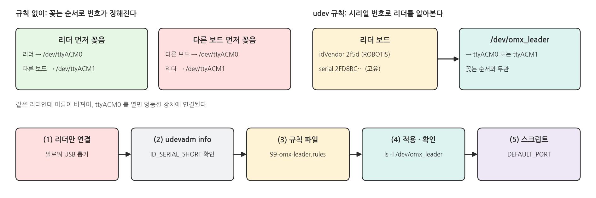
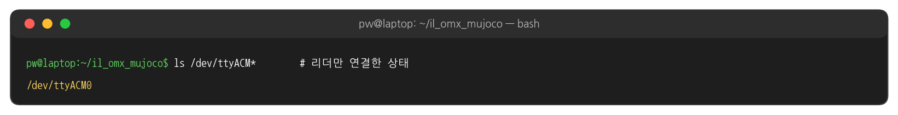
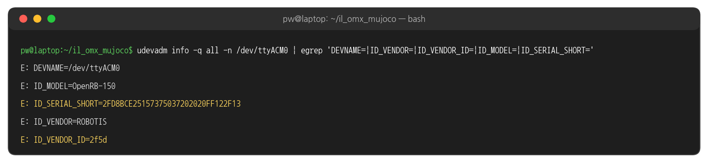
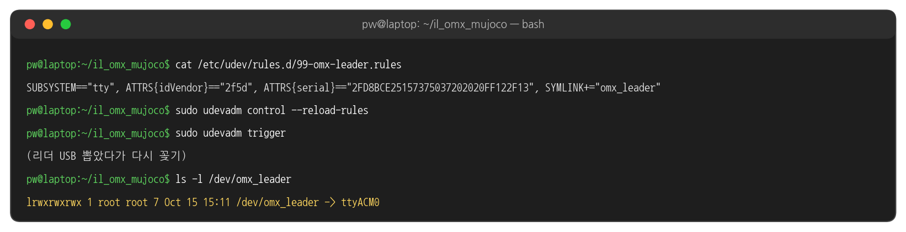
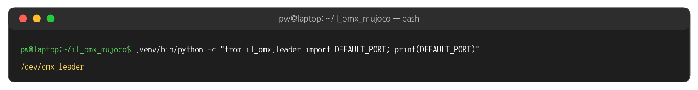

## 0. 시작 전에

### 필요한 것

{width=1000}

## 1. 설치

### 설치 흐름

{width=1000}

### ① apt 패키지

```bash
sudo apt update
sudo apt install -y python3-venv git tree
```

### ② 저장소 받기

```bash
cd ~
git clone https://github.com/PinkWink/il_omx_mujoco.git
cd il_omx_mujoco
```

### 실행 결과: 저장소 받기

{width=1000}

### ③ venv와 패키지 설치

```bash
python3 -m venv .venv
.venv/bin/pip install -e .
```

### 실행 결과: pip install

{width=1000}

- 처음 설치할 때는 PyTorch · CUDA 라이브러리를 포함해 수 GB를 내려받습니다. 네트워크에 따라 수 분에서 수십 분 걸립니다.
- 같은 PC에서 pip 캐시가 있을 때 다시 설치하면 약 40초 걸렸습니다.
- `-e` (editable): 저장소의 `il_omx/` 코드를 고치면 다시 설치하지 않아도 바로 반영됩니다.

### pip install 이 설치하는 것

{width=1000}

### ④ OMX 모델 받기 (menagerie)

```bash
git clone --depth 1 https://github.com/ROBOTIS-GIT/robotis_mujoco_menagerie.git third_party/robotis_mujoco_menagerie
du -sh .venv third_party
```

### 실행 결과: menagerie

{width=1000}

- `models/omx_follower.xml` 이 `third_party/robotis_mujoco_menagerie/robotis_omx/assets/` 의 메시(STL)를 읽습니다. 받지 않으면 장면을 열 수 없습니다 (5절).

### ⑤ 시리얼 포트 권한

```bash
sudo usermod -aG dialout $USER
# 로그아웃 후 다시 로그인
groups
ls -l /dev/ttyACM0       # 리더를 USB로 연결한 상태에서
```

### 실행 결과: dialout 그룹

{width=1000}

- `/dev/ttyACM0` 는 root 와 dialout 그룹만 읽고 쓸 수 있습니다. `groups` 에 dialout 이 보이면 됩니다.
- 리더는 ④ 페이지부터 씁니다. 지금 연결되어 있지 않아도 설치는 계속할 수 있습니다. 다음 udev 설정만 리더가 있어야 합니다.

### ⑤ 리더 포트 이름 고정 (udev) - 왜 필요한가

{width=1000}

- 리눅스는 USB 시리얼 장치에 꽂은 순서대로 `/dev/ttyACM0`, `/dev/ttyACM1` … 번호를 붙입니다. 팔로워나 다른 보드를 먼저 꽂으면 리더가 `ttyACM1` 이 될 수 있습니다.
- udev 규칙을 한 번 만들어 두면, 리더 보드의 고유 번호(시리얼)를 보고 몇 번째로 꽂혔든 항상 `/dev/omx_leader` 라는 이름을 붙여 줍니다.
- 이 강의의 스크립트는 `/dev/omx_leader` 가 있으면 그것을, 없으면 `/dev/ttyACM0` 를 씁니다.

### ⑤ udev (1) 리더만 USB에 연결

:::warning 먼저 USB를 정리하세요
- PC의 USB에는 **리더(OMX-L)만** 연결합니다.
- 팔로워(OMX-F)가 연결되어 있다면 팔로워의 USB 케이블을 PC에서 뽑아 주세요.
- 리더와 팔로워는 같은 보드(ROBOTIS OpenRB-150)를 써서 이름이 똑같이 보입니다. 하나만 꽂혀 있어야 지금 읽는 값이 리더의 값이라고 확신할 수 있습니다.
:::

```bash
ls /dev/ttyACM*
```

### 실행 결과: 리더만 연결

{width=1000}

- `/dev/ttyACM0` **하나만** 나와야 합니다. 두 개 이상 나오면 리더가 아닌 USB 장치를 뽑고 다시 확인합니다.
- `no matches found` 나 `No such file` 이 나오면 리더의 USB 케이블과 전원을 확인합니다.

### ⑤ udev (2) 리더의 고유 번호 확인

```bash
udevadm info -q all -n /dev/ttyACM0 | egrep 'DEVNAME=|ID_VENDOR=|ID_VENDOR_ID=|ID_MODEL=|ID_SERIAL_SHORT='
```

### 실행 결과: udevadm info

{width=1000}

- `ID_VENDOR_ID=2f5d` : 제조사 번호 (ROBOTIS). 모든 OMX 보드가 같습니다.
- `ID_SERIAL_SHORT=…` : 보드마다 다른 32자리 고유 번호입니다. **이 값으로 리더를 알아봅니다.** 위 화면은 예시 리더의 값이고, 여러분 PC에서는 다른 값이 나옵니다.

### ⑤ udev (3) 규칙 파일 만들기

```bash
SERIAL=$(udevadm info -q property -n /dev/ttyACM0 | sed -n 's/^ID_SERIAL_SHORT=//p')
echo $SERIAL
printf 'SUBSYSTEM=="tty", ATTRS{idVendor}=="2f5d", ATTRS{serial}=="%s", SYMLINK+="omx_leader"\n' "$SERIAL" \
  | sudo tee /etc/udev/rules.d/99-omx-leader.rules
```

- 첫 줄이 (2)에서 본 `ID_SERIAL_SHORT` 값을 `SERIAL` 변수에 담습니다. 32자리를 손으로 옮겨 적지 않아도 됩니다.
- `echo $SERIAL` 의 출력이 (2)의 `ID_SERIAL_SHORT` 와 같은지 눈으로 확인합니다. 빈 줄이면 (1)부터 다시 합니다.
- 모든 줄을 **같은 터미널**에서 차례로 실행합니다. 새 터미널에서는 `SERIAL` 변수가 비어 있습니다.
- 셋째 줄의 `%s` 자리에 `$SERIAL` 값이 들어가 규칙 한 줄이 완성되고, `sudo tee` 가 그 줄을 규칙 파일에 씁니다.
- `sudo` 가 비밀번호를 물으면 로그인 비밀번호를 입력합니다. `tee` 가 파일에 쓴 한 줄을 화면에도 보여 줍니다.

### ⑤ udev (3) 규칙 한 줄 읽기

| 항목 | 뜻 |
|---|---|
| `SUBSYSTEM=="tty"` | 시리얼 포트 장치에만 적용 |
| `ATTRS{idVendor}=="2f5d"` | (2)의 `ID_VENDOR_ID` (ROBOTIS) |
| `ATTRS{serial}=="…"` | (2)의 `ID_SERIAL_SHORT` (이 리더 한 대) |
| `SYMLINK+="omx_leader"` | `/dev/omx_leader` 라는 이름(심볼릭 링크)을 추가 |

- 편집기를 쓰고 싶다면 `sudo nano /etc/udev/rules.d/99-omx-leader.rules` 로 열어 위 한 줄을 붙여 넣고, `…` 자리에 자신의 `ID_SERIAL_SHORT` 를 적습니다. 저장은 Ctrl+O → Enter, 종료는 Ctrl+X.
- OMX-AI 과정에서 만든 `99-omx.rules` 가 이미 있어도 그대로 두면 됩니다. 새 파일은 리더 한 줄만 따로 가집니다.

### ⑤ udev (4) 규칙 적용과 확인

```bash
cat /etc/udev/rules.d/99-omx-leader.rules
sudo udevadm control --reload-rules
sudo udevadm trigger
# 리더 USB를 뽑았다가 다시 꽂은 뒤
ls -l /dev/omx_leader
```

### 실행 결과: /dev/omx_leader

{width=1000}

- `/dev/omx_leader -> ttyACM0` 처럼 화살표가 보이면 성공입니다. 리더가 `ttyACM1` 로 잡히면 화살표가 `ttyACM1` 을 가리킵니다.
- 이제 다른 USB 장치를 함께 꽂아도 리더는 항상 `/dev/omx_leader` 입니다. 팔로워는 이 강의에서 쓰지 않으므로 다시 꽂지 않아도 됩니다.

### ⑤ udev (5) 스크립트가 쓰는 포트

```bash
.venv/bin/python -c "from il_omx.leader import DEFAULT_PORT; print(DEFAULT_PORT)"
```

### 실행 결과: 기본 포트

{width=1000}

- `/dev/omx_leader` 가 나오면 ④ 페이지부터 `--port` 없이 실행해도 리더를 찾습니다.
- `/dev/ttyACM0` 가 나오면 규칙이 적용되지 않은 것입니다. (4)의 `cat` 출력에서 시리얼 값이 비어 있지 않은지 확인합니다.

### ⑥ 설치 확인: 버전과 GPU

```bash
.venv/bin/python -c "import mujoco, lerobot, torch; print('mujoco', mujoco.__version__); print('lerobot', lerobot.__version__); print('torch', torch.__version__, 'cuda', torch.cuda.is_available(), torch.cuda.get_device_name(0))"
nvidia-smi --query-gpu=name,driver_version,memory.total --format=csv
```

### 실행 결과: 버전과 GPU

{width=1000}

- `cuda True` 가 나와야 GPU로 학습할 수 있습니다. `False` 이거나 오류가 나면 NVIDIA 드라이버부터 확인합니다.

### ⑥ 학습용 가중치 미리 받기

```bash
.venv/bin/python -c "import torchvision; torchvision.models.resnet18(weights='IMAGENET1K_V1')"
```

- ACT 의 영상 백본(ResNet18) ImageNet 가중치 47 MB 를 `~/.cache/torch/hub` 에 받아 둡니다. 받지 않으면 첫 학습(⑦) 때 받으므로, 그때 인터넷이 없으면 학습이 시작되지 않습니다.

### ⑥ 설치 확인: 폴더 구조

```bash
cd ~/il_omx_mujoco
ls -a
tree -L 2 -d
```

### 실행 결과: 폴더 구조

{width=1000}

- `.venv/` (③), `il_omx.egg-info/` (③), `third_party/robotis_mujoco_menagerie/` (④) 가 보이면 됩니다.
- `data/`, `outputs/` 는 아직 없습니다. 렌더 · 녹화 · 학습을 하면 생깁니다.

### ⑥ 설치 확인: 카메라 렌더

```bash
MUJOCO_GL=egl .venv/bin/python scripts/render_cameras.py
ls outputs
```

### 실행 결과: 카메라 렌더

{width=1000}

### 실행 결과: outputs/cameras.png

{width=1000}

- 창 없이(오프스크린) 렌더한 두 카메라 이미지입니다. 녹화 · 학습에서는 같은 카메라를 320x240 으로 씁니다.

### ⑥ 설치 확인: 뷰어

```bash
.venv/bin/python scripts/view_scene.py
```

### 실행 결과: 뷰어 첫 화면

{width=1000}

- 마우스: 왼쪽 드래그 = 회전, 오른쪽 드래그 = 이동, 휠 = 확대 · 축소
- 오른쪽 Control 패널의 슬라이더로 관절을 움직여 볼 수 있습니다. 창을 닫으면 끝납니다.

## 2. 실행 구조

### venv 파이썬으로 실행

{width=1000}

### 스크립트와 페이지

{width=1000}

### 데이터와 결과 폴더

{width=1000}

## 3. MuJoCo 버전 고정

### venv마다 다른 버전

{width=1000}

- 이 강의는 `mujoco==3.15.0` 으로 고정합니다. 녹화한 시연, 학습한 정책, 평가를 모두 같은 버전에서 해야 결과가 재현됩니다.
- 다른 프로젝트에서 다른 MuJoCo 버전이 필요하면 그 프로젝트용 venv를 따로 만들면 됩니다.

## 4. 코드와 설정

### pyproject.toml - 의존성

```text
# pyproject.toml (발췌)
[project]
name = "il-omx"
requires-python = ">=3.10"
dependencies = [
    "mujoco==3.15.0",                                # 버전 고정 (3절)
    "numpy",
    "pillow",
    "imageio[ffmpeg]",                               # 평가 영상 저장
    "lerobot[dynamixel,dataset,training]==0.6.1",    # 리더 드라이버 · LeRobotDataset · ACT 학습
]
```

### pyproject.toml - 패키지

```text
# pyproject.toml (발췌)
[project]
version = "0.1.0"

[tool.setuptools]
packages = ["il_omx"]                                # pip install -e . 로 import il_omx 가능
```

### .gitignore

```bash
# .gitignore (발췌) - 큰 파일과 내려받는 것은 저장소에 넣지 않는다
.venv/
outputs/          # 학습 체크포인트 · 평가 결과
third_party/      # menagerie (④ 에서 git clone)
data/             # 녹화한 시연
```

## 5. 문제 해결

### 자주 나는 오류

{width=1000}

### 실행 결과: menagerie 가 없을 때

{width=1000}

- 오류 경로가 `models/` 아래로 나오지만, 실제로 없는 것은 `third_party/` 의 메시입니다. ④를 실행하면 해결됩니다.

### 해 볼 것

- `.venv/bin/pip show mujoco` 로 설치 위치(Location) 확인 → venv 안의 site-packages
- 다른 폴더에 venv를 하나 더 만들어 다른 버전의 mujoco를 설치하고, 두 venv에서 `mujoco.__version__` 비교
- `scripts/render_cameras.py --out /tmp/cams` 로 저장 위치를 바꿔 실행
