## 1. 장면 구성

### XML 두 개

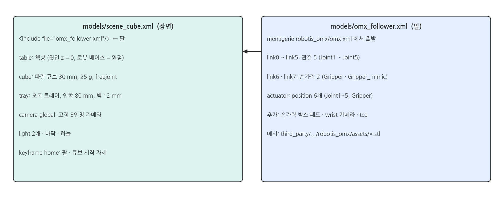{width=1000}

### OMX 팔: 관절 5 + 그리퍼

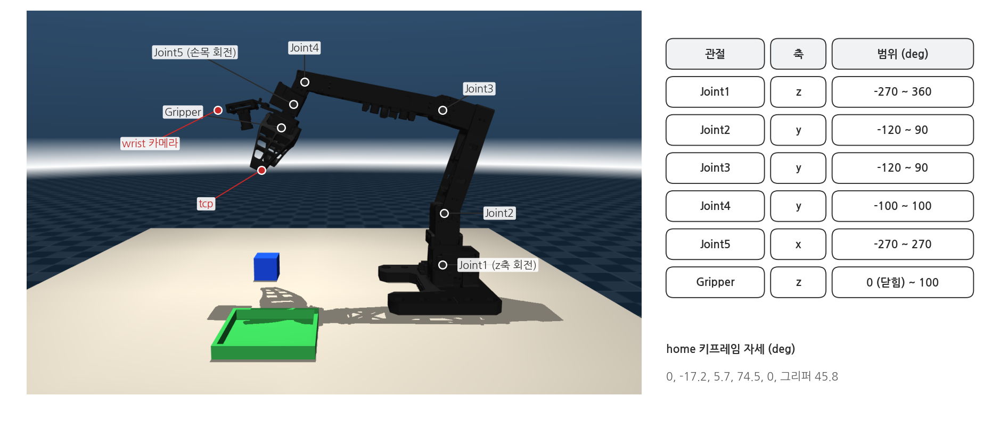{width=1000}

- 관절 이름 · 순서(Joint1~5, Gripper)는 실물 OMX 리더가 보내는 값과 같습니다. 행동(action)도 이 순서의 6개 값입니다.
- `tcp` (tool center point): 손가락을 닫았을 때 두 손가락 끝 사이의 점. IK 스크립트 시연(⑩)이 이 점을 큐브로 보냅니다.

### 위치 제어 액추에이터

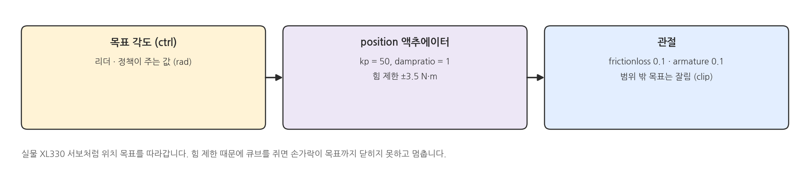{width=1000}

### 그리퍼: 손가락 두 개, 액추에이터 하나

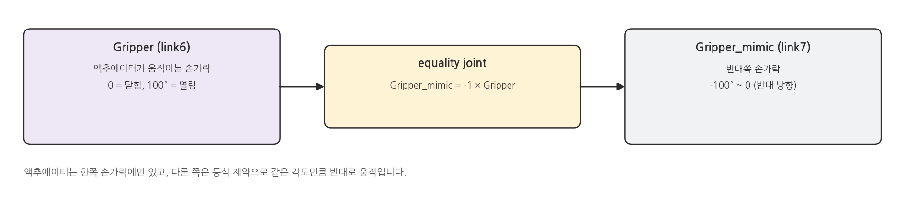{width=1000}

### 손가락 충돌: 볼록 껍질 대신 박스 패드

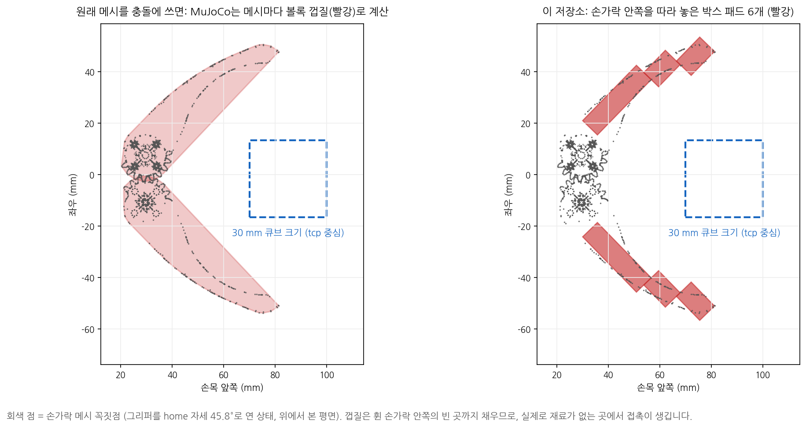{width=1000}

### 실제 렌더: 박스 패드

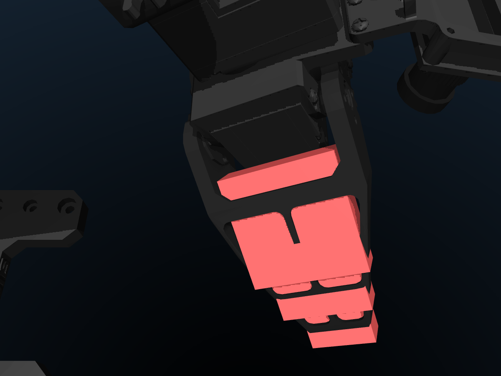{width=800}

- MuJoCo는 메시(mesh) 충돌을 메시마다 볼록 껍질로 계산합니다. 휜 손가락처럼 오목한 모양은 실제보다 뚱뚱해집니다.
- 그래서 손가락 메시는 보이기만 하고(visual), 충돌은 손가락 안쪽 면을 따라 놓은 박스 6개가 맡습니다.

### 카메라 두 대

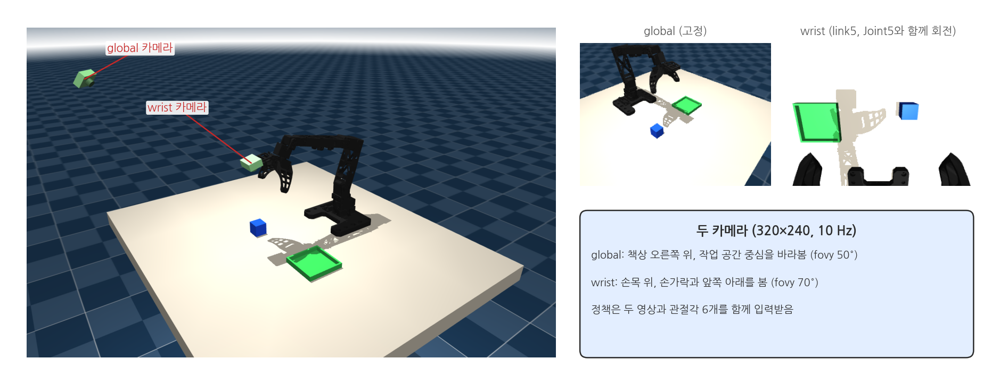{width=1000}

### 시간: 제어 10 Hz, 물리 500 Hz

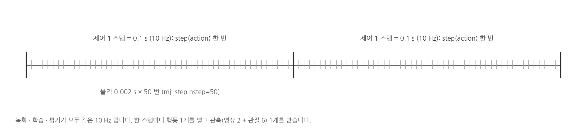{width=1000}

## 2. 실행: 환경 둘러보기

### 터미널: env_tour.py

```bash
cd ~/il_omx_mujoco
MUJOCO_GL=egl .venv/bin/python docs/lecture/env_tour.py
```

### 실행 결과: env_tour.py

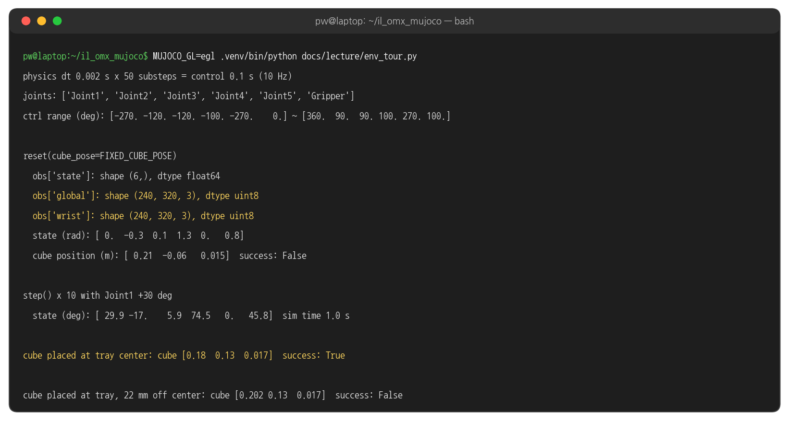{width=1000}

- `reset()` 이 주는 관측: 관절각 6개(`state`)와 두 카메라 영상(240×320×3)
- `step()` 10번 = 시뮬레이션 1초. Joint1 목표를 30° 돌리면 1초 뒤 29.9° 까지 따라갑니다.
- 큐브를 트레이 가운데 두면 `success: True`, 가운데에서 22 mm 옆이면 `False` (허용 범위 ±20 mm)

### 무작위 리셋

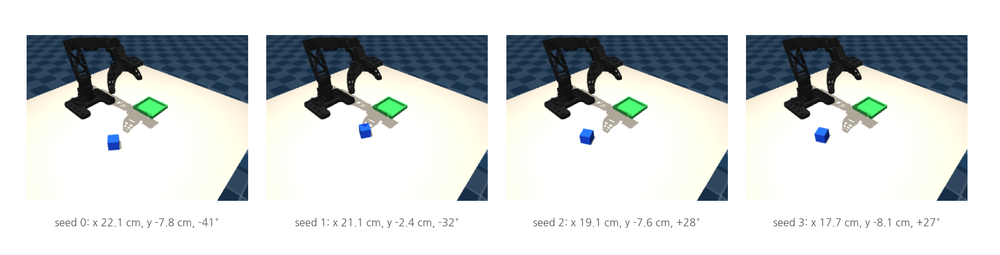{width=1000}

- `reset()` 은 큐브를 x 17~25 cm, y -10~-2 cm, 회전 ±45° 범위에서 무작위로 놓습니다.
- `reset(seed=s)` 처럼 seed 를 주면 같은 자리가 다시 나옵니다. 평가(⑧ · ⑨)는 seed 1000 부터 씁니다.
- `--fixed-cube` 를 주면 `reset(cube_pose=FIXED_CUBE_POSE)` 로 항상 x 21 cm, y -6 cm, 회전 0° 에 놓습니다.

### 뷰어로 보기

```bash
.venv/bin/python scripts/view_scene.py
```

- 뷰어 오른쪽 Control 패널 슬라이더로 관절을 직접 움직여 볼 수 있습니다 (② 페이지 첫 화면 참고).
- `]` / `[` 키로 카메라를 global · wrist 로 바꿔 정책이 보는 화면을 확인합니다.

## 3. 성공 판정

### 세 조건

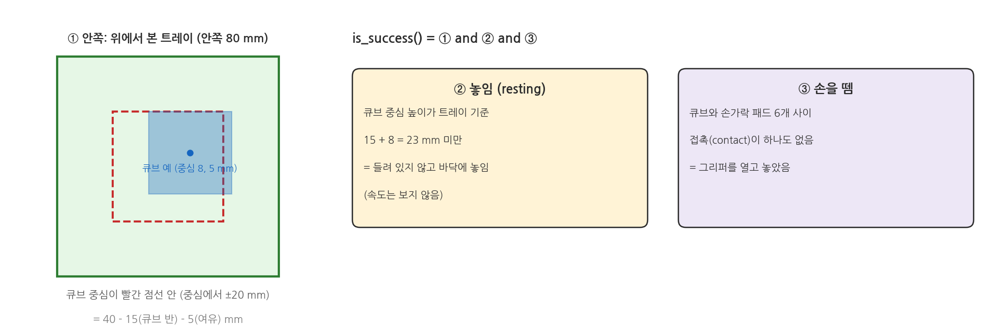{width=1000}

### 시연 한 번 동안의 조건 변화

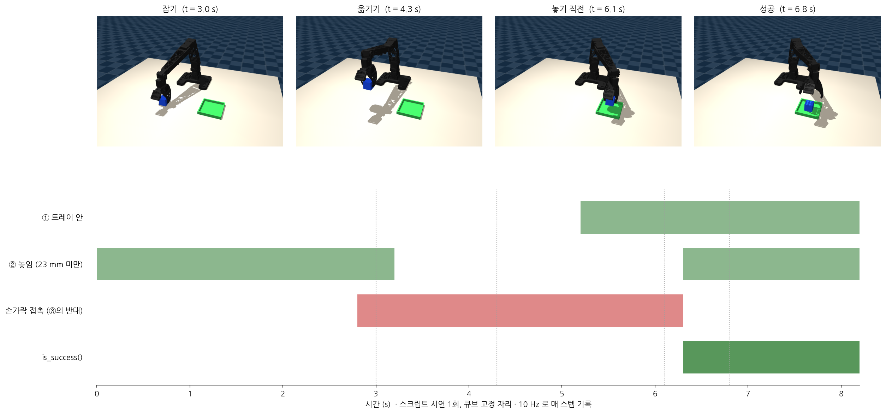{width=1000}

- 2.8 s 손가락이 큐브에 닿음 → 3.2 s 큐브가 들림 (② 거짓) → 5.2 s 트레이 위로 옮겨짐 (① 참)
- 6.3 s 그리퍼를 열어 손가락이 떨어지고 큐브가 트레이 바닥에 놓이는 순간 `is_success()` 가 참이 됩니다.
- 녹화(⑥)는 이 순간부터 0.5 s 더 기록하고 자동 저장, 평가(⑧ · ⑨)는 이 순간을 성공으로 셉니다.

## 4. 코드와 설정

### 큐브 · 트레이 · global 카메라 - scene_cube.xml 발췌

```xml
<!-- models/scene_cube.xml (발췌) -->
<camera name="global" pos="0.5 -0.28 0.38" mode="targetbody" target="workspace_center" fovy="50"/>

<!-- 30 mm 큐브 (25 g). condim 4 = 비틀림 마찰까지 계산해 잡은 큐브가 돌지 않게 -->
<body name="cube" pos="0.2 -0.06 0.015">
  <freejoint name="cube_joint"/>
  <geom name="cube" type="box" size="0.015 0.015 0.015" mass="0.025" material="cube_blue"
    condim="4" friction="1.2 0.02 0.001" solref="0.004 1"/>
</body>

<!-- 트레이: 안쪽 80 mm, 벽 높이 12 mm -->
<body name="tray" pos="0.18 0.13 0">
  <geom name="tray_floor" type="box" pos="0 0 0.001" size="0.044 0.044 0.001" material="tray"/>
  <geom name="tray_wall_px" type="box" pos="0.042 0 0.006" size="0.002 0.044 0.006" material="tray"/>
  ...
</body>
```

### 손가락 패드 · wrist 카메라 · 그리퍼 - omx_follower.xml 발췌

```xml
<!-- models/omx_follower.xml (발췌) -->
<position kp="50" dampratio="1" forcerange="-3.5 3.5"/>           <!-- 모든 관절의 위치 액추에이터 -->

<default class="finger_pad">                                       <!-- 손가락 충돌용 박스 -->
  <geom type="box" group="3" density="0" condim="4" friction="1.5 0.02 0.001" solref="0.004 1"/>
</default>

<body name="link5" pos="0.0287 0 0">
  <joint name="Joint5" class="Joint5"/>
  <camera name="wrist" pos="0.045 0 0.075" xyaxes="0 -1 0 0.66 0 0.75" fovy="70"/>
  <site name="tcp" pos="0.085 -0.0017 0" size="0.004" group="4"/>
  <body name="link6" pos="0.0295 0.0075 0">
    <joint name="Gripper" class="Gripper"/>
    <geom mesh="follower_07_gripper_motorized" class="visual"/>      <!-- 보이기만 -->
    <geom class="finger_pad" name="finger_l_base" pos="0.025 0.005 0" size="0.015 0.004 0.015"/>
    ...
</body>

<equality>
  <joint joint1="Gripper_mimic" joint2="Gripper" polycoef="0 -1 0 0 0"/>   <!-- mimic = -Gripper -->
</equality>
```

### reset · step - env.py 발췌

```python
# il_omx/env.py (발췌)
def reset(self, seed=None, cube_pose=None, arm_q=None, render=True):
    if seed is not None:
        self.rng = np.random.default_rng(seed)             # 같은 seed → 같은 큐브 자리
    mujoco.mj_resetDataKeyframe(self.model, self.data, self.home_key)
    if arm_q is not None:                                  # 리더 자세에서 시작 (팔이 튀지 않게)
        q = np.clip(arm_q, self.ctrl_low, self.ctrl_high)
        self.data.qpos[self.qpos_ids] = q
        self.data.qpos[self.qpos_ids[-1] + 1] = -q[-1]     # 그리퍼 mimic 관절
        self.data.ctrl[self.actuator_ids] = q
    if cube_pose is None:                                  # 무작위 자리 (TaskConfig 범위)
        c = self.cfg
        cube_pose = (self.rng.uniform(*c.cube_x_range), self.rng.uniform(*c.cube_y_range),
                     self.rng.uniform(*c.cube_yaw_range))
    x, y, yaw = cube_pose
    a = self.cube_qpos_adr
    self.data.qpos[a:a + 3] = [x, y, self.CUBE_HALF]
    self.data.qpos[a + 3:a + 7] = [np.cos(yaw / 2), 0, 0, np.sin(yaw / 2)]   # z축 회전 쿼터니언
    mujoco.mj_forward(self.model, self.data)
    return self.get_observation(render)

def step(self, action, render=True):
    action = np.clip(np.asarray(action, dtype=float), self.ctrl_low, self.ctrl_high)
    self.data.ctrl[self.actuator_ids] = action                       # 관절 목표 6개
    mujoco.mj_step(self.model, self.data, nstep=self.n_substeps)     # 0.002 s x 50 = 0.1 s
    return self.get_observation(render)
```

### is_success - env.py 발췌

```python
# il_omx/env.py (발췌)
def is_success(self) -> bool:
    rel = self.cube_pos - self.data.xpos[self.tray_body]                       # 트레이 기준 큐브 위치
    limit = self.TRAY_INNER_HALF - self.CUBE_HALF - self.cfg.tray_margin      # 0.040 - 0.015 - 0.005 = 0.020 m
    inside = abs(rel[0]) < limit and abs(rel[1]) < limit                        # ① 트레이 안
    resting = rel[2] < self.CUBE_HALF + 0.008                                   # ② 23 mm 미만 = 놓임
    return bool(inside and resting and not self.cube_touching_gripper())       # ③ 손을 뗌
```

### TaskConfig

```python
# il_omx/env.py (발췌)
@dataclass
class TaskConfig:
    fps: int = 10                                     # 제어 · 녹화 · 평가 주기
    image_height: int = 240
    image_width: int = 320
    cube_x_range: tuple = (0.17, 0.25)                # 무작위 큐브 범위 (m)
    cube_y_range: tuple = (-0.10, -0.02)
    cube_yaw_range: tuple = (-np.pi / 4, np.pi / 4)   # ±45°
    tray_margin: float = 0.005

FIXED_CUBE_POSE = (0.21, -0.06, 0.0)                  # --fixed-cube: 범위의 가운데, 회전 0
```

### 해 볼 것

- `env_tour.py` 에서 22 mm 를 19 mm 로 바꿔 실행 → `success` 가 어떻게 바뀌는지 확인
- `view_scene.py` 뷰어에서 `]` 키로 wrist 카메라로 바꾸고, Control 패널로 Joint5 를 돌려 화면이 어떻게 도는지 보기
- `render_cameras.py` 를 실행하기 전에 `scene_cube.xml` 의 global 카메라 `fovy` 를 50 → 70 으로 바꿔 보고 다시 되돌리기
