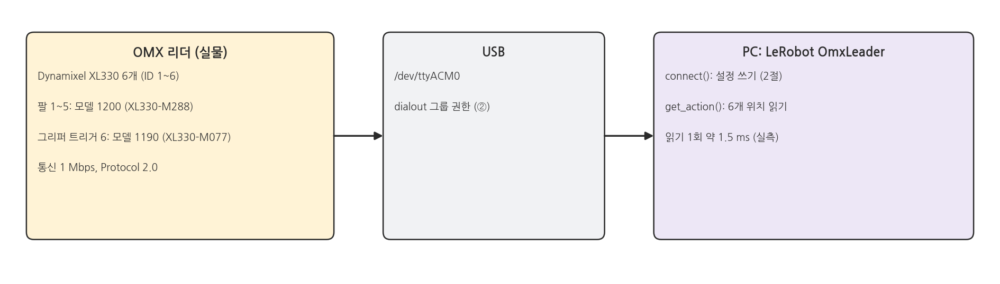
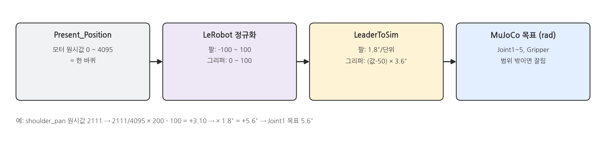
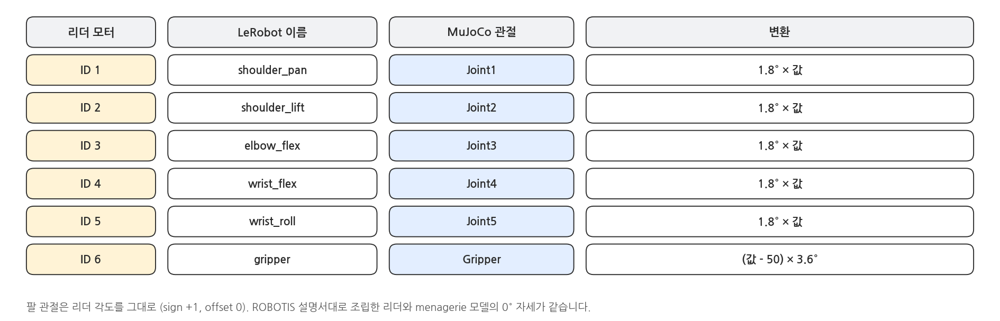
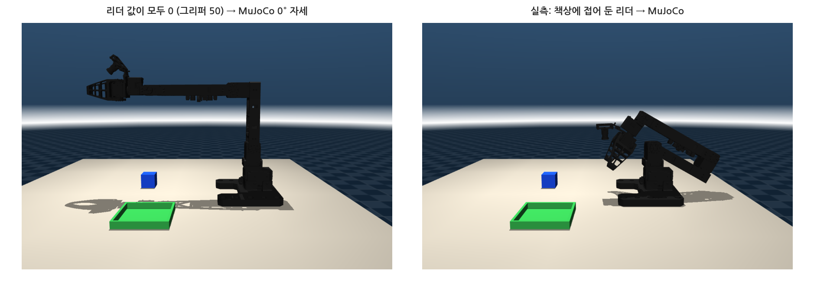
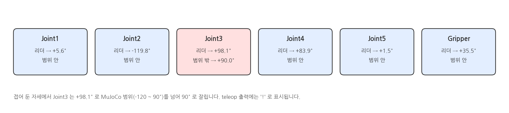
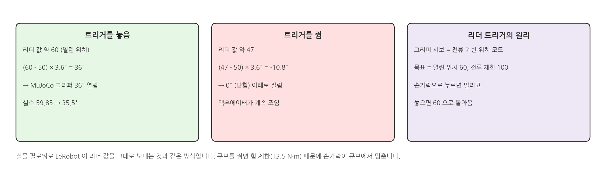
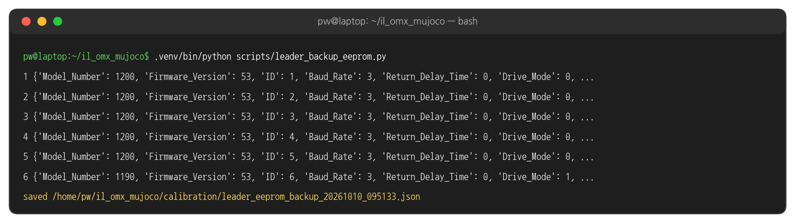
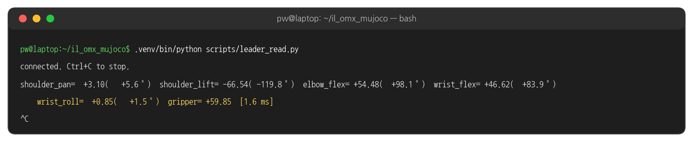
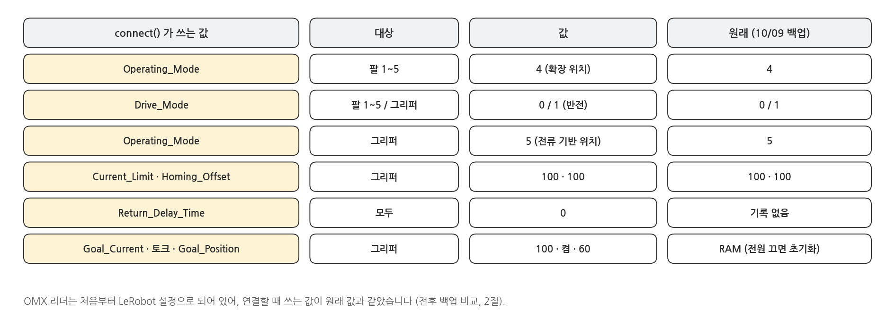
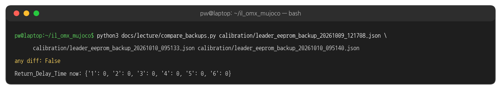

## 1. OMX 리더와 연결

### 하드웨어

{width=1000}

- 이 과정에서 실물 로봇은 리더 하나입니다. 리더에는 모터 구동 명령을 보내지 않고, 관절 위치를 읽기만 합니다 (그리퍼 트리거만 예외, 1절 마지막).
- LeRobot 0.6.1 의 `OmxLeader` 클래스를 그대로 씁니다. LeRobot 에는 실물 OMX 팔로워용 `omx_follower` 도 있어, 나중에 실물 팔로워로 옮길 때도 같은 리더 코드를 씁니다.

### 읽은 값이 MuJoCo 목표가 되기까지

{width=1000}

### 관절 매핑

{width=1000}

### 0° 자세와 실측 자세

{width=1000}

### 범위를 넘는 값

{width=1000}

### 그리퍼 트리거

{width=1000}

## 2. 실행: 리더 확인

### 터미널 1: 설정 백업 (처음 한 번, 읽기 전용)

```bash
cd ~/il_omx_mujoco
.venv/bin/python scripts/leader_backup_eeprom.py
```

### 실행 결과: 설정 백업

{width=1000}

- 모터 6개의 설정(EEPROM)을 읽어 `calibration/leader_eeprom_backup_<시각>.json` 으로 저장합니다. 모터에는 아무것도 쓰지 않습니다.
- LeRobot 으로 처음 연결하기 전에 한 번 떠 두면, 나중에 설정이 바뀌었는지 비교할 수 있습니다.

### 터미널 1: 관절 값 읽기

```bash
.venv/bin/python scripts/leader_read.py      # Ctrl+C 로 끝
```

### 실행 결과: 관절 값 읽기

{width=1000}

- 팔은 LeRobot 정규화 값(-100 ~ 100)과 각도(°), 그리퍼는 0 ~ 100 값입니다. 10 Hz 로 같은 줄을 덮어 씁니다.
- 한 번 읽는 데 약 1.5 ms 걸렸습니다. 녹화 주기(100 ms)보다 훨씬 짧습니다.
- 관절을 하나씩 손으로 움직이며 해당 값만 바뀌는지, 방향이 MuJoCo 관절과 같은지 확인합니다.

### 연결할 때 리더에 쓰는 것

{width=1000}

- `leader_read.py`, `teleop.py`, `record.py` 는 모두 LeRobot `connect()` 로 연결하고, 이때 위 값들을 리더에 씁니다.
- 그리퍼 토크를 켜고 목표를 열린 위치(60)로 주기 때문에, 연결하면 트리거가 열린 쪽으로 움직입니다. 팔 관절에는 토크를 걸지 않습니다.

### 터미널 1: 연결 전후 비교

```bash
.venv/bin/python scripts/leader_backup_eeprom.py          # leader_read.py 실행 전
.venv/bin/python scripts/leader_read.py                   # 몇 초 뒤 Ctrl+C
.venv/bin/python scripts/leader_backup_eeprom.py          # 실행 후
python3 docs/lecture/compare_backups.py calibration/leader_eeprom_backup_*.json
```

### 실행 결과: 연결 전후 비교

{width=1000}

- 처음 백업(10/09, LeRobot 첫 연결 전)과 `leader_read.py` 실행 전 · 후의 설정이 모두 같았습니다.
- `Return_Delay_Time` 은 처음 백업에 없던 항목이라 원래 값은 알 수 없고, 지금은 모두 0 입니다.

## 3. 코드와 설정

### connect_leader - il_omx/leader.py

```python
# il_omx/leader.py
from lerobot.teleoperators.omx_leader import OmxLeader, OmxLeaderConfig

CALIBRATION_DIR = ROOT / "calibration"
DEFAULT_PORT = "/dev/ttyACM0"

def connect_leader(port: str = DEFAULT_PORT) -> OmxLeader:
    """Connect using the project's calibration file (calibration/omx_leader.json)."""
    leader = OmxLeader(OmxLeaderConfig(port=port, id="omx_leader", calibration_dir=CALIBRATION_DIR))
    leader.connect()           # 보정값이 모터와 다르면 calibrate(), 이어서 configure()
    return leader
```

### 단위 - il_omx/leader_mapping.py

```python
# il_omx/leader_mapping.py (발췌)
ARM_MOTORS = ["shoulder_pan", "shoulder_lift", "elbow_flex", "wrist_flex", "wrist_roll"]
DEG_PER_UNIT = 180.0 / 100.0           # 팔: -100 ~ 100 = 한 바퀴
GRIPPER_DEG_PER_UNIT = 360.0 / 100.0   # 그리퍼: 0 ~ 100 = 한 바퀴
```

### LeaderToSim - il_omx/leader_mapping.py

```python
# il_omx/leader_mapping.py (발췌)
class LeaderToSim:
    def __call__(self, action: dict) -> np.ndarray:
        """Return the 6-dim sim action [Joint1..5, Gripper] in radians."""
        arm = np.deg2rad(self.sign * (self.leader_deg(action) + self.offset_deg))
        return np.append(arm, self.gripper_to_sim(action["gripper.pos"]))

    def gripper_to_sim(self, value: float) -> float:
        return float(np.deg2rad((value - self.gripper_zero) * GRIPPER_DEG_PER_UNIT))   # (값 - 50) x 3.6°
```

### configs/leader_to_sim.json

```javascript
{
  "joints": {
    "shoulder_pan":  {"sim_joint": "Joint1", "sign": 1, "offset_deg": 0.0},
    "shoulder_lift": {"sim_joint": "Joint2", "sign": 1, "offset_deg": 0.0},
    "elbow_flex":    {"sim_joint": "Joint3", "sign": 1, "offset_deg": 0.0},
    "wrist_flex":    {"sim_joint": "Joint4", "sign": 1, "offset_deg": 0.0},
    "wrist_roll":    {"sim_joint": "Joint5", "sign": 1, "offset_deg": 0.0}
  },
  "gripper": {"zero": 50.0}
}
```

- 조립이 설명서와 다르거나 방향이 반대인 관절이 있으면 `sign` (-1) 과 `offset_deg` 로 맞춥니다. 코드는 고치지 않아도 됩니다.

### calibration/omx_leader.json

```javascript
{
  "shoulder_pan": {"id": 1, "drive_mode": 0, "homing_offset": 0, "range_min": 0, "range_max": 4095},
  ...
  "gripper":      {"id": 6, "drive_mode": 1, "homing_offset": 100, "range_min": 0, "range_max": 4095}
}
```

- LeRobot 보정 파일. 모터에 저장된 값과 같으면 `connect()` 가 다시 보정하지 않습니다.

### configure() (1) 팔 모터 - LeRobot omx_leader.py 발췌

```python
# lerobot/teleoperators/omx_leader/omx_leader.py (0.6.1, 발췌)
def configure(self) -> None:
    self.bus.disable_torque()
    self.bus.configure_motors()                                    # 모든 모터 Return_Delay_Time = 0
    for motor in self.bus.motors:
        if motor != "gripper":
            self.bus.write("Operating_Mode", motor, OperatingMode.EXTENDED_POSITION.value)
        ...
```

### configure() (2) 그리퍼 트리거 - LeRobot omx_leader.py 발췌

```python
# lerobot/teleoperators/omx_leader/omx_leader.py (0.6.1, 발췌) configure() 이어서
    self.bus.write("Operating_Mode", "gripper", OperatingMode.CURRENT_POSITION.value)
    self.bus.write("Current_Limit", "gripper", 100)
    self.bus.write("Goal_Current", "gripper", 100)
    self.bus.write("Homing_Offset", "gripper", 100)
    self.bus.enable_torque("gripper")                              # 트리거: 누르면 밀리고 놓으면 복귀
    if self.is_calibrated:
        self.bus.write("Goal_Position", "gripper", self.config.gripper_open_pos)   # 60
```

### 해 볼 것

- `leader_read.py` 를 켜고 관절을 하나씩 ±90° 정도 움직여 각도 값이 따라오는지 확인
- 트리거를 끝까지 쥐었을 때의 그리퍼 값을 읽고, (값 - 50) × 3.6° 로 MuJoCo 그리퍼 목표를 계산
- `configs/leader_to_sim.json` 에서 `wrist_roll` 의 `sign` 을 -1 로 바꾸고 ⑤ 텔레옵에서 손목 회전 방향이 반대로 되는지 본 뒤 되돌리기
