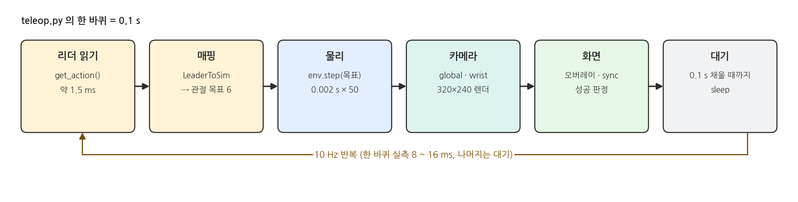
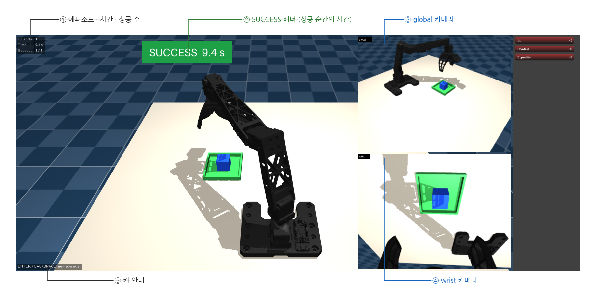
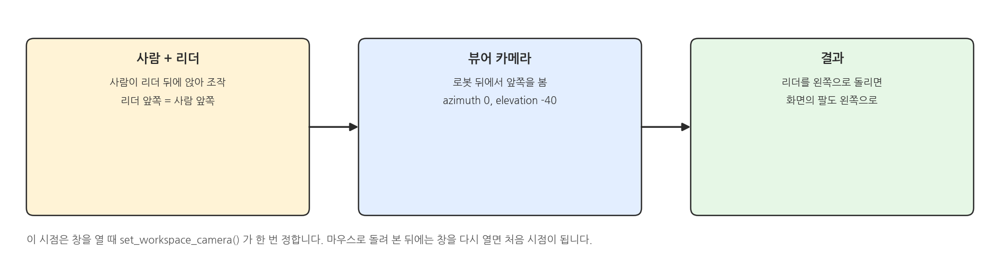
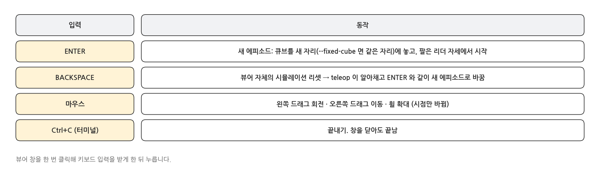
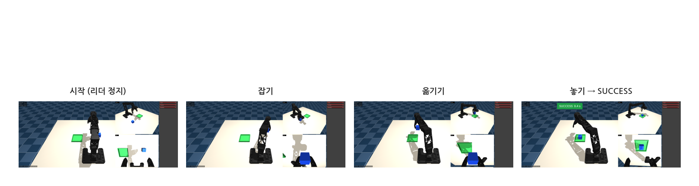
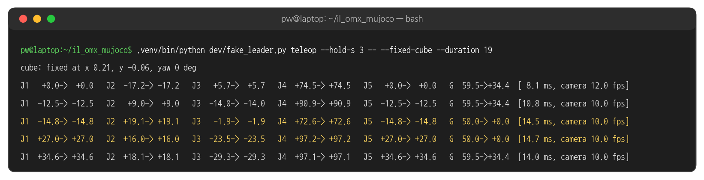
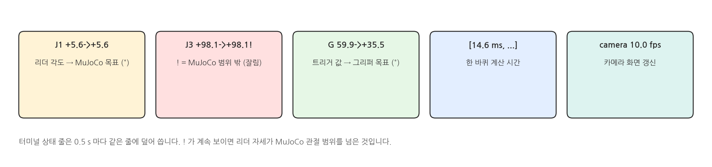
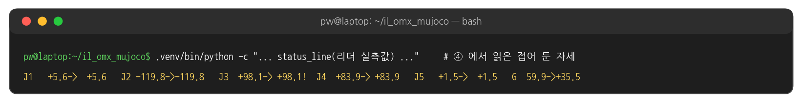
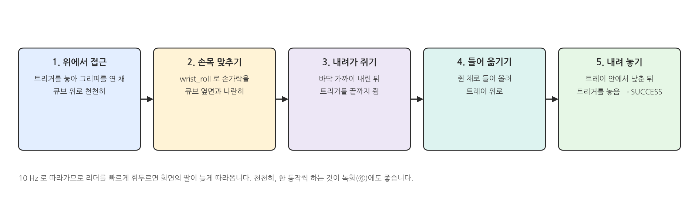

## 1. 텔레옵이란

### 리더로 MuJoCo 팔 움직이기

{width=1000}

- `teleop.py` 는 연습용입니다. 녹화하지 않고, 리더로 MuJoCo 팔을 조작하며 성공 판정만 보여 줍니다.
- 녹화(⑥)와 같은 10 Hz · 같은 화면이라서, 여기서 익힌 조작감이 녹화에 그대로 이어집니다.

### 화면 구성

{width=1000}

### 화면 시점: 로봇 뒤에서

{width=1000}

### 키와 마우스

{width=1000}

## 2. 실행: 텔레옵

### 터미널 1: teleop

```bash
cd ~/il_omx_mujoco
.venv/bin/python scripts/teleop.py                  # 큐브 자리가 에피소드마다 바뀜
.venv/bin/python scripts/teleop.py --fixed-cube     # 큐브가 항상 같은 자리 (실습 1 연습)
```

### 실행 결과: 한 에피소드

{width=1000}

- 이 페이지의 화면과 출력은 사람 대신 가짜 리더(IK 궤적 재생, `dev/fake_leader.py`)로 `teleop.py` 를 실행해 얻었습니다. 화면 구성 · 판정 · 출력 형식은 실물 리더와 같습니다.
- 가짜 리더는 3초 정지한 뒤 움직이므로 SUCCESS 시간 9.4 s 에는 정지 3초가 포함됩니다.

### 실행 결과: 터미널

{width=1000}

### 상태 줄 읽기

{width=1000}

### 범위를 넘는 자세: !

{width=1000}

- 리더를 책상에 접어 둔 채 teleop 을 시작하면 Joint3 에 `!` 가 붙습니다 (+98.1° > MuJoCo 한계 90°). 팔을 세우면 사라집니다.

### 조작 요령

{width=1000}

### 느린 PC

```bash
.venv/bin/python scripts/teleop.py --camera-fps 5     # 카메라 화면만 5 Hz 로 (제어는 10 Hz 그대로)
.venv/bin/python scripts/teleop.py --camera-fps 0     # 카메라 화면 끄기
```

- 한 바퀴에서 가장 오래 걸리는 것은 카메라 두 대의 렌더입니다. 텔레옵에서는 카메라를 줄여도 조작에는 영향이 없습니다.
- 녹화(⑥)에서는 카메라 영상이 데이터이므로 끌 수 없습니다.

## 3. 코드와 설정

### 연결과 첫 리셋 - teleop.py 발췌

```python
# scripts/teleop.py (발췌)
leader = connect_leader(args.port)                    # ④: LeRobot OmxLeader
mapper = LeaderToSim()
env = OmxCubeEnv(TaskConfig(), render=cameras_on)
cube_pose = cube_pose_from_args(args)                 # --fixed-cube 이면 고정 자리, 아니면 None(무작위)
env.reset(arm_q=mapper(leader.get_action()), cube_pose=cube_pose, render=False)   # 팔은 리더 자세에서 시작
```

### 10 Hz 루프 (1) 리셋 또는 한 스텝 - teleop.py 발췌

```python
# scripts/teleop.py (발췌)
while viewer is None or viewer.is_running():
    action = leader.get_action()                      # 리더 6개 값
    target = mapper(action)                           # MuJoCo 관절 목표 (rad)
    with viewer.lock():
        if reset_event.is_set() or env.data.time < sim_time:   # ENTER 또는 BACKSPACE
            reset_event.clear()
            episodes.new()
            obs = env.reset(arm_q=target, cube_pose=cube_pose, render=render)
        else:
            obs = env.step(target, render=render)     # 0.1 s 진행
        ...
```

- BACKSPACE 는 뷰어가 시뮬레이션을 직접 리셋합니다. sim 시간이 줄어든 것을 보고 새 에피소드로 바꿉니다.

### 10 Hz 루프 (2) 성공 판정과 화면 - teleop.py 발췌

```python
# scripts/teleop.py (발췌) 루프 이어서
    with viewer.lock():
        ...
        sim_time = env.data.time
        episodes.update(env.is_success())             # 성공 순간의 시간을 기억 (배너)
    overlay.set_cameras({cam: obs[cam] for cam in CAMERA_NAMES})
    overlay.set_banner(episodes.banner())
    overlay.flush()
    viewer.sync()
    time.sleep(max(0.0, dt - (time.perf_counter() - t0)))   # t0 = 루프 시작 시각. 0.1 s 를 채움
```

### 뷰어 시점 - viewer_overlay.py 발췌

```python
# il_omx/viewer_overlay.py (발췌)
def set_workspace_camera(viewer):
    """Free camera behind the robot, so left/right match the operator sitting behind the leader."""
    viewer.cam.lookat[:] = [0.2, 0.03, 0.03]
    viewer.cam.distance = 0.7
    viewer.cam.azimuth = 0
    viewer.cam.elevation = -40
```

### 해 볼 것

- `--fixed-cube` 로 같은 자리에서 5번 연속 성공해 보기 (실습 1 연습). Success 칸이 5 / 5 가 되는지 확인
- 옵션 없이 실행해 큐브가 45° 가까이 돌아간 자리에서 손목(wrist_roll)을 맞춰 잡아 보기
- `--camera-fps 0` 으로 실행해 상태 줄의 ms 값이 어떻게 바뀌는지 비교
