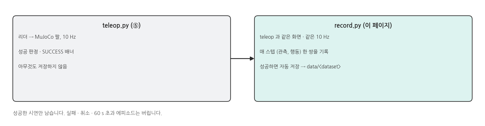
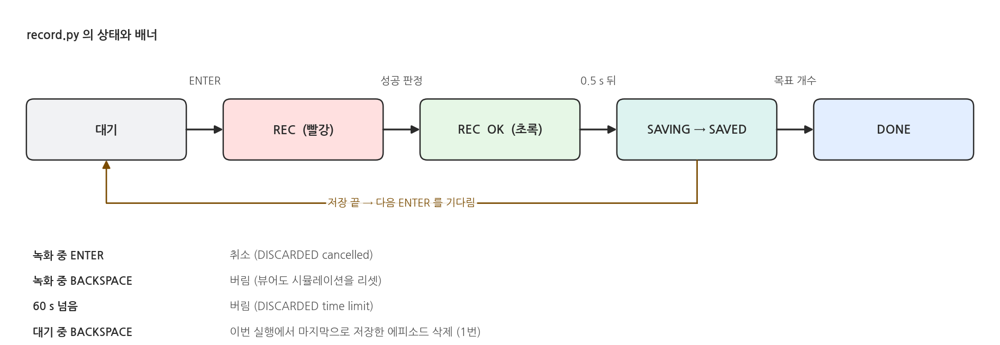
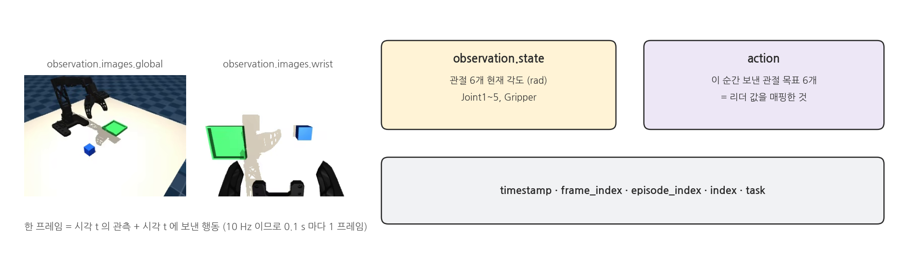
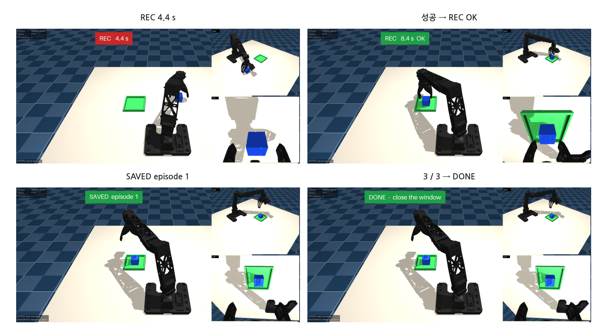
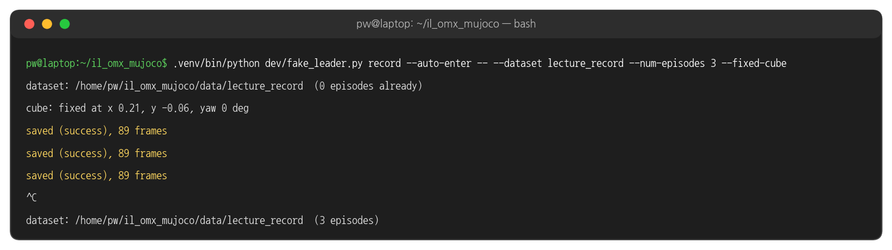
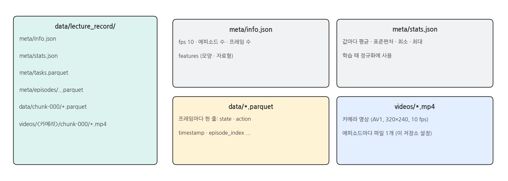
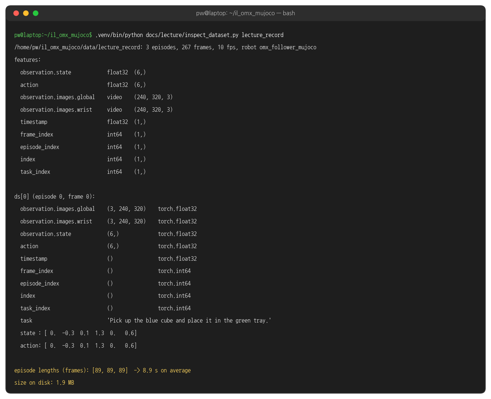
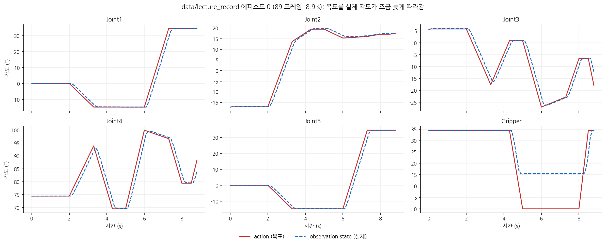
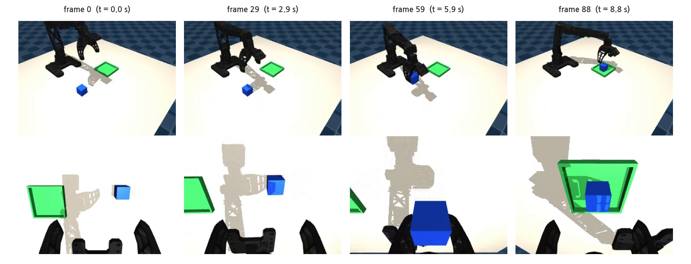
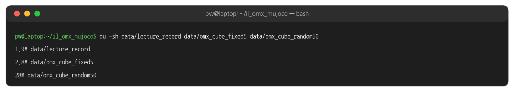

## 1. 녹화란

### teleop 과 record

{width=1000}

### 상태와 키

{width=1000}

- 성공 판정(③ 페이지)이 참이 된 뒤 0.5 s 를 더 기록하고 저장합니다. 그리퍼를 놓는 장면까지 시연에 들어가게 하기 위해서입니다.
- 저장할 때마다 데이터셋을 마무리(finalize)하므로, 터미널이 죽어도 잃는 것은 녹화 중인 에피소드 하나뿐입니다.
- 같은 `--dataset` 이름으로 다시 실행하면 뒤에 이어 붙입니다. 설정(fps, 영상 크기)이 다르면 시작하지 않습니다.

### 한 프레임에 들어가는 것

{width=1000}

## 2. 실행: 녹화

### 터미널 1: record

```bash
cd ~/il_omx_mujoco
.venv/bin/python scripts/record.py --dataset my_fixed5 --num-episodes 5 --fixed-cube     # 실습 1 (⑧)
.venv/bin/python scripts/record.py --dataset my_random50 --num-episodes 50               # 실습 2 (⑨)
```

- 뷰어 창을 한 번 클릭한 뒤 ENTER 로 녹화를 시작합니다. 성공하면 자동 저장되고, 다음 ENTER 를 기다립니다.
- 목표 개수를 채우면 배너가 `DONE - close the window` 로 바뀝니다. 창을 닫거나 터미널에서 Ctrl+C 로 끝냅니다.

### 실행 결과: 녹화 화면

{width=1000}

- 이 페이지의 녹화는 사람 대신 가짜 리더(IK 궤적 재생, `dev/fake_leader.py --auto-enter`)로 `record.py` 를 실행해 만들었습니다. 가짜 리더는 매 에피소드 2초 정지한 뒤 움직입니다.
- 왼쪽 위: 데이터셋 이름 · 저장 개수 / 목표 · 이번 실행에서 저장한 수. 왼쪽 아래: 지금 누를 수 있는 키

### 실행 결과: 터미널

{width=1000}

## 3. 데이터셋 들여다보기

### 폴더 구조

{width=1000}

### 터미널 1: inspect_dataset.py

```bash
.venv/bin/python docs/lecture/inspect_dataset.py lecture_record
```

### 실행 결과: inspect_dataset.py

{width=1000}

- 저장할 때는 320×240×3 (uint8) 영상이지만, 꺼낼 때는 학습용 텐서 (3, 240, 320), 0~1 float 으로 나옵니다.
- 첫 프레임의 state 와 action 이 같습니다. 녹화는 팔이 리더 자세에서 시작하기 때문입니다.

### 한 에피소드의 관절 궤적

{width=1000}

- 실제 각도(파랑)가 목표(빨강)를 0.1~0.2 s 늦게 따라갑니다. 위치 제어 액추에이터의 반응입니다 (③).
- 그리퍼(오른쪽 아래): 목표는 0° (닫힘) 인데 실제는 15.4° 에서 멈춥니다. 손가락이 큐브에 막혀 힘 제한(±3.5 N·m)으로 쥐고 있는 상태입니다. 정책은 이 차이까지 함께 배웁니다.

### 한 에피소드의 영상

{width=1000}

### 데이터셋 크기

{width=1000}

- 에피소드 하나 (약 9 s) 가 0.6 MB 정도입니다. 영상을 AV1 로 압축하기 때문에 50개도 28 MB 입니다.
- `data/` 는 git 에 올라가지 않습니다. 다른 PC 로 옮길 때는 폴더째 복사합니다.

## 4. 코드와 설정

### 녹화 루프 (1) ENTER 와 기록 - record.py 발췌

```python
# scripts/record.py (발췌)
with viewer.lock():
    if enter.is_set() and finish is None:
        enter.clear()
        if recording:
            finish = (False, "cancelled")                       # 녹화 중 ENTER = 취소
        elif recorder.num_episodes < args.num_episodes:
            obs = env.reset(arm_q=target, cube_pose=cube_pose)  # 새 큐브, 팔은 리더 자세
            recording, success_frame = True, None
    if recording and finish is None:
        recorder.add(obs, target)                               # 시각 t 의 관측 + 시각 t 의 행동
    ...
```

### 녹화 루프 (2) 저장 · 버림 판단 - record.py 발췌

```python
# scripts/record.py (발췌) with viewer.lock() 안 이어서
    obs = env.step(target)                                      # 0.1 s 진행
    if recording and finish is None:
        if success_frame is None and env.is_success():
            success_frame = recorder.frames                     # 성공 순간
        if success_frame is not None and recorder.frames - success_frame >= POST_ROLL_S * args.fps:
            finish = (True, "success")                          # 0.5 s 더 기록한 뒤 저장
        elif recorder.frames >= args.max_episode_s * args.fps:
            finish = (False, "time limit")                      # 60 s 초과는 버림
```

### features - dataset.py 발췌

```python
# il_omx/dataset.py (발췌)
TASK = "Pick up the blue cube and place it in the green tray."

def dataset_features(image_height: int, image_width: int) -> dict:
    joints = {"dtype": "float32", "shape": (len(JOINT_NAMES),), "names": list(JOINT_NAMES)}
    features = {"observation.state": dict(joints), "action": dict(joints)}
    for cam in CAMERA_NAMES:                                    # global, wrist
        features[f"observation.images.{cam}"] = {
            "dtype": "video", "shape": (image_height, image_width, 3), "names": ["height", "width", "channels"]}
    return features
```

### EpisodeRecorder (1) 기록 · 저장 - dataset.py 발췌

```python
# il_omx/dataset.py (발췌)
class EpisodeRecorder:
    def add(self, obs: dict, action: np.ndarray):
        self.dataset.add_frame(make_frame(obs, action))
        self.frames += 1

    def save(self):
        self.dataset.save_episode()          # parquet + mp4 쓰기
        self.dataset.finalize()              # 파일을 닫아 바로 읽을 수 있게
        self.dataset = open_dataset(*self._open_args)
        self.frames = 0
```

### EpisodeRecorder (2) 버리기 - dataset.py 발췌

```python
# il_omx/dataset.py (발췌) class EpisodeRecorder 이어서
    def discard(self):                       # 취소 · 시간 초과
        if self.dataset.has_pending_frames():
            self.dataset.clear_episode_buffer()
        self.frames = 0
```

### 해 볼 것

- `--num-episodes 2` 로 녹화한 뒤 같은 이름으로 다시 실행해 이어 붙여 보기 → `inspect_dataset.py` 로 에피소드 수 확인
- 한 번은 일부러 트레이 밖에 놓고 ENTER 로 취소해 보기 → 터미널에 `discarded (cancelled)` 확인
- 녹화 직후 BACKSPACE 로 마지막 에피소드를 지우고 개수가 줄어드는지 확인
