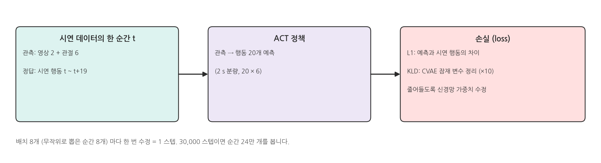
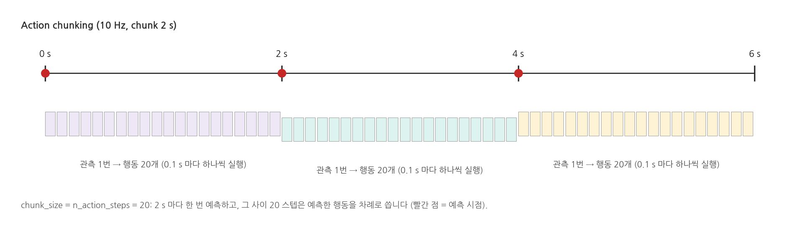
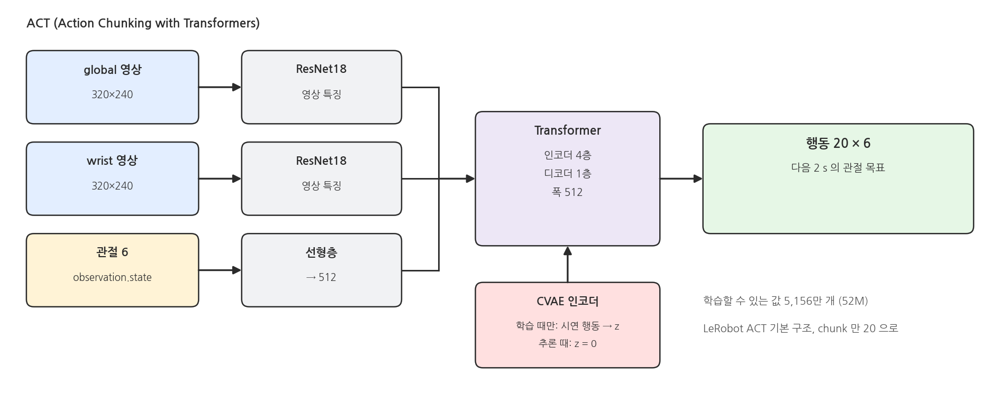
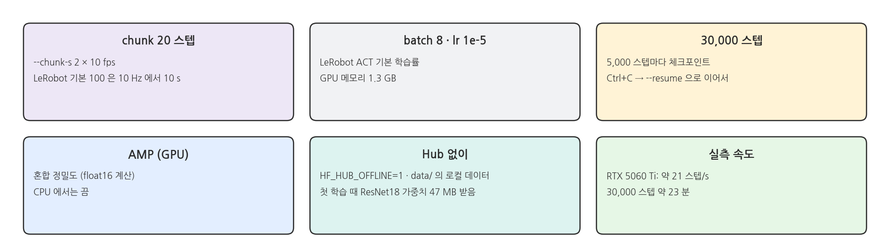
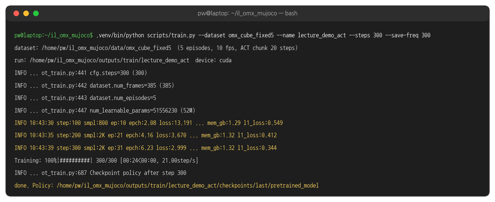
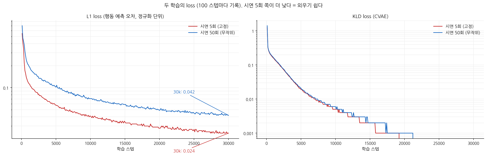
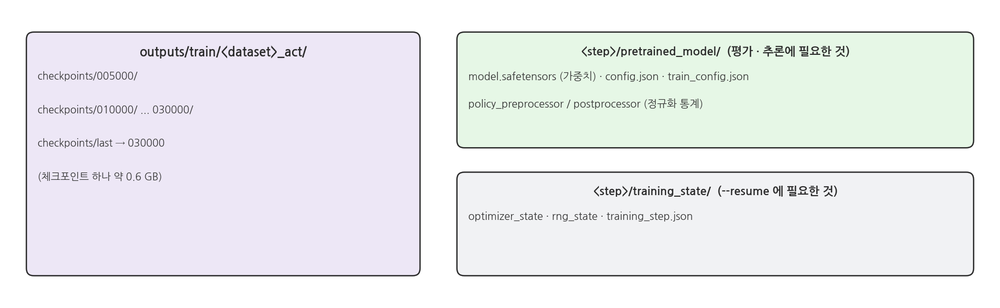
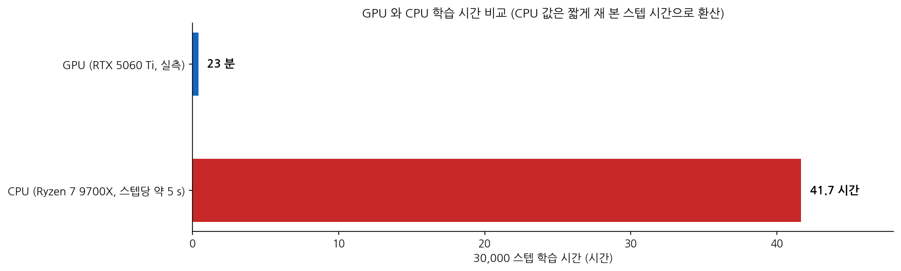

## 1. ACT 학습이란

### 시연을 따라 하도록 학습

{width=1000}

### Action chunking

{width=1000}

- 한 번에 앞으로 2 s 의 행동을 통째로 예측하므로, 매 순간 따로 예측할 때보다 움직임이 끊기지 않습니다.
- 그 대신 2 s 동안은 새 관측을 보지 않습니다. 큐브가 미끄러지면 다음 예측(2 s 뒤)에서야 반응합니다.

### ACT 구조

{width=1000}

- 학습 때는 CVAE 인코더가 시연 행동을 보고 잠재 변수 z 를 만들어, 같은 상황에서 시연이 조금씩 다른 것을 흡수합니다. 평가 때는 z = 0 을 씁니다.
- 그래서 같은 관측이면 항상 같은 행동이 나옵니다. 큐브 자리를 고정한 평가는 몇 번을 해도 결과가 같습니다 (⑧).

### 이 저장소의 학습 설정

{width=1000}

## 2. 실행: 학습

### 터미널 1: train

```bash
cd ~/il_omx_mujoco
.venv/bin/python scripts/train.py --dataset my_fixed5          # → outputs/train/my_fixed5_act
.venv/bin/python scripts/train.py --dataset my_random50        # → outputs/train/my_random50_act
```

- 데이터셋에 에피소드가 5개 미만이면 시작하지 않습니다.
- 같은 이름의 학습 폴더가 있으면 시작하지 않습니다. 이어서 하려면 `--resume`, 새로 하려면 `--name` 으로 다른 이름을 줍니다.

### 실행 결과: 학습 (300 스텝 짧게 실행)

{width=1000}

- `smpl` = 지금까지 본 순간 수, `ep` = 에피소드 기준으로 몇 개 분량을 봤는지, `epch` = 데이터셋을 몇 바퀴 돌았는지
- 30,000 스텝 실제 학습 두 번은 각각 23 분 (RTX 5060 Ti) 걸렸습니다.

### 중간에 멈추고 이어서

```bash
# Ctrl+C 로 멈춘 뒤
.venv/bin/python scripts/train.py --resume --dataset my_random50                 # 마지막 체크포인트에서 이어서
.venv/bin/python scripts/train.py --resume --dataset my_random50 --steps 50000   # 더 길게
```

### loss 곡선

{width=1000}

- 시연 5회는 같은 장면 5개뿐이라 빨리, 더 낮게 내려갑니다 (외우기 쉬움). 시연 50회는 장면이 다양해서 loss 가 더 높게 남습니다.
- loss 가 낮다고 잘하는 정책은 아닙니다. 실제 성공률은 ⑧ · ⑨ 에서 MuJoCo 로 평가합니다.

### 체크포인트 폴더

{width=1000}

- 체크포인트 하나가 약 0.6 GB 입니다 (정책 + 이어서 학습할 optimizer 상태). 30,000 스텝이면 6개, 약 3.6 GB 입니다.

### GPU 와 CPU

{width=1000}

- GPU 가 없는 PC 에서는 학습이 현실적으로 어렵습니다. GPU 가 있는 PC 에서 학습하고, `outputs/train/<run>` 폴더를 복사해 평가합니다.

## 3. 코드와 설정

### 학습 명령 (1) 데이터셋 · 정책 - train.py 발췌

```python
# scripts/train.py (발췌)
chunk = max(1, round(args.chunk_s * fps))           # 2 s x 10 fps = 20 스텝
cmd = [sys.executable, "-m", "lerobot.scripts.lerobot_train",
       f"--dataset.repo_id=local/{args.dataset}",
       f"--dataset.root={root}",                    # data/<dataset> (로컬)
       "--policy.type=act",
       f"--policy.chunk_size={chunk}",
       f"--policy.n_action_steps={chunk}",          # 예측한 20개를 모두 실행한 뒤 다시 예측
       "--policy.push_to_hub=false",
       "--wandb.enable=false",
       f"--output_dir={run_dir}",
       ..., *common]
```

### 학습 명령 (2) 학습 길이 · 장치 - train.py 발췌

```python
# scripts/train.py (발췌)
common = [f"--steps={args.steps}",                  # 30000
          f"--batch_size={args.batch_size}",        # 8
          f"--save_freq={args.save_freq}",          # 5000
          f"--num_workers={args.num_workers}",
          f"--policy.device={device}",
          f"--policy.use_amp={str(device == 'cuda').lower()}"]
env = dict(os.environ, SVT_LOG="1", HF_HUB_OFFLINE="1")   # 인터넷(Hub) 을 쓰지 않음
subprocess.run(cmd, env=env, cwd=ROOT)
```

### 학습한 정책으로 행동 얻기 - eval.py 발췌

```python
# scripts/eval.py (발췌)
policy = ACTPolicy.from_pretrained(path)                         # <step>/pretrained_model
pre, post = make_pre_post_processors(policy.config, pretrained_path=str(path), ...)

def act(obs: dict) -> np.ndarray:
    frame = {"observation.state": obs["state"].astype(np.float32)}
    for cam in CAMERA_NAMES:
        frame[f"observation.images.{cam}"] = obs[cam]
    action = predict_action(frame, policy, torch_device, pre, post, use_amp=False, task=TASK)
    return action.squeeze(0).cpu().numpy()                       # 관절 목표 6개 (줄에 쌓인 20개 중 다음 것)
```

### 해 볼 것

- `--steps 5000` 으로 짧게 학습하고 `--resume --steps 10000` 으로 이어서 학습해 보기
- `--chunk-s 1` (10 스텝) 로 학습한 정책을 ⑨ 의 방법으로 평가해 2 s 와 비교
- 학습 중 다른 터미널에서 `nvidia-smi` 로 GPU 메모리 · 사용률 확인
