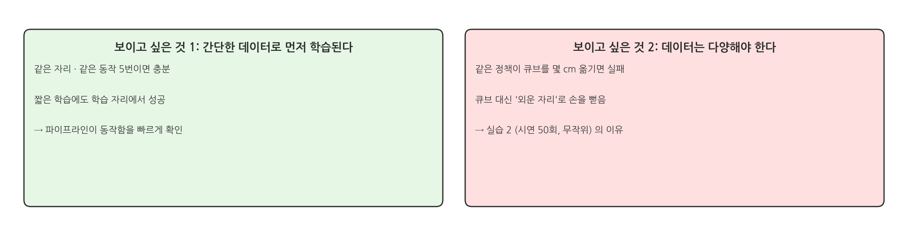
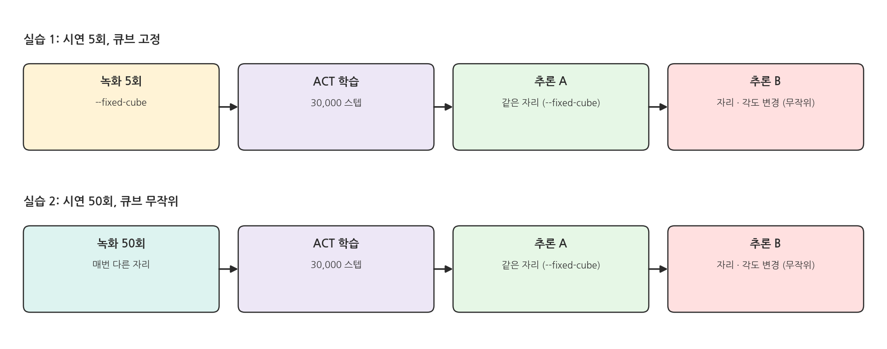
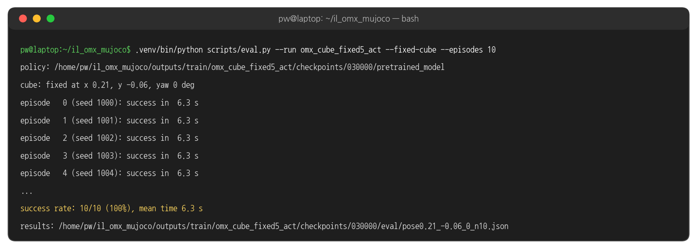
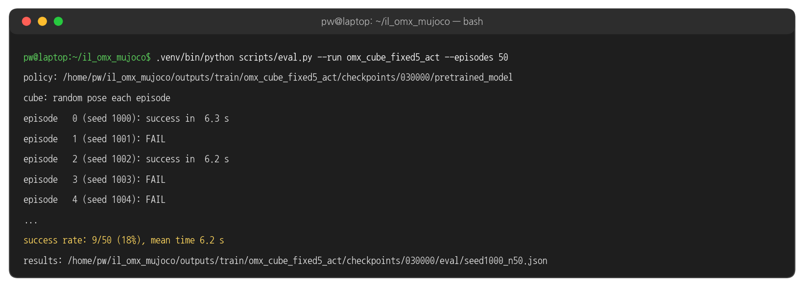
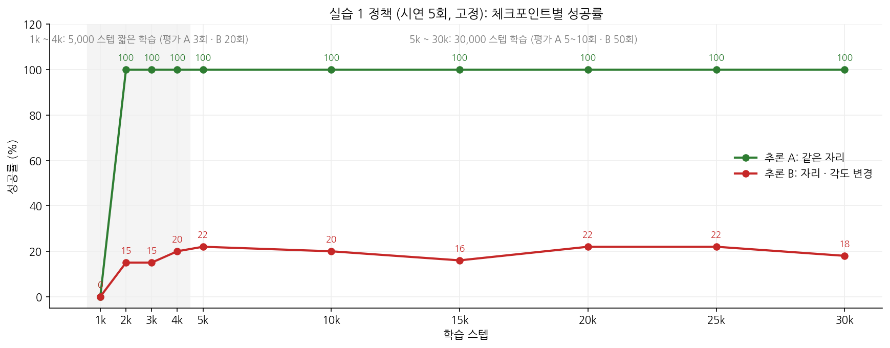
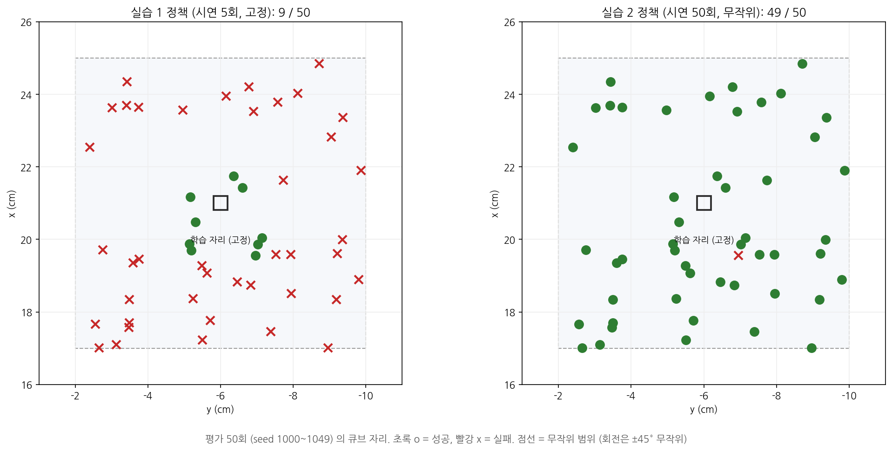
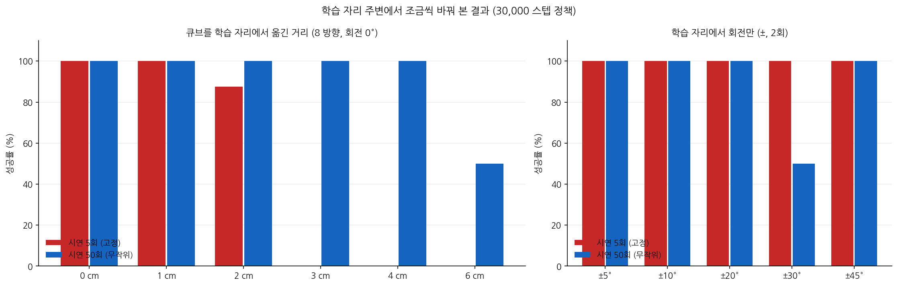
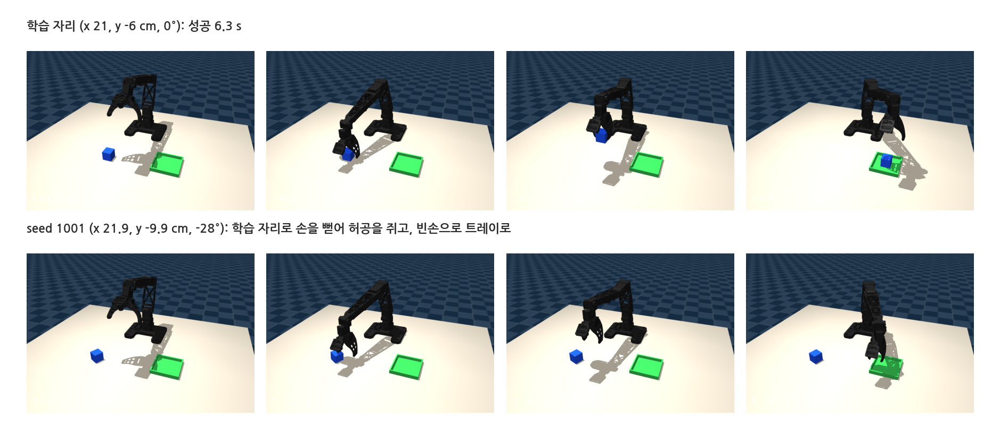
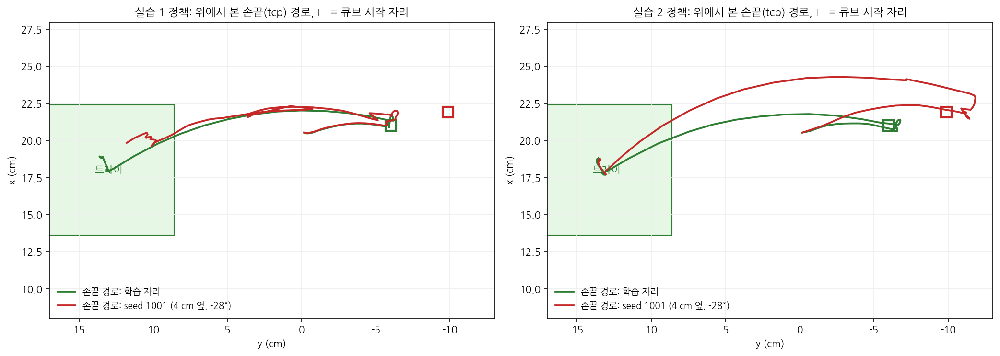

## 1. 실습 1 의 목적

### 보이고 싶은 두 가지

{width=1000}

### 실습 순서

{width=1000}

- 실습 1 은 위쪽 줄입니다. 큐브를 한 자리에 고정하고 시연 5회 → 학습 → 추론 A (같은 자리) → 추론 B (자리 · 각도 변경)
- 이 페이지의 수치는 사람 대신 IK 스크립트로 만든 시연 5회(⑩)로 학습한 결과입니다. 스크립트는 같은 자리에서 매번 똑같이 움직이므로, 사람 시연 5회보다 더 '같은' 데이터입니다.

## 2. 실행

### 터미널 1: 녹화 5회 (큐브 고정)

```bash
cd ~/il_omx_mujoco
.venv/bin/python scripts/record.py --dataset my_fixed5 --num-episodes 5 --fixed-cube
```

- 5번 모두 같은 자리 (x 21 cm, y -6 cm, 회전 0°) 입니다. 녹화 방법은 ⑥ 과 같습니다.
- 스크립트로 같은 조건의 데이터를 만들려면 (⑩): `.venv/bin/python scripts/scripted_pick_place.py --episodes 5 --fixed-cube --dataset scripted_fixed5`. 이미 녹화한 `my_fixed5` 에 섞이지 않도록 이름을 따로 줍니다 (같은 이름이면 뒤에 이어 붙습니다).
- 이 페이지의 실행 결과는 스크립트로 만든 데이터셋 `omx_cube_fixed5` 와 그 학습 결과 `omx_cube_fixed5_act` 입니다. 명령의 `my_fixed5` 자리에 이 이름이 들어간 것만 다릅니다.

### 터미널 1: 학습

```bash
.venv/bin/python scripts/train.py --dataset my_fixed5 --steps 5000 --save-freq 1000
```

- 5,000 스텝 약 4 분 (RTX 5060 Ti). 같은 자리 5회짜리 단순한 데이터는 2,000 스텝이면 이미 성공하므로 (3절) 기본값 30,000 스텝까지 갈 필요가 없습니다.
- `--save-freq 1000`: 1,000 스텝마다 체크포인트가 생깁니다. 학습 중에도 다른 터미널에서 중간 체크포인트를 평가할 수 있습니다.
- 아래 실행 결과는 30,000 스텝으로 학습한 정책입니다. 3절 곡선처럼 5,000 스텝에서도 추론 A 100%, 추론 B 15 ~ 25% 로 같습니다.

### 터미널 2: 추론 A - 같은 자리

```bash
.venv/bin/python scripts/eval.py --run my_fixed5_act --fixed-cube --episodes 10 --view
```

### 실행 결과: 추론 A

{width=1000}

- 10번 모두 6.3 s 에 성공. 같은 자리 · 같은 정책이면 MuJoCo 도 정책도 매번 똑같이 계산하므로 10번의 결과가 같습니다.
- `--view` 를 주면 MuJoCo 뷰어로 실시간 재생되고, 빼면 화면 없이 빠르게 돕니다. 어느 쪽이든 처음 5회는 영상(`eval/*.mp4`)으로 남습니다.

### 터미널 2: 추론 B - 자리 · 각도 변경

```bash
.venv/bin/python scripts/eval.py --run my_fixed5_act --episodes 50
```

### 실행 결과: 추론 B

{width=1000}

- 큐브 자리를 seed 1000 ~ 1049 로 정합니다. 모든 정책을 같은 50 자리에서 비교할 수 있습니다. 스크립트 시연(seed 0 부터)과는 겹치지 않고, 사람이 녹화할 때는 seed 없이 무작위로 놓입니다.

## 3. 결과 읽기

### 간단한 데이터로 먼저 학습된다

{width=1000}

- 같은 자리(초록)는 **2,000 스텝 (학습 약 2 분) 에 이미 성공**했고, 그 뒤 모든 체크포인트에서 100% 입니다. 1,000 스텝에서는 아직 0% 입니다.
- 학습을 더 해도 바뀐 자리(빨강)는 15 ~ 25% 에 머뭅니다. 학습 시간의 문제가 아니라 데이터의 문제입니다.
- 1k ~ 4k 는 1,000 스텝마다 저장하도록 5,000 스텝 학습을 따로 한 번 더 해서 얻은 값입니다 (평가 A 3회, B 20회).

### 어디서 성공하고 어디서 실패하나

{width=1000}

- 실습 1 정책(왼쪽)이 성공한 9 자리는 모두 학습 자리 근처입니다.

### 조금씩 옮겨 보기

{width=1000}

- 실습 1 정책(빨강)은 1 cm 까지 8/8, 2 cm 7/8, **3 cm 부터 0/8** 입니다.
- 회전만 바꾼 경우(오른쪽)는 ±45° 까지 모두 성공했습니다. 이 과제에서 실습 1 정책을 무너뜨리는 것은 위치입니다.

### 실패하는 모습

{width=1000}

### 손끝이 간 곳

{width=1000}

- 실습 1 정책(왼쪽)은 큐브가 4 cm 옆(빨간 □)에 있어도 손끝이 학습 자리(초록 □) 근처로 갑니다. 영상 속 큐브를 보고 움직이는 것이 아니라, 외운 동작을 되풀이합니다.
- 실습 2 정책(오른쪽)은 같은 자리에서 손끝이 빨간 □ 로 갑니다 (⑨).

## 4. 정리

### 실습 1 에서 배운 것

- 데이터가 단순하면 (같은 자리 5번) 학습이 빠르고, loss 도 낮습니다 (⑦). 녹화 → 학습 → 추론 파이프라인 점검에 좋습니다.
- 그러나 정책은 '큐브를 보고 잡는 법' 이 아니라 '그 자리로 가는 동작' 을 배웠습니다. 큐브가 3 cm 만 옮겨져도 실패합니다.
- 그래서 시연은 평가 때 만날 상황을 덮을 만큼 다양해야 합니다 → 실습 2 (⑨).

### 해 볼 것

- 추론 A 를 `--cube-pose 0.22 -0.06 0` (1 cm 옆), `0.23 -0.06 0` (2 cm), `0.24 -0.06 0` (3 cm) 로 바꿔 가며 어디서 무너지는지 직접 찾기
- `--policy outputs/train/my_fixed5_act/checkpoints/002000/pretrained_model` 처럼 중간 체크포인트(001000 ~ 005000)를 평가해 곡선 그려 보기
- 사람이 녹화한 시연 5회와 스크립트 시연 5회의 결과 비교 (사람 시연은 매번 조금씩 다름)
