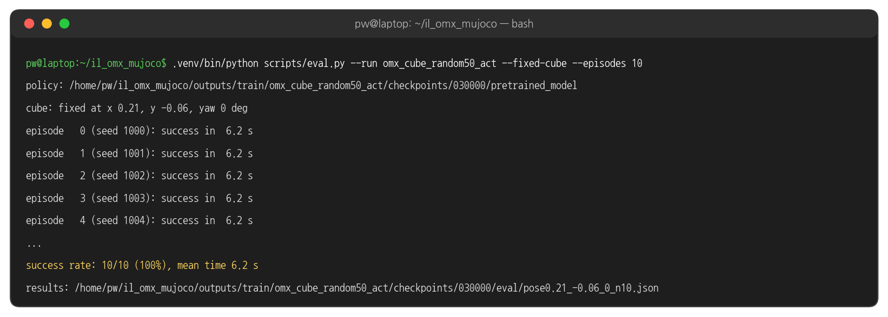
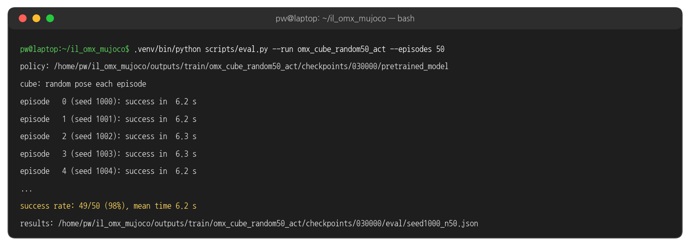
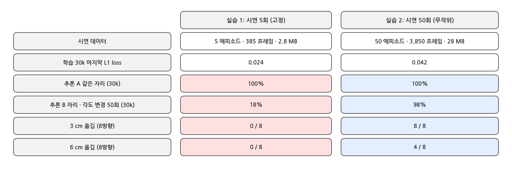
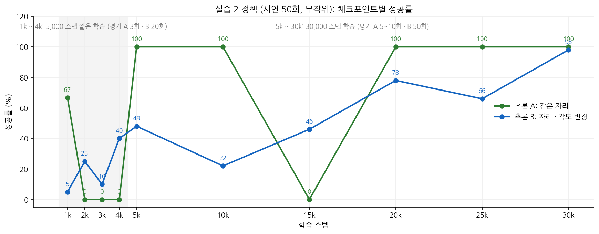
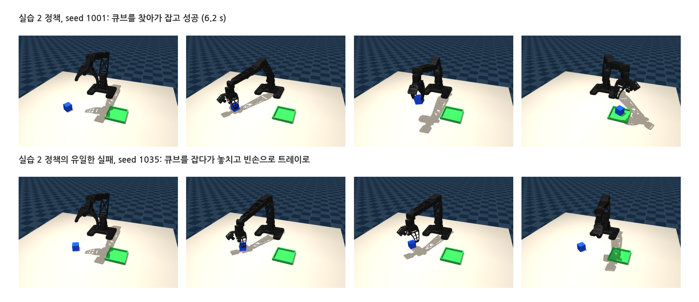

## 1. 실습 2 의 목적

### 다양한 시연 50회

{width=1000}

- 실습 1 과 같은 과제 · 같은 학습 설정 · 같은 평가입니다. 바뀌는 것은 시연뿐입니다: 큐브 자리와 각도가 매번 다른 50회 (x 17 ~ 25 cm, y -10 ~ -2 cm, ±45°).
- 이 페이지의 수치는 IK 스크립트 시연 50회(⑩)로 학습한 결과입니다.

## 2. 실행

### 터미널 1: 녹화 50회 (큐브 무작위)

```bash
cd ~/il_omx_mujoco
.venv/bin/python scripts/record.py --dataset my_random50 --num-episodes 50
```

- 한 번에 다 못 하면 창을 닫고 나중에 같은 명령으로 이어서 녹화합니다 (같은 `--dataset` 이름이면 이어 붙음).
- 스크립트로 같은 조건의 데이터를 만들려면: `.venv/bin/python scripts/scripted_pick_place.py --episodes 50 --dataset my_random50`

### 실행 결과: 스크립트 시연 50회 수집

{width=1000}

### 터미널 1: 학습

```bash
.venv/bin/python scripts/train.py --dataset my_random50
```

- 데이터가 10배지만 학습 시간은 같습니다 (30,000 스텝, 약 23 분). 스텝 수가 같고, 스텝마다 보는 순간 수(배치 8)도 같기 때문입니다.

### 터미널 2: 추론 A - 같은 자리

```bash
.venv/bin/python scripts/eval.py --run my_random50_act --fixed-cube --episodes 10 --view
```

### 실행 결과: 추론 A

{width=1000}

### 터미널 2: 추론 B - 자리 · 각도 변경

```bash
.venv/bin/python scripts/eval.py --run my_random50_act --episodes 50
```

### 실행 결과: 추론 B

{width=1000}

## 3. 결과 읽기

### 실습 1 과 나란히

{width=1000}

### 체크포인트별 성공률

{width=1000}

- 같은 자리(초록)도 처음에는 흔들립니다: 1k 67% → 2k ~ 4k 0% → 5k 부터 100% (15k 제외). 실습 1 정책이 2k 부터 계속 100% 였던 것과 대조적입니다. 다양한 데이터는 배우는 데 더 오래 걸립니다.
- 바뀐 자리(파랑)는 오르내리며 올라가 30k 에서 98% 가 됩니다 (5k 48% → 10k 22% → 15k 46% → 20k 78% → 25k 66% → 30k 98%).
- 15k 체크포인트는 같은 자리에서도 0% 였습니다. 중간 체크포인트 하나만 보고 판단하지 말고, 여러 체크포인트를 평가해 고릅니다.
- 실습 1 보다 늦게 배우는 대신, 자리가 바뀌어도 성공합니다. 30k 에서도 아직 오르는 중이라 더 학습하면 (`--resume --steps 50000`) 나아질 수 있습니다.

### 어디서 성공하고 어디서 실패하나

{width=1000}

### 조금씩 옮겨 보기

{width=1000}

- 실습 2 정책(파랑)은 4 cm 까지 8/8, 6 cm 에서 4/8 입니다. 6 cm 옆은 무작위 범위(±4 cm) 의 가장자리 밖이기도 합니다.

### 성공과 유일한 실패

{width=1000}

- seed 1001 은 실습 1 정책이 허공을 쥐었던 자리입니다. 실습 2 정책은 큐브를 찾아가 잡습니다.
- 유일한 실패(seed 1035)는 큐브를 잡다가 놓친 경우입니다. 놓친 뒤 다시 잡지 않고 빈손으로 트레이까지 갑니다. 스크립트 시연에는 '놓쳤다가 다시 잡는' 장면이 한 번도 없어서, 정책도 그 행동을 모릅니다.

## 4. 정리

### 실습 1 과 실습 2 에서 배운 것

- 단순한 데이터 (같은 자리 5회) 는 빨리 배우지만, 그 자리만 압니다.
- 다양한 데이터 (다른 자리 50회) 는 늦게 배우지만, 처음 보는 자리에서도 큐브를 보고 잡습니다.
- 정책은 시연에 있는 것만 배웁니다. 다시 잡는 행동을 원하면, 시연에 다시 잡는 장면을 넣어야 합니다. 사람이 리더로 녹화하면 실수 · 복구가 자연스럽게 들어갑니다.

### 해 볼 것

- 시연 수를 10 / 20 / 30 으로 줄여 학습하고 추론 B 성공률을 비교 (같은 데이터셋에서 앞쪽 에피소드만 쓰려면 녹화를 나눠서)
- 일부러 한 번 놓친 뒤 다시 잡는 시연을 10개 정도 섞어 학습하고, seed 1035 같은 실패가 줄어드는지 보기
- `--resume --steps 50000` 으로 더 학습한 뒤 다시 평가
