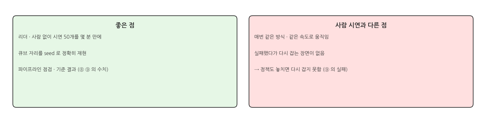
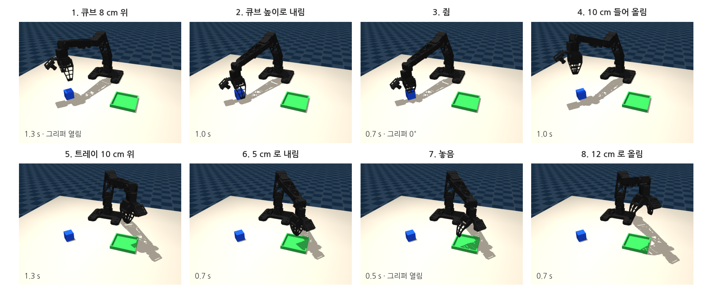
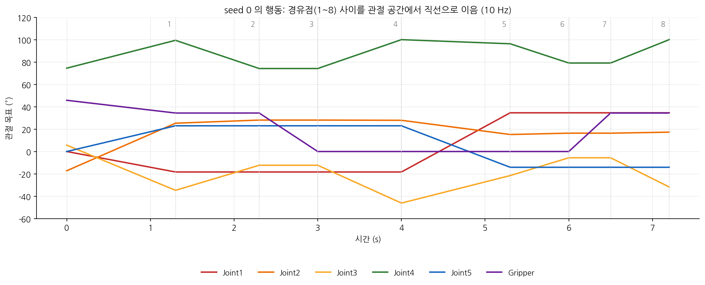
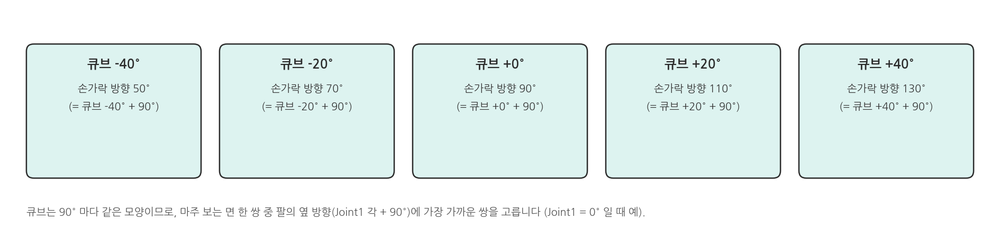
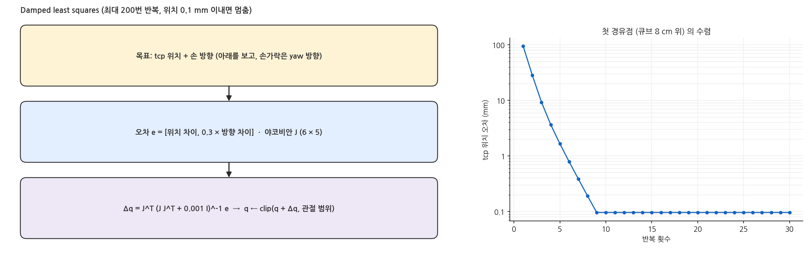
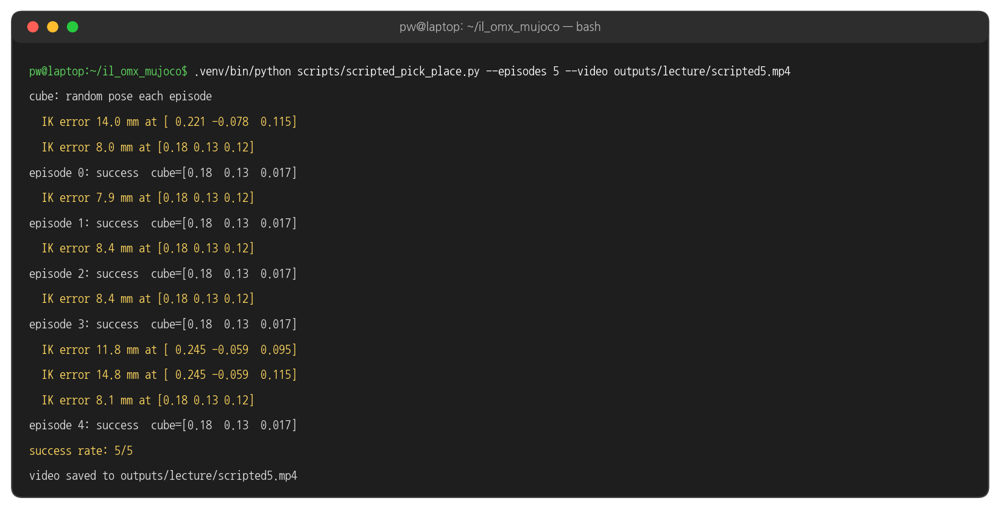
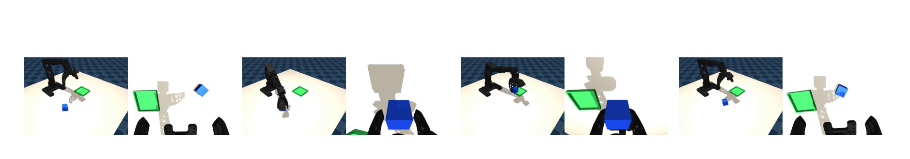
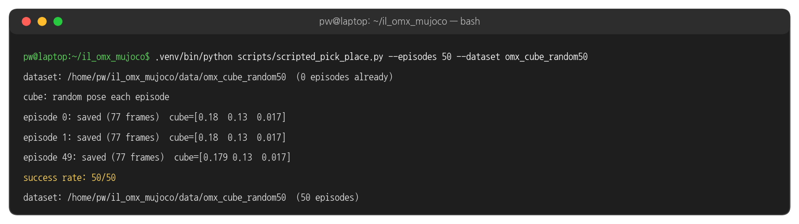

## 1. 스크립트 시연이란

### 사람 대신 IK 로 만든 시연

{width=1000}

- ⑥ ~ ⑨ 페이지의 녹화 화면 · 데이터 · 학습 결과는 모두 이 방법으로 만들었습니다 (실습 1: 고정 자리 5회, 실습 2: 무작위 50회).
- 수강생이 리더로 녹화한 시연으로 학습하면 수치는 달라집니다. 이 페이지의 결과는 비교용 기준입니다.

### 경유점 8개

{width=1000}

- 큐브 · 트레이 위치를 기준으로 tcp 의 목표 위치와 시간을 정하고, 경유점마다 IK 로 관절 각을 구합니다.
- 경유점 사이는 관절 공간에서 직선으로 이어 10 Hz 행동을 만듭니다. 끝나면 큐브가 트레이에 놓일 때까지 최대 2 s 기다리고, 녹화처럼 0.5 s 더 기록합니다.

### 경유점 사이의 행동

{width=1000}

### 잡는 방향 고르기

{width=1000}

### IK: damped least squares

{width=1000}

- OMX 는 관절이 5개라 손 방향 3개 + 위치 3개를 모두 맞출 수 없습니다. 방향 오차에 0.3 을 곱해 위치를 우선 맞춥니다.
- 높고 먼 경유점에서는 '아래를 보는' 방향을 다 맞추지 못해 위치 오차가 남습니다 (2절의 `IK error` 경고). 공중 경유점이라 잡기 · 놓기에는 영향이 없었습니다.

## 2. 실행

### 터미널 1: 동작 확인 (영상 저장)

```bash
cd ~/il_omx_mujoco
.venv/bin/python scripts/scripted_pick_place.py --episodes 5 --video outputs/scripted5.mp4
```

### 실행 결과: 5회

{width=1000}

- `IK error ... at [x y z]`: 그 경유점에서 tcp 위치를 5 mm 보다 정확히 맞추지 못했다는 경고입니다. 위치가 트레이 위 12 cm, 큐브 위 10 cm 처럼 모두 공중입니다.

### 실행 결과: 영상 (global | wrist)

{width=1000}

### 터미널 1: 데이터셋으로 저장

```bash
.venv/bin/python scripts/scripted_pick_place.py --episodes 5 --fixed-cube --dataset scripted_fixed5     # 실습 1 과 같은 조건
.venv/bin/python scripts/scripted_pick_place.py --episodes 50 --dataset scripted_random50               # 실습 2 와 같은 조건
```

### 실행 결과: 50회 수집

{width=1000}

- 성공한 에피소드만 저장합니다 (record.py 와 같은 형식 · 같은 10 Hz · 같은 카메라). 50 / 50 성공, 에피소드마다 77 프레임 (7.7 s).
- 에피소드 i 는 seed i 의 큐브 자리를 씁니다. 평가는 seed 1000 부터라 학습에 쓴 자리와 겹치지 않습니다.

## 3. 코드

### plan (1) 손가락 방향 - scripted_pick_place.py 발췌

```python
# scripts/scripted_pick_place.py (발췌)
GRIP_OPEN = 0.6      # rad (34.4°)
GRIP_CLOSED = 0.0

def plan(env, ik, cube_yaw):
    cube = env.cube_pos
    tray = env.data.xpos[env.tray_body].copy()
    yaw_c = grasp_yaw(cube_yaw, np.arctan2(cube[1], cube[0]))     # 큐브를 잡을 손가락 방향
    yaw_t = grasp_yaw(cube_yaw, np.arctan2(tray[1], tray[0]))     # 트레이에서의 손가락 방향
    ...
```

### plan (2) 경유점 8개 - scripted_pick_place.py 발췌

```python
# scripts/scripted_pick_place.py (발췌) plan() 이어서
    waypoints = [
        (cube + [0, 0, 0.08], yaw_c, GRIP_OPEN, 1.3),            # (tcp 위치, 방향, 그리퍼, 초)
        (cube + [0, 0, 0.005], yaw_c, GRIP_OPEN, 1.0),
        (cube + [0, 0, 0.005], yaw_c, GRIP_CLOSED, 0.7),
        (cube + [0, 0, 0.10], yaw_c, GRIP_CLOSED, 1.0),
        (tray + [0, 0, 0.10], yaw_t, GRIP_CLOSED, 1.3),
        (tray + [0, 0, 0.05], yaw_t, GRIP_CLOSED, 0.7),
        (tray + [0, 0, 0.05], yaw_t, GRIP_OPEN, 0.5),
        (tray + [0, 0, 0.12], yaw_t, GRIP_OPEN, 0.7),
    ]
```

### plan (3) 경유점마다 IK - scripted_pick_place.py 발췌

```python
# scripts/scripted_pick_place.py (발췌) plan() 이어서
    q = env.data.qpos[:5].copy()
    segments = []
    for pos, yaw, grip, seconds in waypoints:
        q, err = ik.solve(q, pos, top_down_rotation(yaw))          # 앞 경유점의 해에서 출발
        if err > 5e-3:
            print(f"  IK error {err * 1000:.1f} mm at {np.round(pos, 3)}")
        segments.append((q.copy(), grip, max(1, round(seconds * env.cfg.fps))))
    return segments
```

### grasp_yaw - scripted_pick_place.py 발췌

```python
def grasp_yaw(cube_yaw: float, joint1_yaw: float) -> float:
    """Pick the cube face pair whose normal is closest to the arm's sideways direction."""
    base = joint1_yaw + np.pi / 2
    k = np.round((base - cube_yaw) / (np.pi / 2))      # 90° 단위로 가장 가까운 면 쌍
    return cube_yaw + k * np.pi / 2
```

### OmxIK.solve (1) 오차 계산 - il_omx/ik.py 발췌

```python
# il_omx/ik.py (발췌)
for _ in range(iters):                                            # 최대 200
    d.qpos[:ARM_DOFS] = q
    mujoco.mj_kinematics(m, d)
    mujoco.mj_comPos(m, d)
    err[:3] = target_pos - d.site_xpos[self.site]                 # 위치 오차
    mujoco.mju_mat2Quat(cur_quat, d.site_xmat[self.site])
    mujoco.mju_subQuat(err[3:], target_quat, cur_quat)            # 방향 오차 (tcp 좌표계)
    err[3:] = rot_weight * d.site_xmat[self.site].reshape(3, 3) @ err[3:]
    if np.linalg.norm(err[:3]) < 1e-4 and np.linalg.norm(err[3:]) < 1e-3:
        break
    ...
```

### OmxIK.solve (2) 관절 갱신 - il_omx/ik.py 발췌

```python
# il_omx/ik.py (발췌) 반복 안 이어서
    mujoco.mj_jacSite(m, d, jacp, jacr, self.site)                # 야코비안
    J = np.vstack([jacp[:, :ARM_DOFS], rot_weight * jacr[:, :ARM_DOFS]])
    dq = J.T @ np.linalg.solve(J @ J.T + damping * np.eye(6), err)
    q = np.clip(q + dq, self.jnt_range[:, 0], self.jnt_range[:, 1])
```

### 해 볼 것

- `--episodes 10 --seed 1000` 으로 평가에 쓰는 자리에서도 스크립트가 모두 성공하는지 확인
- `plan()` 의 첫 경유점 시간 1.3 s 를 0.6 s 로 줄여 빠른 시연을 만들고, 학습 · 평가 결과를 비교
- 스크립트 시연 50회와 직접 녹화한 시연 50회로 각각 학습해 ⑨ 의 방법으로 비교 (사람 시연에는 다시 잡는 장면이 들어갈 수 있음)
