## 1. 실물 팔로워로

### 무엇이 바뀌나

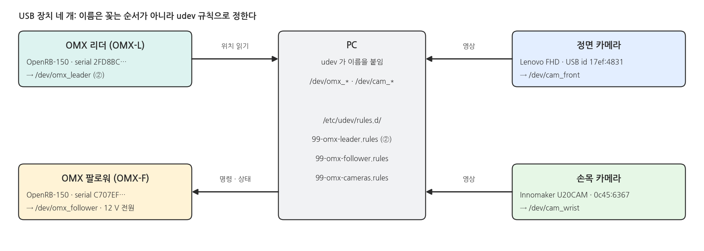{width=1000}

- ⑩ 페이지까지는 리더로 MuJoCo 팔을 움직였습니다. 이제 같은 리더로 **실물 OMX 팔로워(OMX-F)** 를 움직이고, MuJoCo 카메라 대신 **USB 카메라 두 대**(정면 · 손목)로 영상을 얻습니다.
- 장치가 네 개라 꽂는 순서에 따라 `/dev/ttyACM*`, `/dev/video*` 번호가 바뀝니다. 그래서 먼저 udev 규칙으로 이름을 고정합니다.
- 리더 규칙(`/dev/omx_leader`)은 ② 페이지에서 만들었습니다. 이 페이지에서 팔로워와 카메라 규칙을 더합니다.

### 로봇과 타겟의 배치

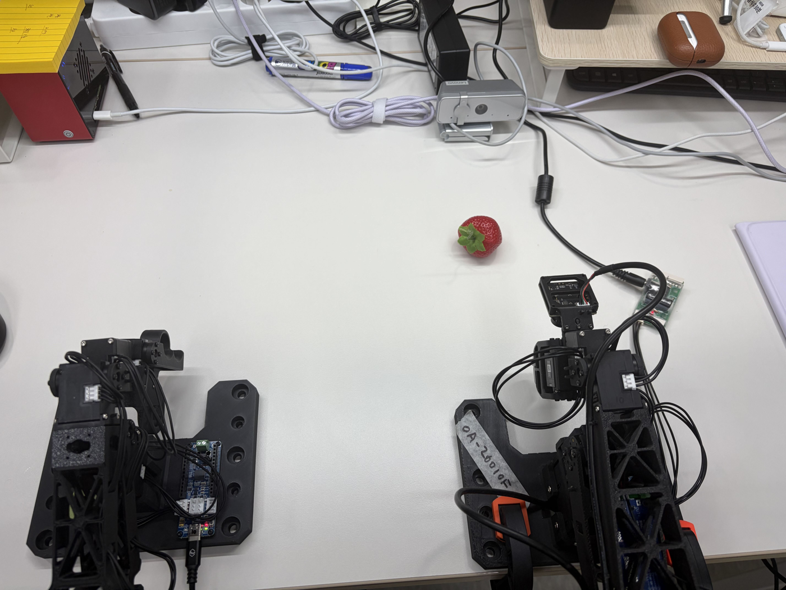{width=900}

- **왼쪽이 리더(OMX-L), 오른쪽이 팔로워(OMX-F)** 입니다. 두 팔을 같은 방향으로 나란히 두면, 리더를 움직이는 방향과 팔로워가 움직이는 방향이 같아 조작하기 쉽습니다.
- **딸기(타겟)** 는 팔로워 앞쪽, 팔이 편하게 닿는 거리에 둡니다. ⑫ 의 시연도 이 근처에서 했습니다.
- **정면 카메라(Lenovo)** 는 책상 맞은편에서 팔로워와 딸기를 마주 보게 둡니다. **손목 카메라** 는 팔로워 그리퍼 위에 달려 있습니다.
- 카메라 케이블과 팔로워 케이블은 팔이 움직이는 범위 밖으로 빼 둡니다 (5절).

### 텔레옵 한 주기

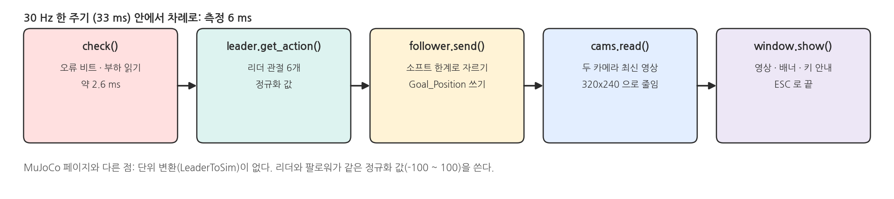{width=1000}

- 리더와 팔로워는 같은 LeRobot 정규화 값(팔 -100 ~ 100, 그리퍼 0 ~ 100)을 씁니다. ④ 페이지의 `LeaderToSim` 같은 변환 없이 리더 값을 그대로 보냅니다.
- 실물에서는 30 Hz 로 돌립니다. 한 주기에 8 ms 정도 걸렸습니다.

### 이 페이지의 순서

| 순서 | 할 일 | 스크립트 |
|---|---|---|
| 2 | 팔로워 이름 고정 | `udevadm`, `/etc/udev/rules.d/99-omx-follower.rules` |
| 3 | 카메라 이름 고정 · fps 맞추기 | `real_cameras.py`, `camera_udev_rule.py` |
| 4 | 팔로워 설정 백업 | `leader_backup_eeprom.py --name follower` |
| 5 | 텔레옵과 안전 | `real_teleop.py` |

## 2. 팔로워 포트 이름 고정 (udev)

### 순서

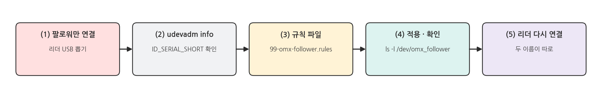{width=1000}

### (1) 팔로워만 USB에 연결

:::warning 먼저 USB를 정리하세요
- PC의 USB에서 **리더(OMX-L)를 뽑고, 팔로워(OMX-F)만** 연결합니다.
- 리더와 팔로워는 같은 보드(ROBOTIS OpenRB-150)를 써서 이름이 똑같이 보입니다. 하나만 꽂혀 있어야 지금 읽는 값이 팔로워의 값이라고 확신할 수 있습니다.
- 팔로워는 12 V 전원도 연결합니다.
:::

```bash
ls /dev/ttyACM*
PORT=$(ls /dev/ttyACM*)
udevadm info -q all -n $PORT | egrep 'DEVNAME=|ID_VENDOR=|ID_VENDOR_ID=|ID_MODEL=|ID_SERIAL_SHORT='
```

### 실행 결과: udevadm info

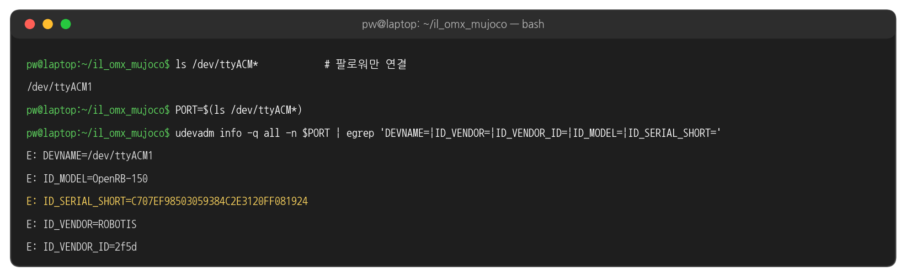{width=1000}

- `ls` 결과는 **하나만** 나와야 합니다. 번호(`ttyACM0`, `ttyACM1` …)는 상관없습니다. 위 화면에서는 리더를 뽑은 직후라 `ttyACM1` 이었습니다.
- `ID_SERIAL_SHORT` 가 팔로워 보드의 고유 번호입니다. ② 페이지에서 본 리더의 번호와 달라야 합니다.

### (2) 규칙 파일 만들기

```bash
SERIAL=$(udevadm info -q property -n $PORT | sed -n 's/^ID_SERIAL_SHORT=//p')
echo $SERIAL
printf 'SUBSYSTEM=="tty", ATTRS{idVendor}=="2f5d", ATTRS{serial}=="%s", SYMLINK+="omx_follower"\n' "$SERIAL" \
  | sudo tee /etc/udev/rules.d/99-omx-follower.rules
```

- ② 페이지의 리더 규칙과 같은 모양이고, 이름만 `omx_follower` 입니다.
- 리더 규칙 파일(`99-omx-leader.rules`)은 그대로 둡니다. 두 파일이 각자 한 줄씩 가집니다.

### (3) 적용하고 리더 다시 연결

```bash
cat /etc/udev/rules.d/99-omx-follower.rules
sudo udevadm control --reload-rules
sudo udevadm trigger
# 팔로워 USB 를 뽑았다가 다시 꽂고, 리더 USB 도 다시 꽂은 뒤
ls -l /dev/omx_*
```

### 실행 결과: 두 이름

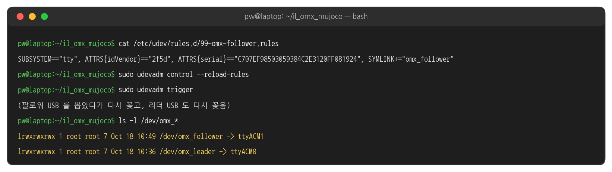{width=1000}

- 화살표가 두 개 보이면 성공입니다. 이제 어떤 순서로 꽂아도 리더는 `/dev/omx_leader`, 팔로워는 `/dev/omx_follower` 입니다.
- 이 페이지부터의 스크립트는 두 이름을 기본값으로 씁니다. 이름이 없으면 `"/dev/omx_follower not found. Plug in the follower (OMX-F) and check the udev rule (page ⑪)."` 처럼 알려 줍니다.

## 3. 카메라 이름 고정 (udev)

### 카메라는 어떻게 구분하나

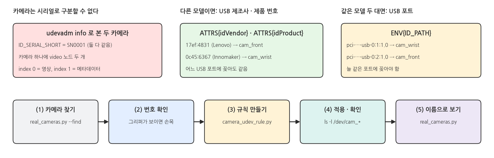{width=1000}

- 이 강의의 카메라 두 대는 시리얼이 둘 다 `SN0001` 이라 시리얼로 구분할 수 없습니다.
- 대신 **모델이 다르면** USB 제조사 · 제품 번호(`idVendor:idProduct`)로, **같은 모델 두 대면** 꽂은 USB 포트(`ID_PATH`)로 구분합니다. 스크립트가 알아서 고릅니다.
- 카메라 하나에 `/dev/video` 노드가 두 개씩 생깁니다. 영상은 `index 0` 쪽이라 규칙에 `ATTR{index}=="0"` 을 넣습니다.

### (1) 카메라 찾기

```bash
.venv/bin/python scripts/real_cameras.py --find
```

### 실행 결과: 카메라 찾기

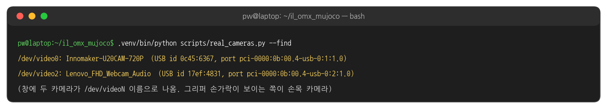{width=1000}

- 창에 두 카메라 영상이 `/dev/videoN` 이름과 함께 나옵니다. **그리퍼 손가락이 보이는 쪽이 손목 카메라**입니다.
- 위 화면에서는 `/dev/video0` 이 손목(Innomaker), `/dev/video2` 가 정면(Lenovo)이었습니다. 번호는 PC마다 다릅니다.
- 줄 끝의 `30 fps` 는 그 카메라가 기본으로 내는 초당 프레임 수입니다. 30 이 아니면 (4)에서 맞춥니다.

### (2) 규칙 만들기와 확인

```bash
.venv/bin/python scripts/camera_udev_rule.py --front /dev/video2 --wrist /dev/video0 \
  | sudo tee /etc/udev/rules.d/99-omx-cameras.rules
sudo udevadm control --reload-rules && sudo udevadm trigger
ls -l /dev/cam_*
```

### 실행 결과: 카메라 규칙

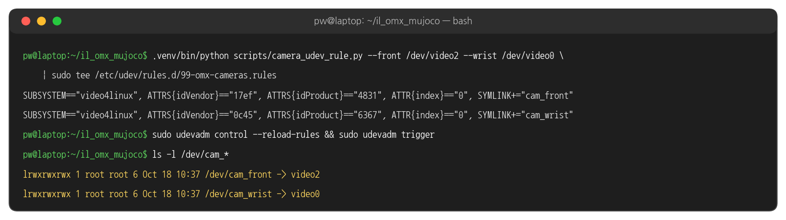{width=1000}

- `--front`, `--wrist` 에는 (1)에서 확인한 자기 PC의 번호를 넣습니다.
- 두 카메라가 같은 모델이면 경고와 함께 USB 포트 규칙이 만들어집니다. 그때는 카메라를 늘 같은 포트에 꽂아야 합니다.

### (3) 이름으로 보기

```bash
.venv/bin/python scripts/real_cameras.py
```

### 실행 결과: 이름으로 연 카메라

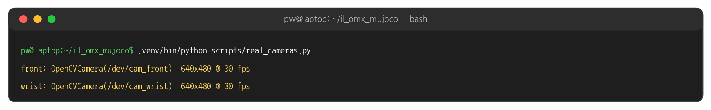{width=1000}

- 창 왼쪽이 `front`, 오른쪽이 `wrist` 입니다. 이름과 영상이 맞는지 확인합니다.
- 카메라는 640x480 으로 받아, 녹화할 때 MuJoCo 페이지와 같은 320x240 으로 줄여 씁니다.
- `cannot run at 30 fps` 가 나오면 (4)로 갑니다.

### (4) 카메라 fps 맞추기 (30 fps 가 안 될 때)

```bash
.venv/bin/python scripts/real_cameras.py --front-fps 15     # 정면 카메라만 15 fps
.venv/bin/python scripts/real_cameras.py --front-fps 0      # 카메라 기본값 그대로
.venv/bin/python scripts/real_cameras.py --wrist-fps 15     # 손목 카메라도 같은 방법
```

### 실행 결과: fps 맞추기

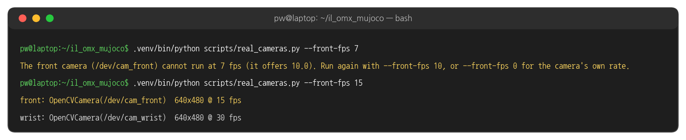{width=1000}

- 카메라마다 낼 수 있는 fps 가 다릅니다. 기본값은 두 카메라 모두 30 fps 이고, 카메라가 못 내는 값을 주면 쓸 수 있는 값을 알려 주고 끝납니다.
- 맞는 값을 찾았으면 **이후 모든 실물 스크립트에 같은 옵션을 붙입니다**: `real_teleop.py`, `real_record.py`, `real_run.py` 에 `--front-fps 15`.
- 녹화 주기(`real_record.py --fps 30`)는 그대로 둡니다. 카메라가 15 fps 면 같은 영상이 두 프레임씩 들어갈 뿐, 데이터셋은 30 fps 로 만들어집니다. 학습한 정책을 실행할 때도 녹화 때와 같은 `--front-fps` 를 씁니다.

## 4. 팔로워 설정 백업

### 터미널 1: 백업 (읽기 전용)

```bash
.venv/bin/python scripts/leader_backup_eeprom.py --port /dev/omx_follower \
  --ids 11 12 13 14 15 16 --name follower
python3 docs/lecture/compare_backups.py calibration/follower_eeprom_backup_*.json
```

### 실행 결과: 백업과 비교

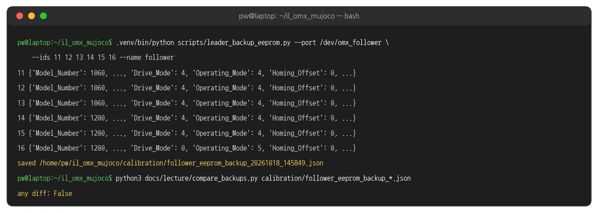{width=1000}

- 팔로워 모터는 ID 11 ~ 16 입니다. ④ 페이지에서 리더를 백업한 스크립트를 `--name follower` 로 그대로 씁니다.
- 위 화면의 비교는 처음 연결 전 백업과 하루 동안 텔레옵 · 녹화 · 정책 실행을 한 뒤의 백업입니다. EEPROM 설정이 그대로였습니다(`any diff: False`).

### 보정 파일: calibration/omx_follower.json

```javascript
{
  "shoulder_pan":  {"id": 11, "drive_mode": 4, "homing_offset": 0, "range_min": 0, "range_max": 4095},
  ...
  "wrist_roll":    {"id": 15, "drive_mode": 4, "homing_offset": 0, "range_min": 0, "range_max": 4095},
  "gripper":       {"id": 16, "drive_mode": 0, "homing_offset": 0, "range_min": 0, "range_max": 4095}
}
```

- 백업에서 읽은 값과 같게 만든 파일입니다. LeRobot 은 연결할 때 이 파일과 모터 값이 다르면 모터 설정을 다시 씁니다. 같으므로 **팔로워의 EEPROM 은 바뀌지 않습니다.**
- 여러분의 백업에서 `Drive_Mode` · `Homing_Offset` 이 위 표와 다르면, 텔레옵 전에 강사에게 알려 주세요.

## 5. 텔레옵과 안전

### 막힌 관절과 안전장치

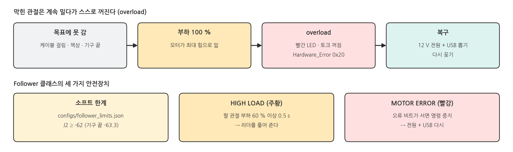{width=1000}

:::warning 텔레옵 전에 꼭 확인하세요
- **케이블**: 팔을 끝까지 뻗고 베이스를 돌려도 모터 케이블 · 카메라 케이블이 걸리거나 당기지 않는지 확인합니다.
- **천천히**: 리더는 천천히 움직입니다. 팔로워가 따라오지 못하는 자세(책상 아래, 기구 끝 너머)로 리더를 밀지 않습니다.
- **주황 HIGH LOAD**: 관절이 세게 밀고 있습니다. 리더를 바로 풀어 줍니다.
- **빨강 MOTOR ERROR / 모터의 빨간 LED**: 모터가 스스로 꺼졌습니다. ESC 로 끝내고, **팔로워의 12 V 전원과 USB 를 모두 뽑았다가 다시 꽂습니다.**
:::

### 실제로 있었던 일

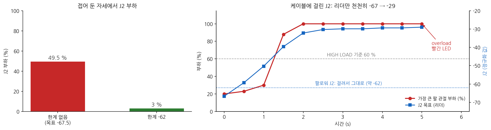{width=1000}

- 왼쪽: 리더를 접으면 J2 가 -67.5 까지 가지만, 팔로워는 -63.3 에서 기구 끝에 닿습니다. 그 상태로 49.5 % 힘으로 계속 밀었습니다. J2 를 -62 까지만 보내도록 소프트 한계를 둔 뒤에는 3 % 였습니다.
- 오른쪽: 케이블이 J2 에 걸린 채 리더를 천천히 세웠습니다. 팔로워 J2 는 움직이지 못하고 부하가 4초 동안 100 % 였고, overload 로 꺼졌습니다. 케이블을 정리한 뒤에는 같은 동작에서 부하가 41 % 를 넘지 않았습니다.

### 리더 잡는 법

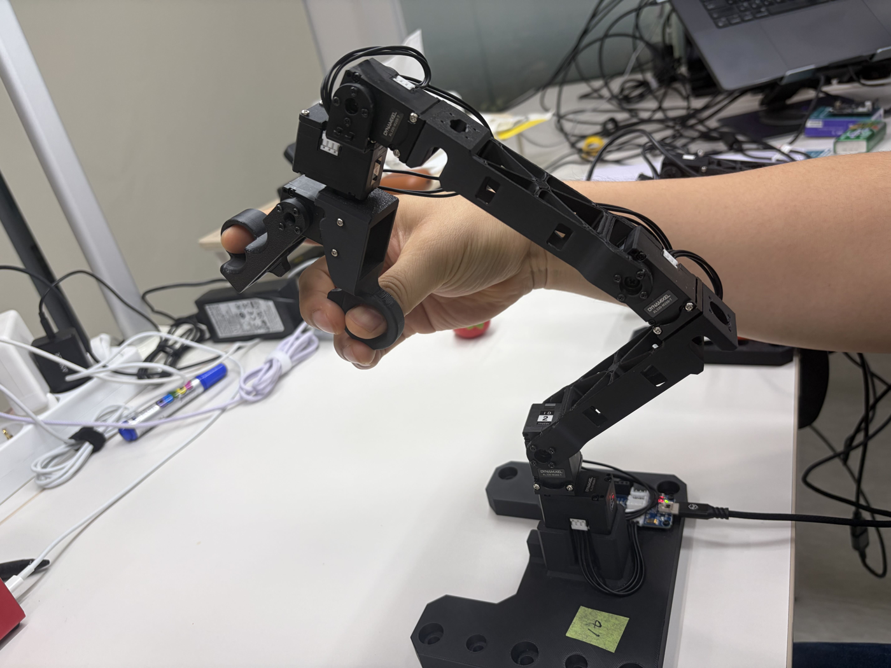{width=800}

- 리더의 손목 부분(그리퍼 트리거가 달린 손잡이)을 손으로 감싸 쥡니다. 팔 전체는 이 손잡이를 따라 움직입니다.
- 트리거의 고리에 손가락을 넣어 그리퍼를 열고 닫습니다. 팔은 손목을 옮기는 것만으로 움직이고, 관절을 하나씩 비틀지 않습니다.
- 처음에는 팔로워를 보면서 천천히 움직여, 리더와 팔로워의 움직임이 같다는 것을 손에 익힙니다.

### 터미널 1: 텔레옵

```bash
.venv/bin/python scripts/real_teleop.py
.venv/bin/python scripts/real_teleop.py --log teleop.csv     # 프레임마다 값 기록
```

- 처음 3초는 팔로워가 리더 자세로 천천히 따라옵니다. 그동안 리더를 쉬는 자세로 가만히 듭니다.
- 끝낼 때는 리더를 쉬는 자세로 되돌린 뒤 ESC 를 누릅니다. 팔로워의 토크가 꺼지면서 팔이 내려앉습니다.

### 실행 결과: 터미널

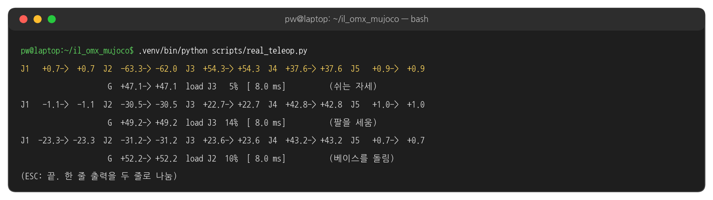{width=1000}

- `J2 -63.3-> -62.0` : 리더는 -63.3 이지만 소프트 한계 때문에 -62.0 을 보냈습니다. 나머지 관절은 리더 값 그대로입니다.
- `load J3 14%` : 팔 관절 다섯 개 중 가장 큰 부하입니다. 케이블을 정리한 뒤 평소 조작에서는 최대 41 % 였습니다.

### 실행 결과: 과부하일 때

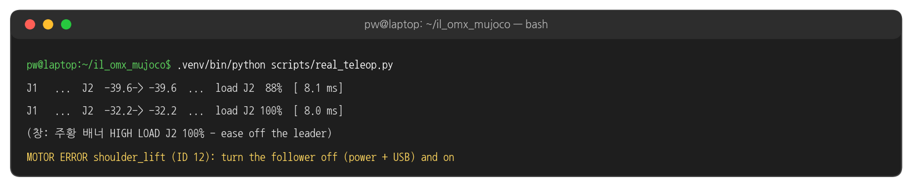{width=1000}

| 배너 | 뜻 | 할 일 |
|---|---|---|
| 회색 `MOVING TO LEADER POSE ...` | 시작 3초 | 리더를 가만히 |
| 주황 `HIGH LOAD J2 100% - ease off the leader` | 0.5 초 넘게 60 % 이상 | 리더를 풀어 줌 |
| 빨강 `MOTOR ERROR ... (ID 12)` | 모터가 꺼짐, 명령 중지 | ESC → 전원 + USB 다시 |
| 빨강 `CAMERA LOST wrist` | 카메라 USB 가 끊김 | 케이블 확인, 다시 잡히면 자동 연결 |

## 6. 코드와 설정

### Follower.send - il_omx/real.py 발췌

```python
# il_omx/real.py (발췌)
class Follower:
    def send(self, target) -> np.ndarray:
        """Send a 6-vector or a leader action dict; returns the clipped target actually sent."""
        if isinstance(target, dict):
            target = to_vector(target)
        target = np.clip(target, self.low, self.high)        # configs/follower_limits.json
        self.robot.send_action(to_action(target))
        return target
```

### configs/follower_limits.json

```javascript
{
  "_comment": "...",
  "shoulder_lift": {"min": -62.0}
}
```

- 적혀 있지 않은 관절은 한계가 없습니다. 자기 팔로워가 접힌 자세에서 HIGH LOAD 를 보이면, `--log` 로 그 관절의 위치를 보고 여기에 한계를 더합니다.

### Follower.check (1) 오류 비트 - il_omx/real.py 발췌

```python
# il_omx/real.py (발췌) class Follower 이어서
    def check(self):
        """(error, warning) texts for the window. An error means a servo shut down (red LED)."""
        errors = [m for m, v in self.bus.sync_read("Hardware_Error_Status", normalize=False).items() if v]
        if errors:
            ids = ", ".join(f"{m} (ID {self.bus.motors[m].id})" for m in errors)
            return f"MOTOR ERROR {ids}: turn the follower off (power + USB) and on", None
```

### Follower.check (2) 부하 - il_omx/real.py 발췌

```python
# il_omx/real.py (발췌) check() 이어서
        raw = self.bus.sync_read("Present_Current", normalize=False)
        for i, m in enumerate(MOTORS[:-1]):      # 그리퍼는 일부러 꽉 쥐므로 제외
            # XL430: 0.1 % 단위 부하. XL330: mA, 전류 한계 1750 mA 기준
            self.load[i] = abs(raw[m]) / (10 if self.bus.motors[m].model.startswith("xl430") else 17.5)
            if self.load[i] < HIGH_LOAD_PCT:                        # 60 %
                self._high_since.pop(m, None)
            elif now - self._high_since.setdefault(m, now) > HIGH_LOAD_S:   # 0.5 s
                warning = f"HIGH LOAD J{i + 1} {self.load[i]:.0f}% - ease off the leader"
```

### 텔레옵 루프 - real_teleop.py 발췌

```python
# scripts/real_teleop.py (발췌)
follower.glide(to_vector(leader.get_action()), args.start_s, args.fps, on_step=show_start)
while window.is_running() and ESCAPE_KEY not in window.poll_keys():
    if error is None:
        error, warning = follower.check()
    if error is not None:                  # 모터가 꺼짐: 더 보내지 않고 안내만
        ...
        continue
    sent = follower.send(leader.get_action())
    window.show(cams.read(), ...)
```

### Cameras - il_omx/real.py 발췌

```python
# il_omx/real.py (발췌)
CAMERA_PATHS = {"front": "/dev/cam_front", "wrist": "/dev/cam_wrist"}
CAPTURE_WIDTH, CAPTURE_HEIGHT, CAPTURE_FPS = 640, 480, 30

class Cameras:
    def read(self) -> dict:
        """Newest RGB frame of each camera at the dataset size (black while a camera is lost)."""
        ...  # cv2.resize(cam.read_latest(), (320, 240), interpolation=cv2.INTER_AREA)
```

- 녹화 중 팔을 뻗다가 손목 카메라 USB 가 1초쯤 끊긴 적이 있었습니다. 그 뒤로는 끊긴 카메라를 검은 화면으로 두고 `CAMERA LOST` 를 띄운 뒤, 장치가 다시 나타나면 2초 간격으로 다시 연결합니다.

### 해 볼 것

- `real_teleop.py --log teleop.csv` 로 1분 조작한 뒤, CSV 에서 관절별 `load_*` 의 최댓값과 `sent_*` - `pos_*` 차이가 가장 큰 관절 찾기
- 리더를 접은 자세에서 J2 의 `leader` 와 `pos` 값을 비교해, 자기 팔로워의 기구 끝 위치 확인하기
- 베이스를 끝까지 돌리고 팔을 끝까지 뻗은 자세에서 케이블 여유를 확인하고, 필요하면 케이블 정리하기
