## 1. 실물로 모방학습

### 전체 흐름

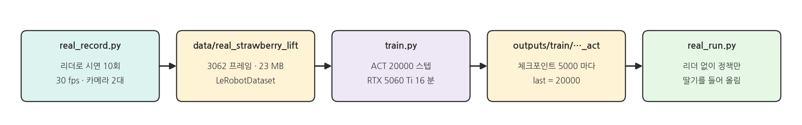{width=1000}

- ⑥ ~ ⑦ 페이지에서 MuJoCo 로 한 녹화 · 학습을 실물 팔로워로 그대로 합니다. 다른 점은 로봇과 카메라가 실물이라는 것뿐이고, 데이터셋 형식(LeRobotDataset)과 학습 스크립트(`train.py`)는 같습니다.
- 과제: **딸기를 집어 들어 올리기** (`"Pick up the strawberry and lift it."`). 시연 10회, ACT 20000 스텝.

### 성공 장면

{width=900}

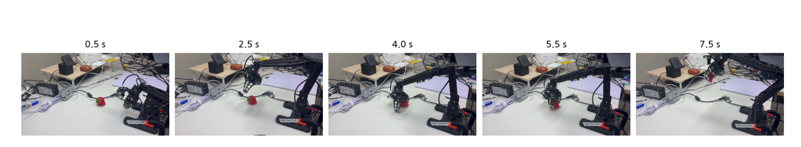{width=1000}

- 리더는 쓰지 않습니다. 정책이 두 카메라 영상과 관절 위치만 보고 팔로워를 움직였습니다.

### MuJoCo 페이지와 다른 점

| 항목 | MuJoCo (⑥ ~ ⑨) | 실물 (이 페이지) |
|---|---|---|
| 로봇 | MuJoCo 팔 | OMX 팔로워 (`/dev/omx_follower`) |
| 카메라 | 장면 안의 global · wrist | USB front · wrist (`/dev/cam_*`) |
| 주기 | 10 Hz | 30 Hz |
| ACT chunk | 2 s = 20 스텝 | 2 s = 60 스텝 |
| 값 | 라디안 | LeRobot 정규화 값 (리더와 같음) |
| 성공 판정 | 자동 (`is_success`) | 사람이 보고 판단 |

## 2. 실행: 녹화

### 녹화 전에

:::warning ⑪ 페이지의 안전 수칙을 그대로 지킵니다
- 케이블 여유를 확인하고, 리더는 천천히 움직입니다.
- 주황 HIGH LOAD 는 리더를 풀고, 빨강 MOTOR ERROR 는 팔로워의 전원 + USB 를 다시 꽂습니다.
- 빨강 CAMERA LOST 가 뜨면 그 시연은 버려집니다. 카메라 케이블을 확인하면 자동으로 다시 연결됩니다.
:::

### 시연을 일정하게

- 매번 같은 순서로 합니다: **쉬는 자세 → 딸기 위로 → 그리퍼 열고 내려가기 → 집기 → 들어 올려 1 ~ 2초 멈춤.**
- 딸기는 정면 카메라 가운데 앞쪽에 놓고, 시연마다 몇 cm 씩만 옮깁니다.
- 매번 쉬는 자세에서 ENTER 로 시작합니다. 시작 자세가 비슷해야 정책이 시작 자세에서 출발하기 쉽습니다.

### 터미널 1: real_record

```bash
cd ~/il_omx_mujoco
.venv/bin/python scripts/real_record.py                    # data/real_strawberry_lift 에 10 회
.venv/bin/python scripts/real_record.py --front-fps 15     # ⑪ (4)에서 정면 카메라 fps 를 바꾼 경우
```

| 키 | 녹화 중이 아닐 때 | 녹화 중 |
|---|---|---|
| ENTER | 녹화 시작 | 저장 |
| BACKSPACE | 이번에 저장한 마지막 시연 지우기 | 이 시연 버리기 |
| ESC | 끝 (쉬는 자세에서) | 끝 (이 시연은 버림) |

### 실행 결과: 녹화

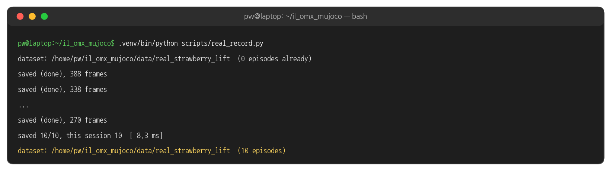{width=1000}

- 10회를 버린 것 없이 저장했습니다. 한 번에 8.0 ~ 13.7 초였습니다.
- 같은 `--dataset` 으로 다시 실행하면 이어서 녹화합니다. 창 오른쪽 위에 `real_strawberry_lift  3 / 10` 처럼 진행이 보입니다.

### 한 시연의 두 카메라

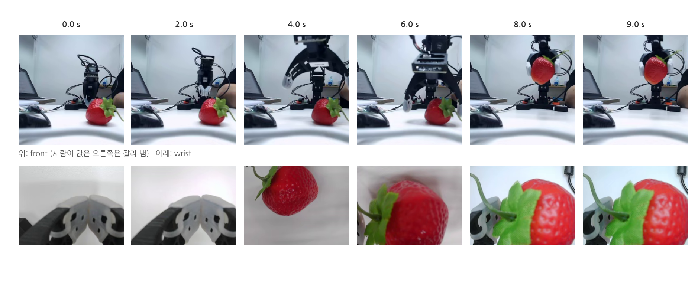{width=1000}

- 정면 카메라는 딸기와 팔 전체의 위치를, 손목 카메라는 그리퍼와 딸기의 거리를 보여 줍니다. 집는 순간(4 ~ 6 s)에는 손목 카메라가 딸기로 가득 찹니다.

## 3. 데이터 들여다보기

### 터미널 1: inspect_dataset.py

```bash
.venv/bin/python docs/lecture/inspect_dataset.py real_strawberry_lift
```

### 실행 결과: 데이터셋

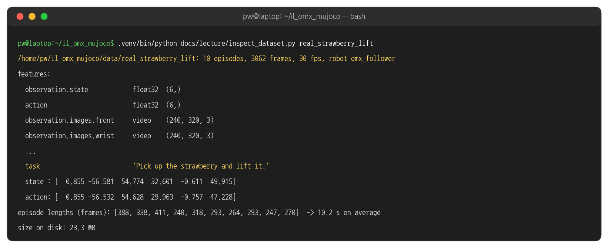{width=1000}

- ⑥ 페이지와 같은 형식입니다. 카메라 이름이 `front` · `wrist`, 로봇이 `omx_follower` 로 바뀌었습니다.
- 첫 프레임의 `state` (팔로워 위치) 와 `action` (리더 값) 이 조금 다릅니다. action 은 "이 순간 팔로워에 보낸 목표", state 는 "이 순간 팔로워가 있는 곳" 입니다.

### 시연 길이

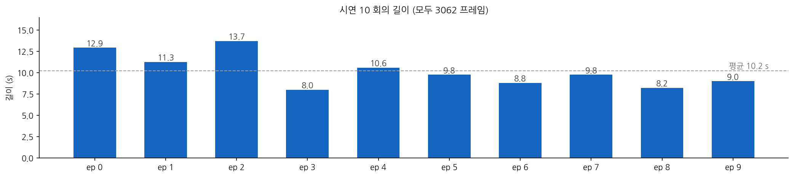{width=1000}

### 관절 궤적

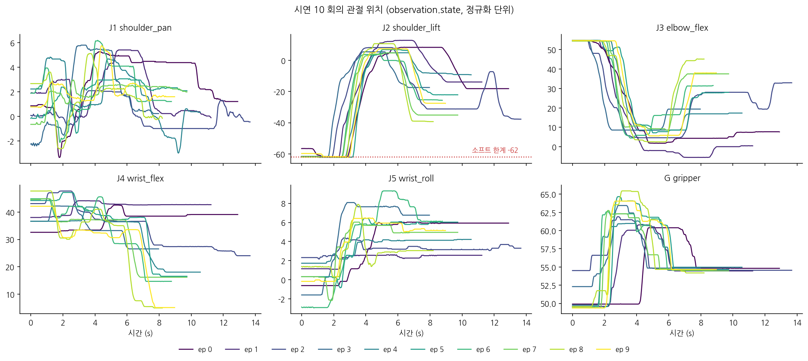{width=1000}

### 터미널 1: 내 데이터셋 그래프

```bash
.venv/bin/pip install matplotlib                                    # 처음 한 번
.venv/bin/python scripts/plot_dataset.py --dataset real_strawberry_lift
.venv/bin/python scripts/plot_dataset.py --dataset real_strawberry_lift --signal action
```

- 로봇 · 카메라 없이, 녹화한 데이터셋만으로 위와 같은 그래프를 그립니다. `outputs/plots/` 에 `<데이터셋>_joints.png` (관절 궤적) 와 `<데이터셋>_lengths.png` (시연 길이) 를 저장합니다.
- `--signal action` 은 팔로워 위치 대신 리더가 보낸 목표를 그립니다. MuJoCo 데이터셋(`my_fixed5` 등)도 같은 명령으로 볼 수 있습니다.

### 실행 결과: 내 데이터셋 그래프

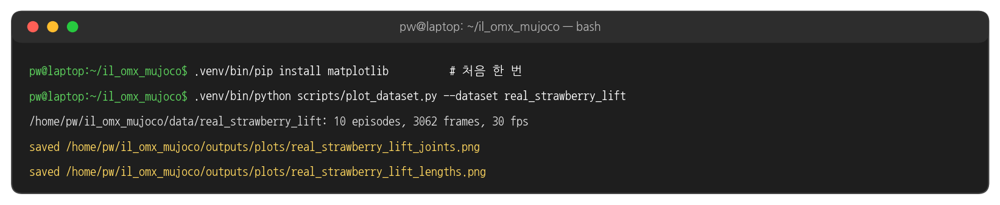{width=1000}

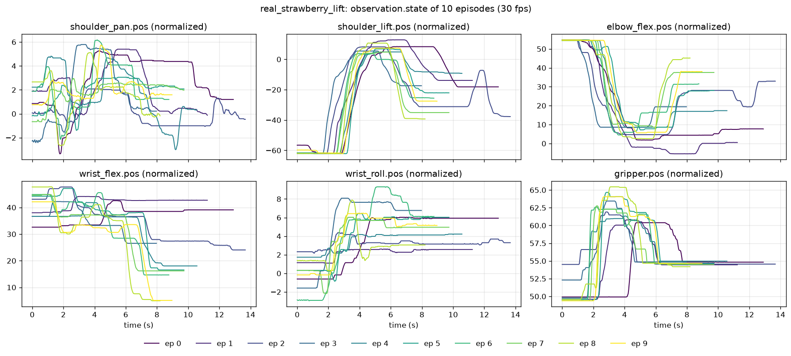{width=1000}

## 4. 실행: 학습

### 터미널 1: train

```bash
.venv/bin/python scripts/train.py --dataset real_strawberry_lift --steps 20000 --save-freq 5000
```

- ⑦ 페이지의 `train.py` 그대로입니다. fps 30 을 데이터셋에서 읽어 ACT chunk 2 초를 60 스텝으로 바꿉니다.
- 결과는 `outputs/train/real_strawberry_lift_act` 에 저장됩니다.

### 실행 결과: 학습

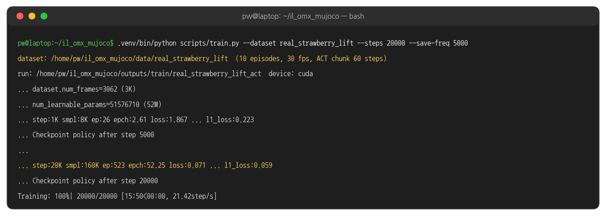{width=1000}

- RTX 5060 Ti 에서 초당 21.4 스텝, 15분 50초 걸렸습니다. GPU 메모리는 1.4 GB 였습니다.
- 3062 프레임을 배치 8 로 20000 번 → 시연 전체를 52 번(epoch) 본 셈입니다.

### loss 곡선

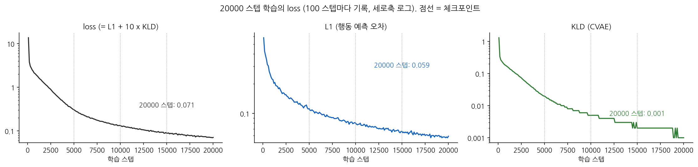{width=1000}

- **L1**: 예측한 행동과 시연 행동의 차이(정규화 단위)입니다. 0.58 에서 0.059 까지 내려갔습니다.
- **KLD**: ACT 의 CVAE 부분입니다. 금방 0.001 근처로 줄어듭니다. 로그에 소수 셋째 자리까지만 찍혀 계단처럼 보입니다.
- 20000 스텝까지 L1 이 조금씩 계속 내려갔습니다.

### 모델이 배운 것 (로봇 없이 확인)

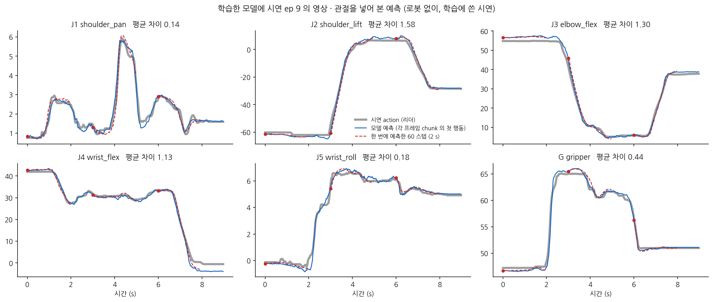{width=1000}

- 학습한 모델에 시연 ep 9 의 영상 · 관절을 한 프레임씩 넣고, 그때 예측한 행동을 시연의 실제 행동과 겹쳐 그렸습니다.
- 파란 선(각 프레임 chunk 의 첫 행동)이 회색 선(시연)을 잘 따라갑니다. 평균 차이는 J2 1.6, J3 1.3 (약 2 ~ 3°) 정도입니다.
- 빨간 점선은 0 · 3 · 6 초에 **한 번에** 예측한 60 스텝(2 초)입니다. 앞으로 2 초 동안 할 행동을 한꺼번에 내놓는 것이 ACT 의 action chunking 입니다.
- 학습에 쓴 시연이라 잘 맞는 것은 당연합니다. 실제 실력은 로봇에서 확인합니다.

## 5. 실행: 정책

### 정책 실행 흐름

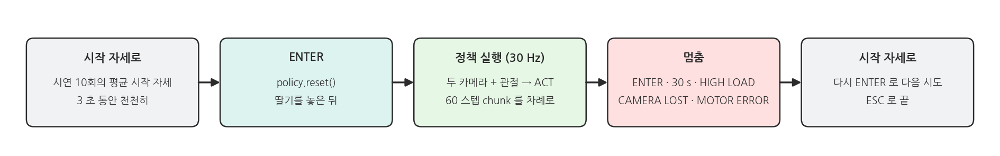{width=1000}

### 터미널 1: real_run

```bash
.venv/bin/python scripts/real_run.py                # outputs/train/real_strawberry_lift_act 의 마지막 체크포인트
.venv/bin/python scripts/real_run.py --max-step 5   # 한 번에 움직이는 양을 더 줄여 천천히
```

- 녹화 때 `--front-fps` 를 썼다면 여기에도 같은 값을 붙입니다 (`real_run.py --front-fps 15`).
- 리더는 필요 없습니다. 시작하면 팔로워가 시연 10회의 평균 시작 자세로 3초 동안 천천히 갑니다.
- 딸기를 놓고 ENTER 로 시작, 다시 ENTER 로 멈춥니다. 정책 실행 중에는 팔로워 전원 가까이에 손을 둡니다.

### 실행 결과: 정책

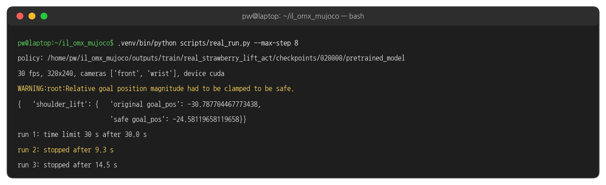{width=1000}

- `run 2` (9.3 s) 에서 딸기를 집어 들어 올린 뒤 ENTER 로 멈췄습니다. 위의 성공 장면이 이런 시도입니다.
- `run 1` 은 30초 제한(`--max-s 30`)에 걸려 스스로 멈췄습니다.
- `had to be clamped` 는 정책의 목표가 현재 위치에서 8 단위(약 14°) 넘게 떨어져 LeRobot 이 잘라 보냈다는 뜻입니다. 이번 실행에서는 6 번뿐이었습니다. 팔을 들 때 J2 가 중력 때문에 목표보다 조금 늦게 따라와서 생깁니다.

| 배너 | 뜻 |
|---|---|
| 회색 `MOVING TO START POSE ...` | 시작 자세로 가는 중 |
| 초록 `POLICY  run 2   9.3 s` | 정책 실행 중 |
| 주황 HIGH LOAD → 자동 멈춤 | 책상 · 딸기를 세게 누름 |
| 빨강 MOTOR ERROR · CAMERA LOST | 멈춤. ⑪ 페이지와 같이 처리 |

## 6. 코드와 설정

### 녹화 루프 (1) 한 프레임 - real_record.py 발췌

```python
# scripts/real_record.py (발췌)
state = follower.state()                      # 팔로워 위치 (observation.state)
images = cams.read()                          # front · wrist 320x240
lost = cams.lost_text()
if lost and recording:                        # 카메라가 끊기면 이 시연은 버림
    recording = False
    recorder.discard()
sent = follower.send(leader.get_action())     # 소프트 한계로 자른 리더 값 (action)
if recording:
    recorder.add({"state": state, **images}, sent)
```

### 녹화 루프 (2) 데이터셋 - real_record.py 발췌

```python
# scripts/real_record.py (발췌)
p.add_argument("--dataset", default="real_strawberry_lift")
p.add_argument("--task", default="Pick up the strawberry and lift it.")
p.add_argument("--fps", type=int, default=30)
...
recorder = EpisodeRecorder(args.dataset, args.fps, args.image_height, args.image_width,
                           joint_names=[f"{m}.pos" for m in MOTORS], cameras=REAL_CAMERAS,
                           robot_type=ROBOT_TYPE, task=args.task)
```

- `EpisodeRecorder` 는 ⑥ 페이지의 MuJoCo 녹화와 같은 클래스입니다. 관절 이름 · 카메라 · 로봇 종류 · 과제 문장만 바꿔 넘깁니다.

### 정책 불러오기 - real_run.py 발췌

```python
# scripts/real_run.py (발췌)
policy = ACTPolicy.from_pretrained(path)
policy.to(device).eval()
pre, post = make_pre_post_processors(policy.config, pretrained_path=str(path), ...)

def act(state: np.ndarray, images: dict) -> np.ndarray:
    frame = {"observation.state": state, **{f"observation.images.{c}": images[c] for c in cameras}}
    action = predict_action(frame, policy, torch.device(device), pre, post, use_amp=False, task=TASK)
    return action.squeeze(0).cpu().numpy()
```

- `predict_action` 은 chunk 60 스텝을 한 번 예측해 두고, 부를 때마다 하나씩 꺼내 줍니다. 60 번을 다 쓰면 그때의 영상 · 관절로 다시 예측합니다.

### 정책 루프 - real_run.py 발췌

```python
# scripts/real_run.py (발췌)
if any(k in ENTER_KEYS for k in keys):
    if running:
        stop = "stopped"
    elif not lost:
        policy.reset()                                    # 이전 시도의 chunk 를 버림
        running, run_start, runs = True, t0, runs + 1
...
if running:
    follower.send(act(follower.state(), images))          # max_step 으로 한 번에 움직이는 양 제한
```

### 시작 자세 - real_run.py 발췌

```python
# scripts/real_run.py (발췌) dataset_settings()
data = pd.concat(pd.read_parquet(f, columns=["frame_index", "observation.state"])
                 for f in sorted((root / "data").glob("*/*.parquet")))
start = np.stack(data[data.frame_index == 0]["observation.state"]).mean(axis=0)
```

- 학습한 데이터셋의 각 시연 첫 프레임 위치를 평균 낸 자세입니다. 정책이 본 적 있는 자세에서 출발하게 합니다.

### 해 볼 것

- 딸기를 시연 때보다 5 cm, 10 cm 옆에 놓고 정책을 실행해 어디까지 집는지 보기 (J1 이 거의 움직이지 않은 시연이라는 것을 떠올리며)
- `--policy outputs/train/real_strawberry_lift_act/checkpoints/005000/pretrained_model` 로 5000 스텝 체크포인트를 실행해 20000 스텝과 비교하기
- 딸기를 다른 물체로 바꾸거나 딸기 위치를 넓게 바꾸며 10회를 더 녹화해(같은 `--dataset` 으로 이어서) 다시 학습해 보기
