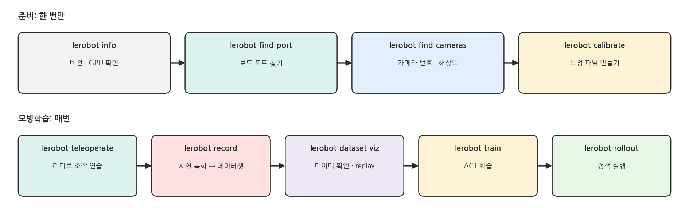
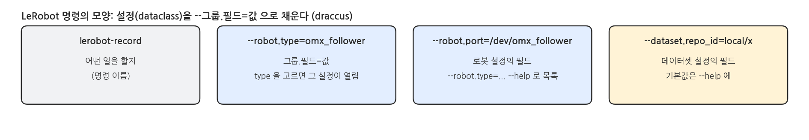

## 1. 수업 코드 밑의 LeRobot

### 왜 이 페이지

- 이 강의의 스크립트(`real_teleop.py`, `real_record.py`, `train.py` …)는 모두 **LeRobot 0.6.1** 위에서 돕니다. 수업용으로 안전장치 · 화면 · 기본값을 덧씌웠을 뿐, 로봇 연결 · 데이터셋 · 학습 · 정책은 LeRobot 의 것입니다.
- 수업 코드만 따라가면 LeRobot 자체의 사용법을 놓치기 쉽습니다. 이 페이지는 **수업 스크립트가 부르는 LeRobot 명령과 함수**를 단계별로 풀어 씁니다.
- 다른 로봇 · 다른 과제로 넘어갈 때는 수업 스크립트 대신 여기의 LeRobot 명령으로 시작하면 됩니다.

### 전체 단계

{width=1000}

### 수업 스크립트와 LeRobot

| 단계 | 수업 스크립트 | LeRobot 명령 | LeRobot 코드 (수업 스크립트 안) |
|---|---|---|---|
| 포트 · 카메라 | udev 규칙 (②, ⑪), `real_cameras.py --find` | `lerobot-find-port`, `lerobot-find-cameras` | `OpenCVCamera` |
| 보정 | `calibration/*.json` 을 저장소에 둠 | `lerobot-calibrate` | `OmxLeader`, `OmxFollower` 의 `connect()` |
| 텔레옵 | `real_teleop.py` | `lerobot-teleoperate` | `leader.get_action()` → `follower.send_action()` |
| 녹화 | `real_record.py` | `lerobot-record` | `LeRobotDataset.create` · `add_frame` · `save_episode` |
| 데이터 확인 | `inspect_dataset.py`, `plot_dataset.py` | `lerobot-dataset-viz`, `lerobot-replay`, `lerobot-edit-dataset` | `LeRobotDataset` |
| 학습 | `train.py` | `lerobot-train` | (`train.py` 가 `lerobot-train` 을 그대로 실행) |
| 정책 실행 | `real_run.py` | `lerobot-rollout` | `ACTPolicy`, `predict_action` |

### LeRobot 명령의 모양

{width=1000}

```bash
lerobot-record --help                              # 모든 옵션과 기본값
lerobot-record --robot.type=omx_follower --help    # omx_follower 를 고르면 그 로봇의 옵션이 더 나옴
```

- 명령마다 설정 묶음(dataclass)이 있고, 옵션은 `--그룹.필드=값` 입니다. 예: `--robot.port`, `--dataset.num_episodes`.
- `--robot.type`, `--teleop.type`, `--policy.type` 처럼 **type 을 고르면** 그 종류의 필드가 생깁니다. OMX 는 `omx_follower` (로봇), `omx_leader` (텔레오퍼레이터) 입니다.
- 값에 공백이나 `{ }` 가 있으면 따옴표로 감쌉니다 (카메라 설정, 과제 문장).

## 2. 설치와 기본 위치

### 설치

```bash
.venv/bin/pip install 'lerobot[dynamixel,dataset,training]==0.6.1'   # 수업 설치 (pyproject.toml)
.venv/bin/pip install 'lerobot[hardware,viz]==0.6.1'                 # LeRobot 명령을 그대로 쓸 때 더
.venv/bin/lerobot-info
```

- 수업 설치에는 Dynamixel · 데이터셋 · 학습만 들어 있습니다. `lerobot-record` 의 키 입력(pynput), `--display_data` 와 `lerobot-dataset-viz` 의 화면(rerun)은 `hardware`, `viz` 를 더 깔아야 합니다.
- 이 강의의 LeRobot 버전은 **0.6.1** 로 고정입니다. 버전마다 명령 이름과 옵션이 바뀌니 다른 버전의 문서를 볼 때는 버전을 확인합니다.

### 실행 결과: lerobot-info

```bash
- LeRobot version: 0.6.1
- Python version: 3.12.3
- PyTorch version: 2.11.0+cu130
- Is PyTorch built with CUDA support?: True
- GPU model: NVIDIA GeForce RTX 5060 Ti
- lerobot scripts: ['lerobot-annotate', 'lerobot-calibrate', ..., 'lerobot-train', ...]
```

### LeRobot 이 파일을 두는 곳

| 무엇 | LeRobot 기본 위치 | 수업 스크립트 |
|---|---|---|
| 보정 파일 | `~/.cache/huggingface/lerobot/calibration/robots/omx_follower/<id>.json` | `calibration/omx_follower.json` (`--robot.calibration_dir`) |
| 데이터셋 | `~/.cache/huggingface/lerobot/<repo_id>` | `data/<이름>` (`--dataset.root`) |
| 학습 결과 | `outputs/train/<날짜>/<시각>_<job_name>` | `outputs/train/<이름>_act` (`--output_dir`) |

- 데이터셋과 정책은 기본으로 **Hugging Face Hub 에 올라갑니다** (`push_to_hub=true`). 내 PC 에만 두려면 `--dataset.push_to_hub=false`, `--policy.push_to_hub=false` 를 붙입니다.
- `repo_id` 는 `사용자/이름` 모양입니다. Hub 에 안 올릴 때는 `local/이름` 처럼 아무 이름이나 씁니다.

## 3. 준비: 포트 · 카메라 · 보정

### 보드 포트 찾기

```bash
lerobot-find-port
```

- 실행하면 지금 있는 포트를 기억한 뒤 "USB 를 뽑고 Enter" 를 기다립니다. 뽑은 뒤 사라진 포트가 그 보드의 포트입니다.
- 꽂는 순서에 따라 `/dev/ttyACM0` 이 바뀌므로, 매번 쓸 거라면 ② · ⑪ 페이지의 udev 규칙(`/dev/omx_leader`, `/dev/omx_follower`)이 편합니다. LeRobot 명령에도 그 이름을 그대로 넣으면 됩니다.

### 카메라 찾기

```bash
lerobot-find-cameras opencv
ls outputs/captured_images
```

- 연결된 카메라를 모두 열어 번호(또는 경로) · 해상도 · fps 를 출력하고, 한 장씩 찍어 `outputs/captured_images/` 에 저장합니다. 사진을 보고 어느 것이 손목 카메라인지 고릅니다.
- LeRobot 카메라 설정에는 번호(`0`) 대신 경로(`/dev/cam_wrist`)도 넣을 수 있습니다. ⑪ 의 udev 이름을 쓰면 번호가 바뀌어도 그대로입니다.

### 보정 (calibrate)

```bash
lerobot-calibrate --robot.type=omx_follower --robot.port=/dev/omx_follower --robot.id=my_follower
lerobot-calibrate --teleop.type=omx_leader --teleop.port=/dev/omx_leader --teleop.id=my_leader
```

- 보정 파일은 **모터의 0 점 · 범위 · 방향** 을 적은 JSON 입니다. `--robot.id` 가 파일 이름이 됩니다 (`my_follower.json`).
- 다른 명령도 연결할 때 보정 파일을 읽고, **파일이 없거나 모터 값과 다르면 보정을 먼저 합니다.** 그래서 같은 로봇에는 늘 같은 `id` 를 씁니다.

### 보정이 모터에 쓰는 것 (OMX)

:::warning OMX 의 보정은 모터 설정을 바꿉니다
- OMX 는 공장에서 보정되어 나오므로, LeRobot 의 OMX 보정은 손으로 범위를 재지 않고 **공장 기본값을 모터에 씁니다** (Operating_Mode, Drive_Mode 0, homing 0, 범위 0 ~ 4095).
- 이 강의의 팔로워는 모터의 Drive_Mode 가 4 여서, 기본값으로 보정하면 그 값이 0 으로 바뀝니다. 그래서 수업 저장소는 **모터와 똑같은 보정 파일**(`calibration/omx_follower.json`)을 넣어 두고, LeRobot 이 보정을 건너뛰게 했습니다.
- LeRobot 명령으로 수업 장비를 쓸 때는 `--robot.calibration_dir=calibration --robot.id=omx_follower` (리더는 `--teleop.calibration_dir=calibration --teleop.id=omx_leader`) 를 붙여 이 파일을 쓰게 합니다. 처음에는 ⑪ 의 EEPROM 백업을 먼저 떠 둡니다.
:::

## 4. 텔레옵: lerobot-teleoperate

### 카메라 설정 변수

```bash
CAMS='{front: {type: opencv, index_or_path: /dev/cam_front, width: 640, height: 480, fps: 30, fourcc: MJPG},
       wrist: {type: opencv, index_or_path: /dev/cam_wrist, width: 640, height: 480, fps: 30, fourcc: MJPG}}'
```

- 카메라는 `{이름: {설정}}` 모양입니다. **이름(`front`, `wrist`)은 데이터셋의 `observation.images.<이름>` 이 되고, 정책도 이 이름으로 영상을 받습니다.** 녹화 · 학습 · 실행에서 같은 이름을 씁니다.
- `fourcc: MJPG` 는 USB 카메라를 압축 모드로 열어 30 fps 를 내게 합니다. 카메라가 30 fps 를 못 내면 `fps` 를 바꿉니다 (⑪ 의 `--front-fps` 와 같은 이야기).

### 터미널 1: teleoperate

```bash
lerobot-teleoperate \
  --robot.type=omx_follower --robot.port=/dev/omx_follower \
  --robot.id=omx_follower --robot.calibration_dir=calibration \
  --robot.max_relative_target=8 \
  --robot.cameras="$CAMS" \
  --teleop.type=omx_leader --teleop.port=/dev/omx_leader \
  --teleop.id=omx_leader --teleop.calibration_dir=calibration \
  --fps=30 --display_data=true
```

- 리더를 읽어(`get_action`) 팔로워에 보내는(`send_action`) 일을 `--fps` 로 되풀이합니다. `--display_data=true` 는 카메라와 관절 값을 rerun 창에 보여 줍니다 (`viz` 설치 필요).
- `--robot.max_relative_target=8` 은 한 번에 현재 위치에서 8 단위(약 14°) 넘게 움직이지 않게 자릅니다. 리더를 빨리 움직여도 팔로워가 튀지 않습니다.

### 수업 스크립트가 더 하는 것

- `real_teleop.py` 는 같은 일을 하면서 ⑪ 의 안전장치를 더합니다: J2 소프트 한계(`configs/follower_limits.json`), 시작할 때 천천히 따라오기(glide), 부하 경고(HIGH LOAD), 모터 오류(MOTOR ERROR) · 카메라 끊김(CAMERA LOST) 표시.
- LeRobot 명령에는 이 안전장치가 없습니다. ⑪ 의 주의사항(케이블 정리, 천천히, 빨간 LED 면 전원 + USB 다시)을 그대로 지킵니다.

## 5. 녹화: lerobot-record

### 터미널 1: record

```bash
lerobot-record \
  --robot.type=omx_follower --robot.port=/dev/omx_follower \
  --robot.id=omx_follower --robot.calibration_dir=calibration \
  --robot.max_relative_target=8 --robot.cameras="$CAMS" \
  --teleop.type=omx_leader --teleop.port=/dev/omx_leader \
  --teleop.id=omx_leader --teleop.calibration_dir=calibration \
  --dataset.repo_id=local/lerobot_strawberry --dataset.root=data/lerobot_strawberry \
  --dataset.single_task="Pick up the strawberry and lift it." \
  --dataset.num_episodes=10 --dataset.fps=30 \
  --dataset.episode_time_s=20 --dataset.reset_time_s=10 \
  --dataset.push_to_hub=false --dataset.no_stamp=true
```

### 녹화 옵션

| 옵션 | 뜻 | 기본값 |
|---|---|---|
| `--dataset.repo_id` | 데이터셋 이름 (`사용자/이름`) | (필수) |
| `--dataset.root` | 저장 폴더. 없으면 `~/.cache/huggingface/lerobot/<repo_id>` | 없음 |
| `--dataset.single_task` | 과제 문장 (모든 프레임의 `task`) | (필수) |
| `--dataset.num_episodes` | 녹화할 에피소드 수 | 50 |
| `--dataset.fps` | 녹화 주기 | 30 |
| `--dataset.episode_time_s` / `reset_time_s` | 한 에피소드 길이 / 다음 에피소드 전 준비 시간 (초) | 60 / 60 |
| `--dataset.push_to_hub` | 끝나면 Hub 에 올리기 | true |
| `--dataset.no_stamp` | `repo_id` 끝에 녹화 날짜 · 시각을 붙이지 않음 | false (붙임) |
| `--resume` | 같은 데이터셋에 이어서 녹화 | false |

### 녹화 흐름과 키

| 키 (터미널 또는 창) | 뜻 |
|---|---|
| → (오른쪽 화살표) | 지금 에피소드(또는 준비 시간)를 일찍 끝냄 |
| ← (왼쪽 화살표) | 지금 에피소드를 버리고 다시 녹화 |
| ESC | 녹화를 멈추고 저장 |

- LeRobot 녹화는 **시간으로** 돌아갑니다: 에피소드 `episode_time_s` 초 → 준비 `reset_time_s` 초 → 다음 에피소드. 준비 시간에도 텔레옵은 되므로 그동안 딸기를 제자리에 놓습니다.
- 수업의 `real_record.py` 는 시간 대신 **ENTER 로 시작 · 저장** 하고, BACKSPACE 로 버리거나 지웁니다. 녹화 내용(관절 · action · 두 카메라)은 같은 LeRobotDataset 입니다.
- 이미 있는 `--dataset.root` 로 다시 실행하면 오류가 납니다. 이어서 녹화할 때는 `--resume=true` 를 붙입니다.
- 기본으로는 `repo_id` 에 날짜 · 시각이 붙습니다 (`local/lerobot_strawberry_20261018_153000`). 이름을 그대로 쓰려면 `--dataset.no_stamp=true` 입니다.

### 수업 녹화와 다른 점

| | `lerobot-record` | `real_record.py` |
|---|---|---|
| 영상 크기 | 카메라 그대로 (위 설정이면 640x480) | 320x240 으로 줄임 (학습이 빠름) |
| 관절 이름 | `shoulder_pan.pos` … | 같음 |
| 에피소드 시작 · 끝 | 시간 (→ 로 일찍 끝냄) | ENTER |
| 안전장치 | `max_relative_target` | 소프트 한계 · 부하 · 오류 · 카메라 끊김 |

- 두 방식의 데이터셋은 형식이 같아 둘 다 `lerobot-train` 으로 학습할 수 있습니다. 다만 **영상 크기가 다른 데이터셋은 한 데이터셋으로 합칠 수 없고**, 정책은 학습한 영상 크기로 실행해야 합니다.

## 6. 데이터 확인

### 에피소드 보기와 되돌려 보기

```bash
lerobot-dataset-viz --repo-id local/lerobot_strawberry --root data/lerobot_strawberry --episode-index 0
lerobot-replay --robot.type=omx_follower --robot.port=/dev/omx_follower \
  --robot.id=omx_follower --robot.calibration_dir=calibration \
  --dataset.repo_id=local/lerobot_strawberry --dataset.root=data/lerobot_strawberry --dataset.episode=0
```

- `lerobot-dataset-viz` 는 한 에피소드의 영상과 관절 값을 rerun 창에 시간축으로 보여 줍니다 (`viz` 설치 필요). 수업의 `plot_dataset.py` 는 모든 에피소드를 한 그림에 겹쳐 그립니다.
- `lerobot-replay` 는 녹화한 action 을 **팔로워로 다시 실행** 합니다. 팔로워가 움직이므로 주변을 비우고 실행합니다.

### 에피소드 지우기

```bash
lerobot-edit-dataset --repo_id local/lerobot_strawberry --root data/lerobot_strawberry \
  --operation.type delete_episodes --operation.episode_indices "[3, 7]"
```

- 잘못된 시연을 골라 지웁니다. 남은 에피소드 번호는 0 부터 다시 매겨집니다. 이 명령은 `--repo_id` 처럼 **밑줄** 을 씁니다 (`lerobot-dataset-viz` 는 `--repo-id` 처럼 하이픈).
- 수업의 `real_record.py` 에서 BACKSPACE 로 지우는 기능도 안에서는 같은 함수(`delete_episodes`)를 씁니다.

## 7. 학습: lerobot-train

### 터미널 1: train

```bash
lerobot-train \
  --dataset.repo_id=local/real_strawberry_lift --dataset.root=data/real_strawberry_lift \
  --policy.type=act --policy.chunk_size=60 --policy.n_action_steps=60 \
  --policy.device=cuda --policy.use_amp=true --policy.push_to_hub=false \
  --output_dir=outputs/train/my_act --job_name=my_act \
  --steps=20000 --batch_size=8 --save_freq=5000 --log_freq=100 \
  --wandb.enable=false
```

- 수업의 `train.py --dataset real_strawberry_lift --steps 20000 --save-freq 5000` 이 실제로 실행하는 명령이 이것입니다. `train.py` 는 옵션을 채워 주고 로그를 파일에 남길 뿐입니다.
- `--policy.chunk_size` · `n_action_steps`: ACT 가 한 번에 내놓는 행동 수입니다. ACT 기본값은 100 인데, 수업은 **2 초 분량**(30 fps 면 60, MuJoCo 10 fps 면 20)으로 맞춥니다.

### 학습 옵션

| 옵션 | 뜻 | 기본값 |
|---|---|---|
| `--policy.type` | 정책 종류: `act`, `diffusion`, `smolvla`, `pi0` … | (필수) |
| `--steps` / `--batch_size` | 학습 스텝 / 배치 크기 | 100000 / 8 |
| `--save_freq` / `--log_freq` | 체크포인트 · 로그 주기 (스텝) | 20000 / 200 |
| `--output_dir` | 결과 폴더 (이미 있으면 오류) | `outputs/train/<날짜>/...` |
| `--policy.device` / `--policy.use_amp` | `cuda` · `cpu` · `mps` / GPU 혼합 정밀도 | |
| `--wandb.enable` | Weights & Biases 기록 | false |

### 이어서 학습

```bash
lerobot-train --config_path=outputs/train/my_act/checkpoints/last/pretrained_model/train_config.json \
  --resume=true --steps=30000
```

- 체크포인트에는 학습 설정(`train_config.json`)이 같이 저장되어, 그 파일만 주면 같은 설정으로 이어 갑니다. `--steps` 를 늘리면 더 학습합니다.
- 결과: `outputs/train/my_act/checkpoints/<스텝>/pretrained_model/` (`config.json`, `model.safetensors`, 정규화 통계). `last` 는 가장 최근 체크포인트입니다.

## 8. 정책 실행: lerobot-rollout

### 터미널 1: rollout

```bash
lerobot-rollout --strategy.type=base \
  --policy.path=outputs/train/my_act/checkpoints/last/pretrained_model \
  --robot.type=omx_follower --robot.port=/dev/omx_follower \
  --robot.id=omx_follower --robot.calibration_dir=calibration \
  --robot.max_relative_target=8 --robot.cameras="$CAMS" \
  --task="Pick up the strawberry and lift it." \
  --fps=30 --duration=30
```

- `--policy.path` 의 정책을 불러 카메라 · 관절을 넣고, 나온 행동을 `--fps` 로 팔로워에 보냅니다. `--duration` 초 뒤 멈추고, 처음 자세로 돌아갑니다 (`--return_to_initial_position`, 기본 true).
- **카메라 이름과 영상 크기는 학습한 데이터셋과 같아야** 합니다. `lerobot-record` 로 640x480 을 녹화해 학습했다면 위 `$CAMS` 그대로, 수업 스크립트(320x240)로 녹화한 정책이면 수업의 `real_run.py` 로 실행합니다.

### 수업 스크립트가 더 하는 것

- `real_run.py` 는 ENTER 로 시작 · 멈춤을 반복하고, 시연의 평균 시작 자세로 천천히 가며, 부하 · 오류 · 카메라 끊김이면 멈춥니다. 카메라 영상도 320x240 으로 줄여 넣습니다.
- `lerobot-rollout` 에는 그 밖의 방식도 있습니다: `--strategy.type=episodic` (에피소드마다 녹화하며 실행), `dagger` (사람이 끼어들어 고친 장면을 모음) 등. `lerobot-rollout --help` 로 봅니다.

## 9. 파이썬에서 LeRobot 쓰기

### 리더와 팔로워 - il_omx/leader.py · real.py 발췌

```python
from lerobot.robots.omx_follower import OmxFollower, OmxFollowerConfig
from lerobot.teleoperators.omx_leader import OmxLeader, OmxLeaderConfig

leader = OmxLeader(OmxLeaderConfig(port="/dev/omx_leader", id="omx_leader", calibration_dir=CALIBRATION_DIR))
follower = OmxFollower(OmxFollowerConfig(port="/dev/omx_follower", id="omx_follower",
                                         calibration_dir=CALIBRATION_DIR, max_relative_target=8))
leader.connect(); follower.connect()        # 보정 파일 확인 → (다르면 보정) → 모터 설정
action = leader.get_action()                # {"shoulder_pan.pos": .., ..., "gripper.pos": ..}
follower.send_action(action)                # 같은 키로 팔로워에 목표 전달
obs = follower.get_observation()            # 관절 위치 (+ cameras 를 주면 영상)
```

- 명령줄의 `--robot.port=...` 는 파이썬에서 `OmxFollowerConfig(port=...)` 입니다. CLI 옵션과 설정 클래스의 필드는 1:1 입니다.

### 카메라 - il_omx/real.py 발췌

```python
from lerobot.cameras.opencv import OpenCVCamera, OpenCVCameraConfig

cam = OpenCVCamera(OpenCVCameraConfig(index_or_path="/dev/cam_front", fps=30,
                                      width=640, height=480, fourcc="MJPG"))
cam.connect()                    # 못 내는 fps · 크기면 여기서 오류
frame = cam.read_latest()        # 백그라운드 스레드가 받은 가장 최근 RGB 영상 (H, W, 3)
cam.disconnect()
```

### 데이터셋 만들기 - il_omx/dataset.py 발췌

```python
from lerobot.datasets.lerobot_dataset import LeRobotDataset

ds = LeRobotDataset.create(repo_id="local/my_data", root="data/my_data", fps=30,
                           robot_type="omx_follower", features=features, use_videos=True)
for step in episode:                       # 한 에피소드 동안
    ds.add_frame({"observation.state": state, "action": action,
                  "observation.images.front": front, "observation.images.wrist": wrist,
                  "task": "Pick up the strawberry and lift it."})
ds.save_episode()                          # 영상 인코딩 · 파일 쓰기
ds.finalize()                              # 다 끝나면 (파일 마무리)
```

- `features` 는 각 키의 dtype · shape · names 입니다 (수업의 `dataset_features()`). 에피소드를 버릴 때는 `ds.clear_episode_buffer()`, 이어 쓸 때는 `LeRobotDataset.resume(...)` 입니다.

### 정책 실행 - scripts/real_run.py 발췌

```python
from lerobot.common.control_utils import predict_action
from lerobot.policies.act.modeling_act import ACTPolicy
from lerobot.policies.factory import make_pre_post_processors

policy = ACTPolicy.from_pretrained(path).to("cuda").eval()
pre, post = make_pre_post_processors(policy.config, pretrained_path=str(path),
                                     preprocessor_overrides={"device_processor": {"device": "cuda"}})
policy.reset()                                      # 새 시도마다: 남은 chunk 비우기
frame = {"observation.state": state, "observation.images.front": front, "observation.images.wrist": wrist}
action = predict_action(frame, policy, torch.device("cuda"), pre, post, use_amp=False, task=task)
follower.send_action(to_action(action.squeeze(0).cpu().numpy()))
```

- `pre` 는 학습 데이터 통계로 입력을 정규화하고, `post` 는 출력 행동을 원래 단위로 되돌립니다. 둘 다 체크포인트 폴더에 저장되어 있습니다.

### 해 볼 것

- `lerobot-record --robot.type=omx_follower --help` 를 실행해 이 페이지에 나오지 않은 로봇 옵션 찾아보기
- `lerobot-record` 로 시연 5회를 `--dataset.root=data/lerobot_try` 에 녹화하고, 수업의 `plot_dataset.py --dataset lerobot_try` 로 그려 보기 (같은 형식이라 그대로 됨)
- 같은 데이터셋을 `lerobot-train --policy.type=diffusion ...` 으로 학습해 보고, ACT 와 학습 시간 · loss 비교하기
